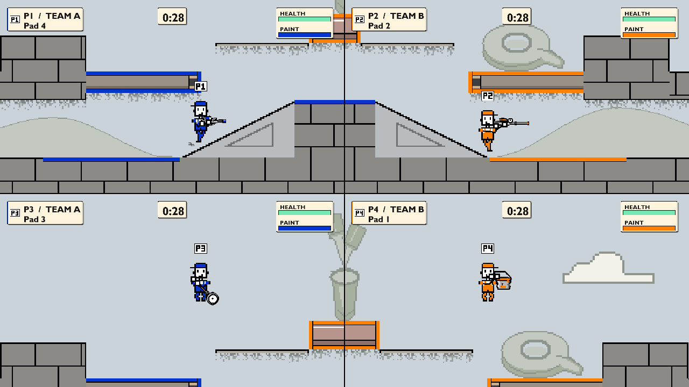

# ColourWars

A local split-screen paint-shooter for up to four players. Two teams, one
arena, and a scoreboard that counts painted surface rather than kills.

## Play

1. Download `ColourWars-0.1.0-windows-x64.zip` from the
   [v0.1.0 release](https://github.com/matt439/ColourWars/releases/tag/v0.1.0).
   Later versions appear on the
   [releases page](https://github.com/matt439/ColourWars/releases).
2. Right-click the game ZIP and choose **Extract All**. Running the game from
   inside the ZIP doesn't work.
3. Open the extracted folder and run `ColourWars.exe`. If Windows says
   "Windows protected your PC", choose **More info**, then **Run anyway** for
   a copy you trust from this repository. The game isn't signed with a
   publisher certificate.

The downloaded game needs no installer, Git, Visual Studio or terminal.

### Requirements

- Windows 10 or 11, 64-bit, and a Direct3D 11-capable graphics card or chip.
  Run on the PC's local desktop; Remote Desktop and most virtual machines
  cannot run it.
- Xbox-style (XInput) controllers, or one player on keyboard and mouse.
  PlayStation and Switch controllers need software that presents an Xbox
  controller to Windows, such as
  [Steam Input](https://partner.steamgames.com/doc/features/steam_controller/getting_started_for_players).

### Start a match

Choose **Play > Single Match > player count**. The device choosing the count
becomes Player 1. Everyone else presses **A** on their pad (**Enter** for
keyboard and mouse) on Join Players, then Player 1 confirms to continue.
No friends around? Player 1 picks an empty seat with **Up/Down** and turns it
into an Easy, Normal or Hard bot with **Left/Right**. Choose **1 Player** for
solo practice.

New? Select **Single Match > 1 Player > Movement Course** for lesson cards on
moving, jumping, dropping through platforms, refilling your paint and using
your sub.

Choose teams, a tool and a sub weapon for each player, then an arena. Random
uses Crossfeed, Press Tower, Close Quarters and Slab Yard, which Stage Select
lists first; the other stages can be selected explicitly. Stage Select previews the arena
before a separate confirmation starts the match.

The arena is an unsaved picture in a paint program
([the backstory](docs/backstory.md)). **A, B or Start** (**Space, Escape or
Enter**) skips the opening. When time runs out, the camera pulls back to
reveal the winner and coverage percentages. Results show each player's
**surface held** at the finish: enemy repaint transfers credit, while
friendly repaint keeps the original painter's credit.

Your team's paint underfoot speeds movement and paint-tank refill. Enemy
paint slows movement and stops refill until you step off it.

For a series, choose **Best of 3** (first to two wins) or **Best of 5** (first
to three). Players, teams and weapons stay fixed. Arenas rotate by default;
Mode also offers Same stage and Loser's pick. Draws award no win and replay
the arena. Pause > Restart restarts the current round; quitting discards the
series. Play Series Again clears the wins after a finished series.

### Controls

These are the defaults. Options > Controls / audio offers the reference and
rebinding pages.

| Action | Gamepad | Keyboard and mouse |
|---|---|---|
| Move | Left stick | A/D |
| Jump | A or left trigger | Space |
| Aim | Right stick | Mouse cursor |
| Shoot | Right trigger | Left mouse button |
| Sub | Right bumper (RB) | Right mouse button |
| Drop through a platform | Left stick down | S or Down |
| Pause/resume | Start | Escape |
| Menu navigation | Left stick or D-pad | Arrow keys or WASD |
| Menu confirm | A | Enter, Space or left click |
| Menu back | B | Escape, Backspace or right click |

Each player carries a **sub weapon** beside their tool for the whole match.
On Weapon Select, **A/Enter** confirms the tool, **Left/Right** chooses the
Grenade, Sprinkler, Paint wall or Random, and **A/Enter** again readies the row.
The grenade bursts into paint and hurts enemies; the sprinkler sticks where
it lands and sprays paint until its time runs out or enemy shots break it;
the wall stops enemy shots and drips paint on the floor beneath it.

A sub costs half a paint tank and has a short cooldown. The square after
**PAINT** on the HUD is solid when it is ready. Endless paint removes the
cost but keeps the cooldown. The roller has fixed aim; other tools follow
the right stick or mouse.

### Settings and controllers

Options and Pause both offer **Controls / audio**: music and SFX volume,
per-pad stick deadzones, rumble, View shake, Aim marker and Toggle fire (press
Shoot once to keep firing, again to stop). **Pad sticks**
shows live stick input; use D-pad/arrows there so the sticks stay free to
test. **Pad Buttons** changes Jump, Shoot, Pause and Sub. **Keyboard Keys**
changes the keyboard seat's actions; Escape always pauses and Down always
drops. Rebinding leaves menu and opening controls unchanged.

**Profiles** stores up to eight people's pad settings and Boost. Assign one
to a pad there, or press **X/R** on Join to cycle a joined pad through them.
The name then follows that pad: on its own line in the match HUD, and after
the pad's label on Join, Team, Weapon, Pause and Results wherever the longer
label fits.
Profile edits save immediately. Other settings pages use **Apply** to save
and **Back** to discard unapplied changes.

Options > **Team palette** offers Random or a fixed pair. Purple/gold,
red/azure and magenta/forest are checked under protan, deutan and tritan
colour-vision simulation. HUD and Results also identify teams by A/B letters.

A controller disconnect pauses play. Reconnect every missing player before
choosing Resume; reconnecting alone never resumes. If Windows gives a
reconnected pad a different XInput slot, press **Start** on it to reclaim the
first missing seat. Quit remains available. During setup, reconnect or go
back to player count to choose a new roster.

## If something goes wrong

- **The game cannot find a file.** Extract the whole ZIP with **Extract All**,
  then run `ColourWars.exe` from the extracted folder. Keep its files and
  subfolders together; copying just the executable is not enough.
- **The game cannot start graphics.** Run it on the PC's local desktop, with a
  Direct3D 11-capable graphics card and its manufacturer's current driver.
  Remote Desktop and most virtual machines cannot run it.
- **Windows blocks the download or executable.** The game is unsigned, so
  SmartScreen may show **Windows protected your PC**. For a copy you trust
  from this repository, **More info > Run anyway** opens it. If antivirus
  removed a file, check Windows Security's **Protection history** for the
  reason and verify the download's source before restoring it.
- **A controller does nothing.** The game reads Xbox-style (XInput) pads.
  PlayStation and Switch pads need a mapper that exposes an Xbox controller,
  such as Steam Input. One player can use keyboard and mouse; Player 1 can
  also turn an empty seat into a bot with Left/Right on Join Players.
- **Cloning or building reports a long path.** Use a short folder such as
  `C:\ColourWars`. Moving a partly built folder leaves old paths in CMake's
  cache; a fresh clone in the short folder avoids them.
- **The first build stops while downloading or compiling dependencies.**
  Check your connection and free disk space, then run `build.cmd` again.
  It keeps completed work. The build prints its log's path
  (`out/build-x64-release.log` by default); keep that log
  if the same step fails again. Visual Studio needs **Desktop development
  with C++**, its Windows SDK, CMake tools and vcpkg components; change the
  installation through **Visual Studio Installer > Modify**.
- **Another error stops the game.** Copy the full error dialog (Ctrl+C while
  it is focused) and report it at
  [GitHub Issues](https://github.com/matt439/ColourWars/issues). Attach
  `build-info.txt` from beside the executable and, if it was saved,
  `%LOCALAPPDATA%\ColourWars\last-error.log`. That short report records build
  and failure categories; it does not contain the message, so include the
  copied dialog too. If the game closes with no dialog at all, the same file
  may hold a short crash report; attach it. For a build failure, attach the
  build log instead.

The [player guide](docs/HOW-TO-PLAY.txt), included beside the executable,
covers starting the game, controls, where settings are saved and removing it.
Settings live in `%LOCALAPPDATA%\ColourWars`, independently of the extracted
game folder. To update, extract a new ZIP; your settings stay.

### Audio

The download includes the game's sound bank. If startup reports that an
optional bank is missing, the game continues silently. Extract the whole ZIP
again to restore its files; Options > Controls / audio adjusts music and SFX
volume. See [the audio reference](docs/development.md#audio) for the bank,
licences and silent fallback.

## Your own stages

Put level JSON files in `%LOCALAPPDATA%\ColourWars\stages\`, which the game
creates beside its save the first time it saves, or use the editor's
**File > Save to My Stages**. They appear after the built-in stages, marked
"Built by you." The game rereads the folder when Stage Select opens from the
main menu. A refused file does not stop the others loading: press **Down**
while browsing arenas to read scan issues. A player who leaves a stage's
bounds is eliminated and respawns, so a gap in the walls or floor is a pit
([Leaving the arena](docs/level-format.md#coordinates-bounds-and-spawns)).

The editor needs a source build and is not included in the game ZIP.
See [the editor guide](docs/level-editor.md#play-the-level) for naming,
saving and playing stages, and [the level format](docs/level-format.md) for
the file contract and limits.

## Building and development

If a ready-made download is unavailable, [Easy build](docs/development.md#easy-build)
walks through the tools and `build.cmd`. GitHub's **Download ZIP** lacks the
engine submodule and cannot be built as downloaded.

ColourWars is the first client of [Labrador](https://github.com/matt439/Labrador),
a 2D game engine. [Development](docs/development.md) covers building, acceptance
checks, release packaging, the engine pin, audio and repository history.
[The architecture](docs/architecture.md) and [OOP guide](docs/oop-guide.md)
explain the code. [Documentation](docs/README.md) indexes the rest;
[TODO.md](TODO.md) holds open work.

## Licence

MIT — see [LICENSE](LICENSE). [NOTICE](NOTICE) records the third-party code
and content terms. The engine has its own LICENSE and NOTICE in
`external/labrador`. The game's Credits page names its code, content tools,
fonts, art and audio sources; the release includes the full notices.
