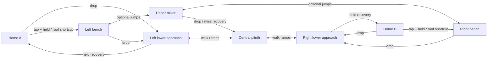

# Crossfeed: original combat-map experiment

Authored 2026-10-20 after the [combat-map research](level-design-research.md).
This is the new-map deliverable requested by the author, distinct from the
preserved [CQ draft](polish-close-quarters.md). The existing arenas remain
available. Crossfeed is explicitly selectable but excluded from Random while
its layout, movement and five tools are evaluated. Reference-arena acceptance
is still open.

## Question and research transfer

**Which approach earns the next useful painting angle: a direct walking route
over the lower rise, or the higher route across the suspended mixer?**

The original layout uses a compact 3,600-unit workshop, two side benches, a
central rising floor and a suspended eraser. Useful paint sits where these
approaches reconnect. Drops return to the walking route. This applies the
research's connected spaces, alternate approaches and recoverable excursions;
it copies no source map, movement constants or resource-pickup system.

The central solid plinth interrupts floor-level straight fire. Its set-square
ramps provide a walkable crossing but deliberately pass paint, as they do in
the rest of ColourWars. The suspended eraser separates the upper approaches
and supplies scored tops, sides and underside. Taking its height trades the
lower route's cover for angles onto the side benches. Actual shot and camera
tests must establish the extent of those opportunities.

ColourWars has no territory movement bonus or ammunition pickups. A route's
reasons to exist are reachable paint, a changed attack angle, disengagement and
time without firing. Camping and pressure therefore need explicit tests.

## Geometry and intended inputs

Source: [crossfeed.json](../game/content/levels/crossfeed.json). Coordinates are
world units, Y increases downward, and player positions are top-left. Gameplay
geometry and full-body spawn positions reflect across X=1800. Decorative art
does not imply collision.

| Piece | Left / centre bounds (X, Y, W, H) | Intended role |
|---|---|---|
| Home floor | 0, 1120, 620, 10 | One-way support; drop to lower departure. |
| Home roof | 0, 960, 620, 10 | One-way player support, projectile blocker; optional held-jump shortcut from home. |
| Home step | 620, 1040, 180, 80 | Optional upper departure: 80-unit tap rise. |
| Home baffle | 800, 940, 240, 180 | Solid firing break; 100-unit held rise from step. |
| Side paint bench | 1040, 1040, 320, 60 | Useful painting / landing space; descending continuation from baffle. |
| Upper ruler | 1400, 960, 260, 10 | Optional 40-gap / 80-rise connection from bench. |
| Central mixer | 1660, 880, 280, 80 | Optional 80 rise from either ruler; scored upper and lower faces. |
| Central plinth | 1620, 1120, 360, 160 | Required walking route, scored top and physical lower firing break. |
| Left ramp | X=1300-1620, Y=1280-1120 | Required walking ascent; not projectile cover. |
| Scored floor | X=920-1300, Y=1280 | Connected walking paint on shared approach; mirrored right. |

The floor remains continuous at Y=1280. The right ramp descends from X=1980 to
2300; the right-side pieces mirror the left. Unscored home / perimeter ground
prevents a large private painting allowance. All four spawns per team begin on
the home floor, at X=30/150/270/390 and Y=1000 on the left.

Route importance and input family are independent:

| Directed connection | Importance | Input and landing outcome |
|---|---|---|
| Home → lower approach | Required accessible departure | Drop through home floor, then walk; continue beneath baffle. |
| Lower approach → plinth → opposite approach | Required contest crossing | Walk up/down ramps; continue or stop on plinth. |
| Home → step → baffle → bench | Optional upper departure | Tap 80, hold 100, then walk/drop; controlled approach to the narrow step. |
| Home → roof → baffle | Optional shortcut | Held 160 rise, then jump the gap; separate from the step route. |
| Bench → ruler → mixer → opposite ruler / bench | Optional upper crossing | 40 gap / 80 rise, then 80 rise; continue, stop or reverse on named landings. |
| Upper route → lower route | Recovery / alternative | Drop or fall; land on plinth, ramp or floor and rejoin. |
| Lower approach → home | Recovery | Held 160 rise through the home floor; return with the same player. |

The graph states the intended connections; the baseline checks below qualify
their specific input families. Baseline tap / held apex is approximately
95 / 207.5 units, but acceleration, body extent,
ceiling contact, one-way supports and braking determine actual feasibility.
The 180-wide step has only 128 units of full-body positioning range against
approximately 121 units of full-speed stopping distance. Test it with a
controlled approach; do not describe it as a forgiving full-speed stop.

## Clearances, pressure and cameras

Home rulers are 10 units thick. The home floor leaves 150 units beneath it;
the roof leaves 150 above it. The side benches leave at least 150 units over
the nearby ramp and 180 over the flat floor. The mixer underside at Y=960
leaves 160 above the plinth: a standing player has 40 units of headroom.
The centre therefore limits jumping; it must not become a compulsory lethal
funnel for broad projectiles or growing mist.

The baffle and one-way home supports block projectiles. This is directional
cover, not spawn invulnerability. Test attacks from the mixer, rulers, side
benches, baffle tops and lower approaches against all spawn bodies and both
departures. An enemy who reaches the baffle may gain a close angle into home;
record this rather than inferring safety from symmetry or a roof.

The overview is X=0-3600, Y=500-1380. Camera bounds match it. The native-size
brush pot sits on the mixer and the tape roll on the right bench. Their quads
start at (1672,564) and (2260,892): the frames' four- and twelve-unit transparent
bottom padding places the visible feet on the supports. The expanded top
includes the complete brush silhouette. These muted props remain scenery.
The compact backdrop deliberately uses two static clouds; the older arenas'
staggered cloud drift and the common static landmarks remain unchanged.
Individual panes
must expose the next landing and escape choice before commitment, including
the two- and three-player partitions. Native clean/heavy captures and scripted
moving approaches support that review; a whole-map drawing does not establish
playing-size warning time or readability.

## Paint and tool hypotheses

All scoring is shared contest, with no scored home surfaces. The floor strips
and plinth are top-only. Side benches and mixer expose all four faces, subject
to the real builder's burial rules. Ramps remain unscored and pass paint.

Independent exposed-area calculation, reconciled with the real builder's runtime tiles:

| Region | Area | Share |
|---|---:|---:|
| Left floor + bench | 12,960 | 33.33% |
| Central plinth + mixer | 12,960 | 33.33% |
| Right floor + bench | 12,960 | 33.33% |
| Total | 38,880 | 100% |

Top faces contribute 24,480 (63%), undersides 11,040 (28.4%) and
walls 3,360 (8.6%). Each side bench loses its outer vertical face against the
baffle. The mixer alone contributes 22.2%; verify practical painting and
repainting of its underside and both sides, rather than treating it as scenery.

| Tool | Role to test, not an established balance result |
|---|---|
| Sprayer | Sustained pressure during a change of cover; standing / moving arcs and replenishment pauses. |
| Sniper | Useful straight lanes interrupted by plinth, mixer and baffles; actual arrival versus crossing and escape time. |
| Roller | Connected walking paint over both approaches and the plinth, plus optional bench tops; travel cost versus exposed area. |
| Mister | Close clusters and underside repainting; growing projectiles must not solve the low centre from one safe position. |
| Bucket | Ballistic attacks and broad contacts around a firing break; trajectory, collision size and retreat must leave counterplay. |

Record stationary and moving first-contact distance/time, cadence, paid paint,
paint per burst/tank, recovery, target movement and cover-to-cover exposure.
Moving sprayer, mister and bucket inherit horizontal player velocity, so
movement and weapon tuning are one comparison. Do not import foreign jump or
weapon constants. Start at the unchanged authored values and distinguish a
geometry failure from a tool-envelope failure before choosing candidates.

## Verification record

The unchanged-value baseline uses 95-unit tap rise, 207.472-unit held rise and
800-unit running speed. It exposed a real controller failure at the continuous
ramp/plinth crest: gravity let the small horizontal overlap resolve as a wall,
especially at partial input. Lowering the ramp gravity multiplier alone failed
the quarter-input restart. The Player now follows its last resolved static
ramp while its finite surface remains beneath the body, clearing that support
on jump, placement and death. A grounded rise blocked by a ceiling returns to
the last supported pose. This is a contact correction, not a jump or weapon
tuning change; flat-to-downhill travel still falls until it contacts the slope.

CPU checks use the actual Player, Scene, builder, weapon payments and projectile
contacts, without devices or the player's save. They reconcile 38,880 exposed
area by object, region and face; check all eight full-body spawns and two
deaths/respawns each; drive required walking crossings and returns; and exercise
optional upper routes in both directions with +/-2 press ticks. The six
quarter/half/full-input crest restarts need no jump. The separate movement case
qualifies 56 mirrored ramp crossings and 12 roof approaches and walking escapes,
including both collider orders, Down, walls, low doorways, jump-off and resets.

Prepared lower-route trials take 82 ticks from near scoring to the plinth, 164
to far scoring and 326 for the ground round trip, identically mirrored. The
home return uses a separate 160-unit held jump and takes 131 ticks; the two-jump
roof shortcut takes 132. Upper crossings take 642/656/647 ticks outward and
1225/1253/1232 round trip for -2/0/+2 press ticks. These include deliberate
checkpoint stops and settling, and are feasibility timings, not optimal routes
or observed match pacing. Forty cold-start opening assays separately record
the first actual contested paint from every spawn with all five tools.

All five tools pay and paint on the lower route. Four aimed tools also reach
the solid plinth across paint-pass ramps and paint the mixer's actual underside.
Thirty-two single-paid-launch trials track each returned projectile identity
through its first retirement, separating launch contacts from swept flight.
The 26 combat trials distinguish stationary targets, actual retreat input,
close Roller contact and moving Mister pursuit. Three hundred selected threat
trials include all eight spawn bodies and representative lower/upper departures
against mixer, enemy ruler, bench, baffle and lower-approach stations. They
record damage rather than require spawn immunity. Straight scripted tracking
has no lead or ballistic compensation and does not establish human counterplay.

The shared painting assay drives the same prepared lower crossing and return
for all five tools, ending fire at the first missed eligible shot or the route
end. It reports actual unique owned area, payment and recovery; it is not a
whole-tank efficiency comparison when paint remains. Supply measurements
distinguish empty readiness just after payment from a genuinely missed
cooldown-eligible opportunity. Sniper regenerates between shots: the baseline
fires 15 paid shots before its first scheduled miss, rather than four shots
per tank. A missed tick can recover automatically under continued held input;
it does not imply a forced manual release.

The verification receipts retain revision, dirty-tree state and source hashes;
the numeric tuning is unchanged at this checkpoint:

- Both game presets built under `/W4 /WX`. All 40 consumer cases passed in
  each configuration. Debug's `playable-v1/acceptance/x64-debug/` is completed
  by the final Crossfeed and terrain checks in `playable-v2/focused-*/`.
  Release's first 24 cases are in `playable-v2/acceptance/x64-release/`; an
  interrupted runner is completed by the remaining 16 in
  `playable-v2/remaining-acceptance/x64-release/`. Three empty captured logs
  were rerun directly with explicit zero exit codes and retained output.
  `playable-v2/consumer-reconciliation.json` maps the 80 case receipts.
- Final editor round-trip, vocabulary, registration, save/history and hidden
  GUI checks passed in both presets. Evidence IDs are
  `2956c50de0204d0b88df70ebed8b7165` (Debug) and
  `e453699924cd4e14a0cb45ef2823bab9` (Release), under
  `out/acceptance/<preset>/level-editor/`. These do not close attended `ED#5`.
- Both D3D11 native matrices passed on the RTX 5080, with 21 full frames,
  51 native crops and 43 readbacks each. Final receipts are
  `playable-v2/native/x64-debug/c60b5a5363334d08a16b5c87a7688909/result.json`
  and `playable-v2/native/x64-release/96c4f4eae98c409387fa84f8712177c0/result.json`.
  They include actual runtime overviews and StagePreview, all 1/2/3/4P panes,
  clean/controlled-heavy moving approaches and home exits, frozen pixels and
  state/RNG, and Debug's replay fingerprint. The verifier independently checks
  production's three-player pane order and fractional StagePreview viewport;
  deliberately wrong pane geometry is rejected.
- Both normal startups passed with the accepted bank, system-only PATH,
  isolated saves, per-monitor-v2 DPI and graceful shutdown. Startup IDs are
  `fdfb31d3c7ed4b018dc71c8271ddedf4` (Debug) and
  `0372dc448f0b44b3a25303614d2c979b` (Release), under `playable-v2/startup/`.
  Packaging is rechecked after the coupled tuning pass; clean-PC `ROAD#1`
  remains a separate human/hardware gate.

The relative roots above are under `out/validation/crossfeed-20261020/`.
The preserved CQ draft has its own earlier receipts in
[its verification record](polish-close-quarters.md#verification-and-remaining-acceptance)
and also passes the current consumer suites.

At four-player playing scale the initial lower view shows the ramp toe and
ascent while the plinth is farther offscreen. The advanced views expose part
of its top (92/57 pixels), enough to distinguish this from the whole-feature
`target_visible` flag. Upper ruler landing edges clear the sampled HUD, but
the lower recovery floor is cropped during upper jumps. A continuous safe
floor is not proof of warning time. Actual camera warning, adversarial aim
and human readability remain open.

These lossless images come from the final Debug native readbacks; their RGB
pixels match the source PPMs. The overview is a native 1280x314 crop, and the
four-player frames are full 1280x720 images, without rescaling:

The heavy state is filled with controlled direct projectile contacts; it
tests terrain/ownership drawing and does not measure any tool's paint range.

Required implementation evidence follows research H1-H8: all eight full-body
spawns and repeated respawns; both departures and returns; mirrored lower and
upper crossings with representative +/-2 input-tick variation; missed-jump
recovery; runtime regional/face-area reconciliation; five paid tool contacts
and sampled firing breaks; clean/heavy 1/2/3/4P native panes, actual overview
and StagePreview; normal content staging and Release packaging.

Attended 1v1/2v2, uneven three-player matches, side/loadout swaps, fresh-player
observations, comfort and physical-pad acceptance remain open. Automated
feasibility and hidden native capture do not close those gates.
