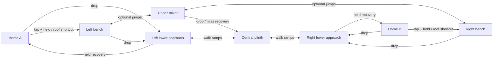
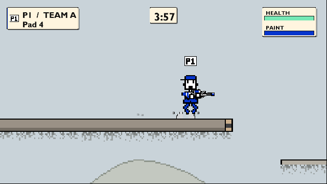
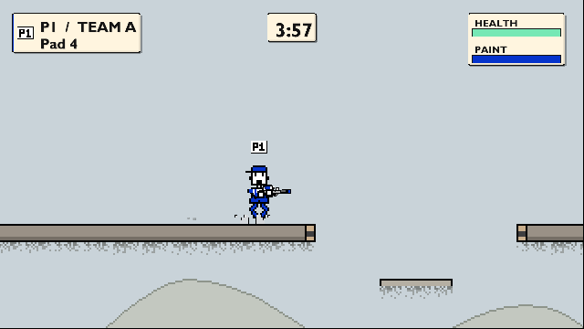
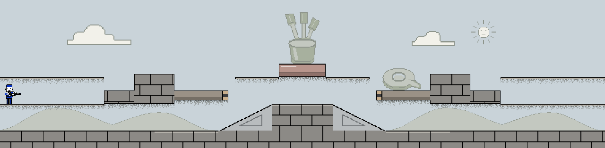
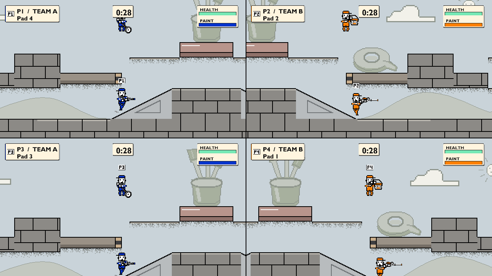
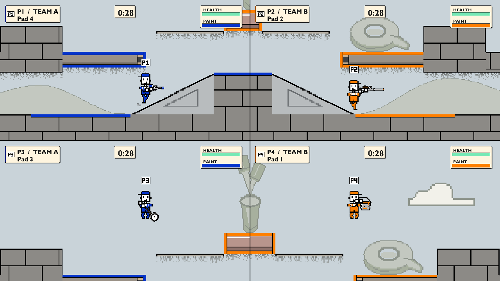

# Crossfeed: original combat-map experiment

Authored 2026-10-20 after the [combat-map research](level-design-research.md).
This is the new-map deliverable requested by the author, distinct from the
preserved [CQ draft](polish-close-quarters.md). The existing arenas remain
available. Crossfeed was explicitly selectable but excluded from Random while
its layout, movement and five tools were evaluated. The author accepted it as
the reference arena on 2026-10-25 ([acceptance](#author-arena-acceptance-2026-10-25))
and asked for it in Random; it is now a Random candidate.

## Question and research transfer

**Which approach earns the next useful painting angle: a direct walking route
over the lower rise, or the higher route across the suspended mixer?**

The original layout uses a compact 3,600-unit workshop, two side benches, a
central rising floor and a suspended eraser. Useful paint sits where these
approaches reconnect. Drops return to the walking route. This applies the
research's connected spaces, alternate approaches and recoverable excursions;
it copies no source map, movement constants or resource-pickup system.

The central solid plinth interrupts floor-level straight fire. Its set-square
ramps provide a walkable crossing but deliberately pass paint, as they do in
the rest of ColourWars. The suspended eraser separates the upper approaches
and supplies scored tops, sides and underside. Taking its height trades the
lower route's cover for angles onto the side benches. Actual shot and camera
tests must establish the extent of those opportunities.

ColourWars has no territory movement bonus or ammunition pickups. A route's
reasons to exist are reachable paint, a changed attack angle, disengagement and
time without firing. Camping and pressure therefore need explicit tests.

## Geometry and intended inputs

Source: [crossfeed.json](../game/content/levels/crossfeed.json). Coordinates are
world units, Y increases downward, and player positions are top-left. Gameplay
geometry and full-body spawn positions reflect across X=1800. Decorative art
does not imply collision.

| Piece | Left / centre bounds (X, Y, W, H) | Intended role |
|---|---|---|
| Home floor | 0, 1120, 620, 10 | Paintable top; one-way support; drop to lower departure. |
| Home roof | 0, 960, 620, 10 | Paintable top; one-way player support, projectile blocker; optional held-jump shortcut from home. |
| Home step | 620, 1040, 180, 80 | Optional upper departure: 80-unit tap rise; scored exposed faces. |
| Home baffle | 800, 940, 240, 180 | Solid firing break; 100-unit held rise from step; scored exposed faces. |
| Side paint bench | 1040, 1040, 320, 60 | Useful painting / landing space; descending continuation from baffle. |
| Upper ruler | 1400, 960, 260, 10 | Paintable top; optional 40-gap / 80-rise connection from bench. |
| Central mixer | 1660, 880, 280, 80 | Optional 80 rise from either ruler; scored upper and lower faces. |
| Central plinth | 1620, 1120, 360, 160 | Required walking route, scored top and physical lower firing break. |
| Left ramp | X=1300-1620, Y=1280-1120 | Required walking ascent; not projectile cover. |
| Scored floor | X=0-1300, Y=1280 | Continuous walking paint beneath home and along the approach; mirrored right. |

The floor remains continuous at Y=1280. The right ramp descends from X=1980 to
2300; the right-side pieces mirror the left. Exposed flat ground beneath home
and the one-way platform tops accept paint. Perimeter walls and the covered
base beneath the ramps/plinth remain unscored. All four spawns per
team begin on the home floor, at X=30/150/270/390 and Y=1000 on the left.

Route importance and input family are independent:

| Directed connection | Importance | Input and landing outcome |
|---|---|---|
| Home → lower approach | Required accessible departure | Drop through home floor, then walk; continue beneath baffle. |
| Lower approach → plinth → opposite approach | Required contest crossing | Walk up/down ramps; continue or stop on plinth. |
| Home → step → baffle → bench | Optional upper departure | Tap 80, hold 100, then walk/drop; controlled approach to the narrow step. |
| Home → roof → baffle | Optional shortcut | Held 160 rise, then jump the gap; separate from the step route. |
| Bench → ruler → mixer → opposite ruler / bench | Optional upper crossing | 40 gap / 80 rise, then 80 rise; continue, stop or reverse on named landings. |
| Upper route → lower route | Recovery / alternative | Drop or fall; land on plinth, ramp or floor and rejoin. |
| Lower approach → home | Recovery | Held 160 rise through the home floor; return with the same player. |

The graph states the intended connections; the baseline and coupled checks below
qualify their specific input families. The original tap / held apex was approximately
95 / 207.5 units; the selected provisional P3 retains 95 / 207.375 with shorter
air time. The lower 177.5-unit P2 remains an experimental comparison. Acceleration, body extent,
ceiling contact, one-way supports and braking determine actual feasibility.
The 180-wide step has only 128 units of full-body positioning range against
approximately 121 units of full-speed stopping distance. Test it with a
controlled approach; do not describe it as a forgiving full-speed stop.

## Clearances, pressure and cameras

Home rulers are 10 units thick. The home floor leaves 150 units beneath it;
the roof leaves 150 above it. The side benches leave at least 150 units over
the nearby ramp and 180 over the flat floor. The mixer underside at Y=960
leaves 160 above the plinth: a standing player has 40 units of headroom.
The centre therefore limits jumping; it must not become a compulsory lethal
funnel for broad projectiles or growing mist.

The baffle and one-way home supports block projectiles. This is directional
cover, not spawn invulnerability. Test attacks from the mixer, rulers, side
benches, baffle tops and lower approaches against all spawn bodies and both
departures. An enemy who reaches the baffle may gain a close angle into home;
record this rather than inferring safety from symmetry or a roof.

**Respawn grace is the fallback, not the first answer (2026-10-24).**
`Player::respawn` refills health and ammunition and returns straight to alive,
with no protection window. Splatoon pairs spawn geometry with brief spawn armour.
If attended `POL#17` play shows spawn pressure that geometry and approach changes
cannot fix, add a short damage-immune grace as a `tuning.json` player value,
default 0. Paint should still land, as it does under the developer
`damage_immune` cheat. Consider ending the grace early on the player's first shot.
Do not add it while spawn trials are being measured: the trials above record
damage at spawn, and immunity would hide what they measure.

The overview is X=0-3600, Y=500-1380. Camera bounds match it. The native-size
brush pot sits on the mixer and the tape roll on the right bench. Their quads
start at (1672,564) and (2260,892): the frames' four- and twelve-unit transparent
bottom padding places the visible feet on the supports. The expanded top
includes the complete brush silhouette. These muted props remain scenery.
The compact backdrop deliberately uses two static clouds; the older arenas'
staggered cloud drift and the common static landmarks remain unchanged.
Individual panes
must expose the next landing and escape choice before commitment, including
the two- and three-player partitions. Native clean/heavy captures and scripted
moving approaches support that review; a whole-map drawing does not establish
playing-size warning time or readability.

## Paint and tool hypotheses

**Ordinary floor is paintable by default**, including home ground and raised
platform tops. Home painting is legitimate work; geography and travel time
must earn the contest rather than forbidding paint near spawn. Flat ground,
the plinth and thin one-way rulers score on top. Departure steps, baffles,
benches and mixer expose all four faces, subject to the real builder's burial
rules. One-way movement and projectile blocking are independent of accepting
paint. Ramps remain the deliberate traversal exception: they pass paint and
do not score. Perimeter walls and covered foundations do not add hidden score.

Independent exposed-area calculation, reconciled with the real builder's runtime tiles:

| Region | Area | Share |
|---|---:|---:|
| Left home ground + floor + roof | 22,320 | 17.95% |
| Left approach + step + baffle + bench | 30,240 | 24.32% |
| Central plinth + mixer + upper rulers | 19,200 | 15.44% |
| Right approach + step + baffle + bench | 30,240 | 24.32% |
| Right home ground + floor + roof | 22,320 | 17.95% |
| Total | 124,320 | 100% |

Top faces contribute 92,640 (74.5%), undersides 21,120 (17.0%) and
walls 10,560 (8.5%). Each side bench loses its outer vertical face against the
baffle. The mixer alone contributes about 7.0%; verify practical painting and
repainting of its underside and both sides, rather than treating it as scenery.

| Tool | Role to test, not an established balance result |
|---|---|
| Sprayer | Sustained pressure during a change of cover; standing / moving arcs and replenishment pauses. |
| Sniper | Useful straight lanes interrupted by plinth, mixer and baffles; actual arrival versus crossing and escape time. |
| Roller | Connected walking paint over both approaches and the plinth, plus optional bench tops; travel cost versus exposed area. |
| Mister | Close clusters and underside repainting; growing projectiles must not solve the low centre from one safe position. |
| Bucket | Ballistic attacks and broad contacts around a firing break; trajectory, collision size and retreat must leave counterplay. |

Record stationary and moving first-contact distance/time, cadence, paid paint,
paint per burst/tank, recovery, target movement and cover-to-cover exposure.
Moving sprayer, mister and bucket inherit horizontal player velocity, so
movement and weapon tuning are one comparison. Do not import foreign jump or
weapon constants. The comparison below started at the unchanged authored values
and distinguishes geometry/contact failures from tool-envelope changes.

## Playtest and paint coverage iteration (2026-10-24)

The author reports that movement **feels good**, but too few surfaces accept
paint in Crossfeed. Input device, player count and individual tool observations
were not specified. Keep P3 movement and C2 framing as the working baseline;
this is positive feel evidence, not completion of the remaining pad, camera
recognition or competitive acceptance checks.

The initial map had six scored objects and only 760 units of paintable ground
across its 3,600-unit width. Its ordinary home ground and raised platforms
accepted no paint. A first coverage draft still preserved that restriction;
the author's clarification below replaces it. The earlier draft's receipts
remain under `out/validation/crossfeed-coverage-20261024/` and do not qualify
the final ordinary-floor candidate.

### Author clarification: ordinary floor accepts paint

The author points to Splatoon: most floor accepts paint, with deliberate
exceptions such as grates. The previous patch was too restrictive. The rule
is now broad paintability across normal traversal surfaces, including home
areas, rather than a small designated contest budget. The revised
[research criterion H4](level-design-research.md#criteria-for-the-original-new-map)
owns that correction too.

Crossfeed now has 18 scored objects. All 2,600 units of exposed flat base ground
and all ordinary platform tops accept paint, including both home floors,
roofs and upper rulers. Steps and baffles accept paint on their exposed
home-facing walls too. The two paint-pass ramps, perimeter walls and covered
central foundation retain explicit exceptions. The score budget is the table
above: 124,320 exposed area, including reachable home paint. Do not restore a
zero-home-score assertion or force equal region shares as a substitute for
playtesting routes, travel cost and repaint opportunity.

The thin ruler tops retain their exact 10-unit supports and existing one-way
collision tag. Paintability belongs to the object role; jumping up, landing,
dropping through and blocking shots keep their existing semantics. Only their
top scores, avoiding overlapping top/underside paint on a thin platform.
Movement tuning, physical geometry and spawns remain as playtested.

### Ordinary-floor validation

Evidence root: `out/validation/crossfeed-floors-20261024/`.

- Both game/editor builds pass. The `paint` consumer case constructs an actual
  Crossfeed Level and verifies paid sprayer paint on the home one-way floor,
  neutral/owned score and device-slot player credit, projectile blocking,
  upward passage/landing and Down through the roof and floor. The physical
  supports remain exactly 10 units deep. Both complete Crossfeed consumer
  cases pass and reconcile 124,320 runtime area to independent face/region
  partitions. Every ordinary flat support has complete top coverage; home
  and approach budgets mirror. All 42 consumer cases pass in each preset.
- Both hidden `CrossfeedOnly` D3D11 matrices pass their 1/2/3/4-player
  clean/heavy moving approaches, home exits, overview and preview. Each
  retains 21 full frames, 51 native crops and 43 readbacks. Paired movement,
  frozen state, RNG and Debug fingerprints pass. Inspection confirms paint
  on home ground and ruler tops; all 72 shared PPM images match between builds
  and staged level hashes match the source (`native-reconciliation.json`).
  Runs: Debug `native/x64-debug/cc0556babe484ceeab7db5d859681f71/`; Release
  `native/x64-release/25f75a8075784819a9b7b935f45803f3/`.
- Format/schema/runtime builder checks and editor edit/undo/save/reopen checks
  cover paintable one-way rulers and reject incompatible materials. Both
  editor suites and their three hidden-window checks pass under
  `out/acceptance/<preset>/level-editor/`: Debug
  `0527e8f88ad94f71878b2afad2514806`; Release
  `5b7455f6dec3403bbbd600ccc65b1221`. The first Debug run exposed the old
  editor Crossfeed area snapshot (38,880); only that snapshot was corrected
  to the independent runtime total, retaining other maps and assertions.
- Normal startup passes in both builds with the accepted bank, isolated save,
  system-only PATH, per-monitor-v2 DPI and graceful shutdown (`startup/`).

The native probe also required six stale duration-fixture calls to use the
current text/source-path `TuneTarget::validate` signature. The repaired branch
passes Debug `DurationTextOnly`, including all six real target validations
(`out/validation/crossfeed-coverage-20261024/duration-fixture/`).

These checks establish painting/scoring integration and retained traversal.
Travel/repaint pacing, spawn pressure and human match balance remain playtest
questions; home paint is included when reviewing those observations.

### Paid repaint and opening checkpoints (2026-10-24)

The ordinary-floor candidate needs fresh observations: the six-object results
below belong to the earlier geometry. The painting probes now label their
first contact **first any paint**, including home paint. The all-tool cold
openings also record when the complete body leaves the home footprint, with
total owned area, paid shots and reserve at that moment. That is a temporal
checkpoint, not ownership clipped to a geographic region: the lower floor is
one scored object spanning both home and approach.

The separate Sniper opening comparison now arms its delayed request when the
Player's **centre** crosses the home support's inward edge (X=620 / 2980).
Using the broadened scored floor's outer edge would arm every spawn at tick
one and collapse the intended input comparison. Each trial checks that the
immediate request begins on tick one and the delayed request waits for the
actual later crossing. Cold weapon cooldown can still make their paid ticks
coincide. This centre-based gate precedes the full-body checkpoint above.

The new [paid repaint case](../scripts/acceptance/crossfeed/repaint_checks.cpp)
compares all five tools in both directions on the prepared lower route:
walk from X=1150 to 2450, stop, turn and return to a stop (mirrored for B).
It holds fire with forward/down aim throughout the route, including automatic
resumption after ammunition recovery. This differs from the older shared
route's stop-at-first-missed-shot policy. Each tool/team repeats the same
inputs and RNG seed on neutral, fully friendly and fully opposing paint;
oversized public contacts establish those initial ownership conditions only.
An opposing-painted no-fire route is the negative control. No live opponent
acts in these trials.

The case checks identical movement, paid schedules and projectile completion
across the three firing conditions, actual score transfer, no unique gain from
friendly repainting, and no gain or payment without firing. Outward/return
snapshots retain in-flight paint separately from the final settled area.
The route is prepared with 60 shot-free ticks; it is not a cold opening or a
measurement of starting-tank capacity, optimal coverage or safe-loop dominance.

Current matched repaint observations (A / B; area in score units):

| Tool | Paid shots | Final captured area | Added during return | Reserve on release |
|---|---:|---:|---:|---:|
| Sprayer | 146 / 146 | 8,064 / 8,208 | 240 / 240 | 0.004665 / 0.004665 |
| Sniper | 5 / 5 | 864 / 576 | 0 / 0 | 0.333332 / 0.299999 |
| Roller | 250 / 249 | 9,120 / 8,496 | 864 / 240 | 0.006665 / 0.003999 |
| Mister | 41 / 40 | 9,216 / 7,920 | 4,608 / 3,312 | 0.18 / 0.20 |
| Bucket | 10 / 9 | 5,136 / 5,712 | 2,640 / 2,256 | 0 / 0.10 |

Each clean result equals the area stolen from the fully opposing condition;
friendly repainting spends the same ammunition and adds zero unique team area.
No-fire controls retain the original enemy ownership and full reserve. The
round trip takes 281 / 275 ticks (4.6833 / 4.5833 seconds), including the stops.
This preserves the previously observed direction asymmetry rather than
qualifying side fairness. Mister adds another 432 / 384 area after release;
the other tools add none after their return snapshots. Refilling after release
takes 101-180 ticks across the ten tool/direction pairs. Cumulative paid cost can
exceed one starting tank because regeneration continues between eligible shots.

The cold-opening checkpoints show why first paint cannot stand for contest
arrival: Sprayer, Roller, Mister and Bucket first paint before full-body home
exit in all eight spawns, and Sniper does so in six. Full-body exit takes
57-85 ticks. In the refreshed Sniper policy comparison, all four firing
policies paint from all eight spawns by tick 180; immediate forward/down first
paint is now tick 62, including home. Those counts say nothing about whether
an opponent is threatened or contested paint is reached. The historical
six-object opening table below remains a separate checkpoint.

Both preset builds and their complete Crossfeed CPU cases pass. The current
sources match the receipt hashes, and Debug/Release produce byte-identical
measurement logs, including 40 repaint trials, 40 all-tool opening checkpoints
and 40 Sniper policy trials. Receipts are under
`out/validation/crossfeed-repaint-20261024/`: Debug
`x64-debug/c6e4d9c416d9464ca420f1f7c42b7893/`, Release
`x64-release/d24316d4236744d292d670bc1576b8e7/`, with the cross-build check in
`validation-results.json`. These are CPU qualification checks; the earlier
native clean/heavy pane evidence remains a separate record.

These controlled measurements support paid repaint integration and expose
limited new coverage on some return paths. Live opposing fire, alternate aim
and routes, home-loop travel incentives and attended spawn-pressure/balance
observations still determine the next `POL#17` / `POL#27` iteration. They do
not justify a tuning or geometry change by themselves.

### Fixed-time home and advancing loops (2026-10-24)

The [home-loop case](../scripts/acceptance/crossfeed/home_loop_checks.cpp)
compares two neutral-floor painting policies over the same 600 active ticks
(9.99996 seconds). Each starts cold at authored spawn zero, including the
initial Down drop and travel in that budget. After landing on the lower floor,
the home policy stops at centre X=120, then 500, and repeats; the advancing
policy stops at 1150, then 2450, and repeats. Team B reflects these coordinates.
There is no settling second before the first input. These are selected lower
routes, not a search over all home floors, roofs, aim angles or optimal play.

All five tools hold primary fire, including recovery and automatic resumption.
Aim points downward toward the next endpoint; its horizontal direction can
reverse on a small braking overshoot before the stopped endpoint changes.
Forty trials cover both routes, all five tools and both teams, each
with a matching no-fire control. They check identical active movement between
fire/no-fire runs, actual lower landing, at least three stopped endpoints
(first arrival followed by an out-and-back), full-body home containment and
actual supported plinth contact on the advancing route. Every firing trial
pays for paint; no-fire trials retain neutral ownership and full ammunition.
Scored area stays constant and no opposing ownership appears.

Owned area at the ten-second cutoff (A / B, in score units):

| Tool | Lower home loop | Advancing lower loop | Paid shots, either route |
|---|---:|---:|---:|
| Sprayer | 6,192 / 6,192 | 16,080 / 16,080 | 156 |
| Sniper | 1,920 / 1,920 | 1,152 / 1,152 | 9 |
| Roller | 6,960 / 7,536 | 22,368 / 22,944 | 266 |
| Mister | 6,960 / 6,960 | 12,528 / 12,480 | 57 |
| Bucket | 6,000 / 6,000 | 10,560 / 9,936 | 16 |

These totals include all ownership earned since spawn, including home paint
before departure; they are not geographically clipped route-region scores.
Object-level floor totals are labelled separately because an object may span
home and approach. All firing and no-fire players land on the lower floor at
tick 19. The advancing policy fully leaves home at tick 85, first stands on
the plinth at tick 188 and reaches four stopped endpoints; the home policy
reaches ten. Both directions share those timings in this sampled policy.

Checkpoint intervals are 180, 180 and 240 ticks. During the last interval,
Sprayer, Roller and Bucket add zero unique area on the home loop, while Sniper
adds 816 and Mister 576. Every advancing trial adds area during that interval.
Reserves at the cutoff match across routes and teams for each tool, ranging
from 0.001331 to 0.033328; cumulative paid cost includes regeneration and is
not starting-tank capacity. A separate release-all-input tail retires flight
without adding another paid shot. Mister needs 25 home / 101 advancing ticks;
the other tools have no flight remaining. None adds paint after this cutoff.

Advancing yields more unique neutral paint for four tools under this aim and
time budget; Sniper favours the shorter home loop. This is evidence about
these scripts, not home-loop safety or competitive dominance. No live opponent
fires, repaints, interrupts a route or causes a respawn. The direction-specific
Roller, Mister and Bucket differences remain recorded rather than treated as
side fairness acceptance. Keep P3, tool values and geometry pending opposition
and alternate-aim observations.

Both preset builds and their complete Crossfeed CPU cases pass. The forty
loop trials produce 120 checkpoint rows and forty settled-flight rows; the
complete Debug/Release measurement logs are byte-identical. Source hashes
match the receipts, and staged map/tuning/presentation hashes match source.
Evidence root: `out/validation/crossfeed-home-loops-20261024/`, with Debug
`x64-debug/7f977b6e91a145928318a917ad4f442e/`, Release
`x64-release/ffcdea574ccd43e68385d7e8c7682d62/`, checkpoint export
`home-loop-checkpoints.csv` and cross-build receipt `validation-results.json`.
The earlier native clean/heavy pane checks remain a separate record.

### Reciprocal firing and lower-approach pressure (2026-10-24)

The CPU [fixture](../scripts/acceptance/crossfeed/fixtures.cpp) now runs the
additional players' weapon phases after moving-projectile contacts and the
primary player's launch, before Scene contact resolution. This follows
`Level`'s firing order; mirrored teams still launch the subject first, rather
than swapping player order or modelling simultaneous fire. Opponent weapon
selection, after-movement aim and payment/emission counters are explicit;
the existing counters retain their primary-player meaning.

The [reciprocal qualification](../scripts/acceptance/crossfeed/reciprocal_checks.cpp)
uses stationary players 130 units apart on the lower approach, Sprayer and
Sniper, both directions and all four independent fire/no-fire combinations.
Both weapons prepare for 90 ticks, outside the 150 active ticks. This exceeds
Sniper's one-second cooldown despite the quantized timestep; 60 ticks does not.
Each firing side must pay for real projectiles and reduce the other player's
health; disabled fire must produce neither payment nor outgoing damage.
Launch-contact retirement counts too: a paid Sniper hit need not leave a
surviving projectile. Four separate controlled projectile-contact callbacks
establish zero health between movement and launch, then the dead state next
tick, and require no payment or launch from either guarded player order.
These are launch guards, not measured lethal firing rates or respawn tests.

The [opposed-loop case](../scripts/acceptance/crossfeed/opposed_loop_checks.cpp)
retains the earlier 600-tick cold-spawn-zero routes, endpoints and downward
subject aim. A cold stationary Sprayer occupies **our lower approach**, at
canonical centre X=1150 on the lower floor (X=2450 for team B), rather than
travelling from an opposing spawn. It tracks the subject's current centre
after movement, with neither lead nor gravity compensation. Eighty trials
cover all five subject tools, both routes, both teams and all four subject /
opponent fire controls. Disabled-fire opponents remain present, so their
body can intercept paint. Those controls differ from the earlier trials
without an opponent.

Both players' actual payments, reserve, health, observed net health decreases,
lethal events and respawns are recorded at ticks 180/360/600 alongside team
ownership, route checkpoints and remaining flight. Observed health loss sums
positive net tick decreases; regeneration within a tick can hide some damage.
Full-body clearance, the opponent's floor station, independent no-fire
controls, conserved scored area and actual damaging pressure are checked.
Live ownership can decrease. The separate tail releases both players' inputs,
requires no additional paid shot and retires flight within 720 ticks.

Advancing subject ownership at tick 600 (A / B, score units):

| Subject tool | Opponent present, fire disabled | Opponent firing | Firing opponent's owned area |
|---|---:|---:|---:|
| Sprayer | 15,024 / 15,024 | 15,024 / 15,024 | 0 / 0 |
| Sniper | 864 / 864 | 864 / 864 | 1,440 / 1,440 |
| Roller | 22,368 / 22,944 | 22,368 / 22,944 | 0 / 0 |
| Mister | 10,272 / 10,224 | 10,128 / 10,080 | 1,248 / 1,248 |
| Bucket | 9,168 / 8,016 | 9,168 / 8,016 | 480 / 480 |

All twenty advancing samples with opposing fire, including subject no-fire
controls, first lose health at tick 98 and accumulate 0.60 observed loss.
The firing subjects inflict 0.26 / 0.334 / 0.435 / 0.38 / 0.402 observed loss
for Sprayer / Sniper / Roller / Mister / Bucket, respectively, in either
direction. All advancing trials still reach four stopped endpoints and first
stand on the plinth at tick 188. The subject's paid counts remain
156 / 9 / 266 / 57 / 16; the firing opponent pays 156 shots.

Home-loop subjects retain the earlier owned totals, reach ten stopped
endpoints and take no damage in this sample. The firing opponent owns 1,440
area; only home-loop Mister damages it (0.11 observed loss). Distant direct
Sprayer aim can meet the floor before the player: this result does not qualify
home safety. Even with opponent fire disabled, its body changes advancing
paint totals relative to the historical absent-opponent control. Do not label
that difference a consequence of opposing fire. Mister's small live/control
difference is recorded without isolating individual contacts or repaint events.

No active trial produces a lethal event or respawn. The route driver specifies
restarting the drop and first endpoint on the input tick after respawn, with
clock and paint retained, but these samples do not exercise that branch.
The longest flight tail is 101 ticks and remains outside the active comparison.
These observations establish reciprocal paid firing and this specific
lower-approach threat; they establish no optimal aim, safe loop, side fairness
or competitive route winner. Keep P3, weapon values and geometry.

Both game/editor preset builds and the complete Crossfeed CPU cases pass.
Debug/Release measurement logs are byte-identical; after excluding the new
rows, all retained measurements match the preceding fixed-time-loop receipt.
Current source hashes match the receipts and staged map/tuning/presentation
hashes match source. Evidence root:
`out/validation/crossfeed-opposed-loops-20261024/`, Debug
`x64-debug/8a168917aeed4720b5172ffeacb8bbc7/`, Release
`x64-release/5d0466e6d37944f39e9da7b31c4a899f/`; exports are
`reciprocal-controls.csv`, `opposed-loop-checkpoints.csv`,
`opposed-loop-settled.csv`, `comparison-at-600.csv` and
`validation-results.json`. The prior native clean/heavy pane captures remain
separate evidence; no geometry or runtime-content change required a new matrix.

The subject-aim comparison below follows these same home/advancing routes and
lower-approach controls, distinguishing retaliation from downward coverage.
Attended spawn-pressure, balance, physical-pad and camera-recognition reviews
remain open.

### Subject aim and retaliation (2026-10-24)

The [opposed-loop case](../scripts/acceptance/crossfeed/opposed_loop_checks.cpp)
retains all eighty downward-aim trials and adds eighty with the subject aiming
at the stationary opponent's current centre after movement. Both policies use
the same cold spawn, RNG seed, home/advancing endpoints, 600 active ticks,
four independent fire controls and subject-first launch order. The opponent
remains a Sprayer at canonical X=1150 on our lower approach, mirrored for B.

The alternate aim starts at the tool's attachment offset, signed toward the
opponent according to the players' relative centres. It supplies no lead,
gravity or inherited-velocity compensation. Close crossings can reverse the
ray relative to that initial attachment-side choice; this is a reproducible
input policy, not perfect aim. Each alive active update of the four aimed tools
verifies the actual weapon rotation. Roller ignores the request and retains its production
movement-facing, forward/down contact volume. No-fire subjects and Roller
must retain their recorded trajectories, payments, health observations,
ownership, reserve and flight tails across policies.

Advancing subjects with **both players firing**, at tick 600 (owned area A / B;
health loss sums positive net tick decreases and can hide concurrent healing):

| Tool | Downward owned area | Opponent-aim owned area | Observed loss inflicted, downward → opponent aim | Subject observed loss, downward → opponent aim |
|---|---:|---:|---:|---:|
| Sprayer | 15,024 / 15,024 | 11,568 / 11,616 | 0.26 → 0.61 | 0.60 → 0.60 |
| Sniper | 864 / 864 | 336 / 336 | 0.334 → 1.002 | 0.60 → 1.01 |
| Roller | 22,368 / 22,944 | 22,368 / 22,944 | 0.435 → 0.435 | 0.60 → 0.60 |
| Mister | 10,128 / 10,080 | 14,688 / 14,736 | 0.38 → 0.60 | 0.60 → 0.60 |
| Bucket | 9,168 / 8,016 | 5,952 / 6,720 | 0.402 → 0.603 | 0.60 → 0.60 |

Every advancing firing pair first supports on the plinth at tick 188. Aimed
Sniper kills the opponent once; when both fire, the subject also dies once
and respawns, finishing three stopped endpoints instead of four. The other
tools retain four. Sniper pays six shots rather than nine in that reciprocal
sample; the other subject totals remain 156 / 266 / 57 / 16 for Sprayer /
Roller / Mister / Bucket. The revived opponent receives production's full
ammunition reset at its constructed lower station, paying 287 rather than 156
shots over the horizon. No travel from an authored enemy spawn is modelled.
Retaliation therefore does not imply less incoming damage over the whole trial.

Home subjects still take no damage and finish ten stopped endpoints. Their
aimed owned areas are 7,776 / 7,776 (Sprayer), zero (Sniper), unchanged
6,960 / 7,536 (Roller), 14,448 / 14,448 (Mister) and 5,616 / 5,856 (Bucket).
Home Sniper now inflicts 2.004 observed loss, killing the stationary opponent
twice with one respawn during the active window; Mister inflicts 0.28 instead
of 0.11. These samples show different coverage and retaliation opportunities,
including increased Mister coverage. They establish neither an unavoidable
home threat nor a safe home loop, optimal aim, side fairness or weapon ranking.
Keep P3, geometry and weapon values; Sniper reserve and Mister lifetime still
need broader observations.

The first runs exposed a fixture-only support assumption on the newly reached
opponent respawn. `Player::place_at` resets support to air at the exact floor
station. The station check now permits that one dead-to-alive tick only when
the body equals its spawn rectangle and velocity is zero; position, bounds
and solid clearance remain required, and normal support must return next tick.

Both game/editor preset builds and complete Crossfeed CPU cases pass.
Debug/Release logs are byte-identical, and filtering only the added aim rows
reproduces the entire preceding receipt. All 160 opposed trials produce 480
active checkpoints; the reconciliation also compares every logged field in
144 no-fire-or-Roller checkpoint pairs and 48 settled pairs. The alternate
samples record fourteen lethal events and ten respawns across both players,
including firing-opponent-disabled controls; the downward baseline still has
none. Maximum released-flight tail is 111 ticks, outside the active horizon.
Current source hashes match both receipts and staged map/tuning/presentation
match source. Evidence root: `out/validation/crossfeed-subject-aim-20261024/`,
Debug `x64-debug/fbcf21000a68443696e739f3b0cbeff9/`, Release
`x64-release/fcadce0f6b334d7e8b3a14299713d431/`. Exports are
`opposed-loop-checkpoints.csv`, `opposed-loop-settled.csv`,
`comparison-at-600.csv` and `validation-results.json`. The failed first
attempts are retained beside the final receipts. Runtime content is unchanged;
the existing native 1-4P clean/heavy captures remain separate evidence.

The walking comparison below adds actual-input lower-approach motion against
these retained subject routes and both aim policies. Human arena/balance,
physical-pad and camera-recognition acceptance remain open.

### Walking lower-approach pressure (2026-10-24)

The [opposed-loop case](../scripts/acceptance/crossfeed/opposed_loop_checks.cpp)
retains all 160 stationary trials and adds 160 with a walking Sprayer attacker.
It starts cold at the same constructed canonical centre X=1150, walks toward
950, then 1250, and repeats, mirrored by subject team. Normal Player input
drives acceleration and braking; the goal changes only at a supported stop
within eight units. Both subject routes, aim policies, four fire controls,
seed, subject-first launch order, 600 active ticks and released-flight tail
remain matched. Current-centre aim is evaluated after both players move,
without lead, gravity or inherited-velocity compensation; Roller keeps its
fixed forward/down volume.

Full-body bounds, solid clearance, lower-floor height and support are checked
each tick, including tail braking and the earlier narrow respawn exception.
All eighty subject-fire-disabled walking controls reach eleven stopped
endpoints, first near at tick 43 and first far at 96, with about 3,234.9 units
of actual travel. The sampled canonical centre range is 954.47-1245.14.
Their complete attacker trajectories and endpoint observations match across
the attacker's own fire control. A respawn returns to the constructed centre
station and resets the next goal to 950; that teleport does not count as
travel. Active endpoint counters stop at tick 600.

Advancing subjects with **both players firing** against the walking attacker
at tick 600 (owned area A / B; observed loss sums positive net tick decreases
and can hide concurrent healing):

| Tool | Downward owned area | Opponent-aim owned area | Observed loss inflicted, downward → opponent aim | Subject observed loss, downward → opponent aim |
|---|---:|---:|---:|---:|
| Sprayer | 15,504 / 15,504 | 10,896 / 10,944 | 0.08 → 0.54 | 0.52 → 0.52 |
| Sniper | 864 / 864 | 336 / 336 | 0.334 → 1.336 | 0.52 → 0.80 |
| Roller | 22,080 / 22,656 | 22,080 / 22,656 | 0.135 → 0.135 | 0.52 → 0.52 |
| Mister | 10,752 / 10,704 | 15,744 / 15,744 | 0.18 → 0.63 | 0.52 → 0.52 |
| Bucket | 8,928 / 8,016 | 6,288 / 6,960 | 0.402 → 0.402 | 0.52 → 0.52 |

All forty advancing samples with attacker fire first lose health at tick 106,
eight ticks later than the stationary controls. Every firing pair first
supports on the plinth at tick 188 and finishes four subject endpoints.
Aimed Sniper kills the attacker once, which respawns and resumes its walking
policy; the subject survives and pays nine shots, compared with one subject
death and six paid shots against the stationary attacker. The revived
attacker pays 287 shots with production's ammunition reset rather than 156
without a respawn. These are effects of this motion/aim policy, not evidence
that moving attackers are generally easier to face.

Home subjects still take no damage and finish ten endpoints. With both players
firing, their downward owned totals match the stationary controls except Mister, which finishes
5,952 / 5,952 rather than 6,960 / 6,960. With opponent aim, home Sniper again
kills the attacker twice with one active-window respawn. Moving bodies and
projectiles can change coverage even when a player's fire is disabled;
compare the four controls before attributing paint differences to incoming
fire. These samples establish neither a safe home loop nor a route winner,
side fairness, optimal aim or human balance. Keep P3, geometry and weapon
values; Sniper reserve and Mister lifetime remain broader hypotheses.

Both game/editor preset builds and complete Crossfeed CPU cases pass.
Debug/Release logs are byte-identical; filtering only the new walking
NOTE/PASS/MEASURE rows reproduces the entire preceding subject-aim log.
The combined stationary/walking matrix contains 320 trials, 960 active
checkpoints and 320 settled rows, including 288 matched no-fire-or-Roller
aim checkpoint pairs and 96 settled pairs. Walking alternate-aim samples
record twelve lethal events and eight respawns across both players and all
fire controls; walking downward samples have none. The maximum released-flight
tail is 111 ticks, outside the active comparison. Source hashes match the
receipts and staged map/tuning/presentation match source. Evidence root:
`out/validation/crossfeed-walking-pressure-20261024/`, Debug
`x64-debug/58b3b0595b1f4f569ef51aefe2358fc1/`, Release
`x64-release/a655957d25ed471da69a5f7e491f170d/`. Exports are
`opposed-loop-checkpoints.csv`, `opposed-loop-settled.csv`,
`comparison-at-600.csv` (stationary versus walking, both subject aims) and
`validation-results.json`. Runtime content is unchanged; the existing native
1-4P clean/heavy captures remain separate evidence.

### Authored-spawn lower-approach pressure (2026-10-24)

The [opposed-loop case](../scripts/acceptance/crossfeed/opposed_loop_checks.cpp)
adds 160 trials starting the cold Sprayer at its opposing authored spawn zero,
canonical centre X=3544. Actual Down input, with no horizontal movement, reaches
the opposing lower floor; ordinary Player input then crosses the ramps/plinth
toward the retained 950/1250 stopped endpoints. During the active window, production
respawn repeats that authored departure, excluding its teleport from travel. The preceding 320
stationary/walking trials, both subject routes and aim policies, four fire
controls, seed 2401027, subject-first launch order, 600 active ticks and released
tail remain matched. No movement, geometry or weapon value changed.

All 160 trials first stop near 950 at tick 246. The eighty subject-fire-disabled
controls independently require actual departure and a stopped out-and-back:
lower landing at 19, full-body home exit at 85, supported plinth at 156, first
far stop at 299 and seven endpoints by 600. Actual horizontal travel is about
4,557.1 units; complete attacker trajectories and Down histories match across
its own fire control. Phase-sensitive bounds, named support, solid clearance
and the authored respawn rectangle are checked throughout the traversal and
tail; the old station-only guards remain unchanged for their original modes.

Firing attackers have paid 145 shots at first arrival: cumulative nominal cost
1.015, reserve/minimum 0.004998, below the Sprayer's 0.007 shot cost. This is not
net reserve depletion: the measurement counts actual paid events while natural
recovery remains active. The snapshot follows both weapon phases and Scene
resolution through the arrival tick. Ownership is global, not paint restricted
to the travel corridor. All arrivals are observed in this sample; the fixture
retains explicit unobserved sentinels for a censored arrival.

Advancing subjects with **both players firing**, at tick 600 (owned area A / B;
observed loss sums positive net tick decreases and can hide concurrent healing):

| Tool | Downward owned area | Opponent-aim owned area | Observed loss inflicted, downward -> opponent aim |
|---|---:|---:|---:|
| Sprayer | 16,080 / 16,080 | 13,488 / 13,536 | 0 -> 0.03 |
| Sniper | 1,056 / 1,056 | 48 / 48 | 0.334 -> 1.002 |
| Roller | 21,936 / 22,512 | 21,936 / 22,512 | 0.105 -> 0.105 |
| Mister | 10,944 / 10,896 | 16,224 / 16,320 | 0.09 -> 0.40 |
| Bucket | 9,936 / 9,264 | 5,664 / 6,624 | 0.402 -> 0.402 |

These twenty advancing reciprocal samples first lose health at tick 180,
before the stopped arrival and later than the constructed walking station's
106. Each observes 0.03 loss and no subject death by 600. Aimed advancing Sniper
kills the attacker once, with no active-window respawn; that observation is
right-censored, not proof that respawning was disabled. Home subjects remain
undamaged in this script. Neither lower loss nor a fixed home loop establishes
route safety, side fairness, optimal firing or human balance. Keep P3 and the
current weapon hypotheses.

Both game/editor preset builds and complete Crossfeed CPU cases pass. Debug
and Release logs are byte-identical. Filtering only the new authored-spawn
NOTE/PASS/MEASURE rows reproduces the entire prior walking-case log text.
The combined matrix has 480 trials, 1,440 active checkpoints and 480 settled
rows, with 432 matched no-fire-or-Roller aim checkpoint pairs and 144 settled
pairs. New alternate-aim trials record eight lethal events and four respawns
across both players and all controls; new downward trials have none. The
maximum tail remains 111 ticks, outside the active comparison. Source hashes
and staged map/tuning/presentation match the receipts. Evidence root is
`out/validation/crossfeed-spawn-pressure-20261024/`: Debug
`x64-debug/677cc1ea774f4735a3f7016951a6077b/`, Release
`x64-release/702d1a02d02d463ca58ab745c4976c66/`; exports are
`opposed-loop-checkpoints.csv`, `opposed-loop-settled.csv`,
`comparison-at-600.csv` and `validation-results.json`. Runtime content is
unchanged, so existing native 1-4P clean/heavy captures remain separate evidence.

The planned arrival-gated comparison is completed below. The remaining primary
acceptance is attended camera/arena/weapon review; no further mandatory scripted
matrix follows from this resource control.

### Arrival-gated authored-spawn fire (2026-10-24)

Both complete Crossfeed CPU cases pass on the qualified current production
objects. Debug and Release logs are byte-identical (SHA256
`882EB2FBD8AF553CBA80AB6B1D1FB0F29A9E5C2D192CC714B43ECE604663217A`).
Filtering only the new policy/life records and its NOTE/PASS lines reproduces
the entire retained 480-trial log. Reconciliation checks 560 trials, 1,680
checkpoint rows, 560 settled rows, 82 active life intervals and the additional
72 no-fire/Roller aim checkpoint pairs plus 24 settled pairs. Evidence is under
`out/validation/crossfeed-arrival-fire-20261024/`, with exact source/probe/input
pins in `matrix-result-v2.json` and `validation-reconciliation-v2.json`.

The new policy adds **80 actual-opponent-fire trials**, reusing the existing
no-opponent-fire controls rather than duplicating them. The complete opposed
matrix is 560 trials: the preceding 480 plus five tools, two teams, home and
advancing routes, two subject aims, and subject fire on/off. Seed 2401027, P3,
C2, authored spawn-zero travel, 950/1250 endpoints, subject-first launch order,
600 active ticks and released tails remain fixed. No runtime value changes.

All 80 first-ever arrivals are observed at **246** with **zero paid shots,
zero nominal cost, reserve/global minimum 1.000000 and zero attacker-owned
area or observed subject loss**. All 80 life-zero gates open after that tick;
the first eligible input, actual firing input and paid shot are **247**. This
is an observed first payment, not a newly inserted cooldown reset. The forty
subject-fire-disabled controls complete seven endpoints and 4,557.06/4,557.09
units of actual mirrored travel. Their full attacker movement/Down histories,
route milestones and endpoints match the reused retained no-fire controls;
alternate-aim no-fire full results and fixed-aim Roller controls pass.

At tick 180 the travelling gated attacker still has full reserve, no payments,
no owned paint and no inflicted observed loss in every sample. By 360 it has
paid 114 shots, reserve 0.201998, and global owned area 624-672 on advancing
runs or 4,704-4,944 on home runs; subjects still have no observed loss. All
forty advancing runs first lose health at **366** and record **0.43** observed
loss by 600, versus held-departure matches' **180** and **0.03**. Home subjects
remain undamaged. None of the gated subjects dies. Thus later first damage
coexists with greater fixed-time damage here; it does not establish safety or
a balance ranking. Observed loss sums positive net tick decreases and can
hide concurrent healing.

The healthy controls pay **148** shots by 600 (nominal cost **1.036**) and end
at reserve **0.003998**. Held-departure matches pay **156** and end at
**0.001331**; they had already paid 145 shots (nominal 1.015) and held only
0.004998 at first arrival, below the 0.007 shot cost. Delaying fire preserves
arrival supply while abandoning travel paint: at 600 the no-subject-fire
gated attacker's global owned area is 864 on advancing runs and 4,944 at home,
versus held matches' 13,968-14,016 and 15,936-16,176. Areas are global ownership,
not geographically isolated corridor paint. Nominal paid cost is events times
authored cost, not net reserve depletion; natural recovery remains active.

Advancing reciprocal subjects' owned area at 600 (team A / B):

| Tool | Held downward -> gated downward | Held opponent aim -> gated opponent aim |
|---|---:|---:|
| Sprayer | 16,080 / 16,080 -> 15,888 / 15,888 | 13,488 / 13,536 -> 13,152 / 13,200 |
| Sniper | 1,056 / 1,056 -> 1,152 / 1,152 | 48 / 48 -> 48 / 48 |
| Roller | 21,936 / 22,512 -> 22,128 / 22,704 | 21,936 / 22,512 -> 22,128 / 22,704 |
| Mister | 10,944 / 10,896 -> 10,848 / 10,800 | 16,224 / 16,320 -> 16,176 / 16,272 |
| Bucket | 9,936 / 9,264 -> 9,696 / 9,264 | 5,664 / 6,624 -> 5,664 / 6,624 |

All eighty matched cases retain the attacker's observed health loss, first
observed damage tick, lethal events and respawns. In advancing reciprocal
runs, inflicted observed loss remains downward/opponent aim: Sprayer 0/0.03,
Sniper 0.334/1.002, Roller 0.105/0.105, Mister 0.09/0.40 and Bucket 0.402/0.402.
For home reciprocal runs, all downward owned areas match; opponent-aim Sprayer
changes 6,912/7,104 -> 5,568/5,568, Mister 14,544/14,544 -> 14,064/14,064 and
Bucket 5,232/5,712 -> 5,232/5,568, while Sniper and Roller match. These side
observations do not establish fairness.

There are **82 active construction/respawn life intervals**: 80 observed gate
openings and two later intervals with unobserved arrivals. Aimed Sniper kills
the attacker once in both home mirrors and once in both advancing mirrors:
four attacker lethal events, two respawns, no subject lethal events/respawns.
The home attackers respawn at **568**, begin a new closed gate and remain
unarrived/unpaid through 600; their reserve 1.000000 is production respawn
supply. Advancing Sniper attackers have no active-window respawn, a censored
observation. Ordinary lives pay 148 shots; the killed home/advancing lives pay
139/143. The first-ever arrival fields still describe life zero even when the
current life's opening fields are -1.

`life_end_tick` ends a construction-to-next-respawn interval (or the active
window), including the dead wait; **567 is not the death tick**. Minimum reserve
at an opening is the fixture's **global** minimum, not a reset per-life minimum.
Per-life payments reconcile with global actual payments. Every closed-input
tick pays nothing, including the arrival and production-respawn ticks. Existing
projectile contacts from a preceding open period/life are allowed while input
is closed; this fixture does not promise zero subsequent world contacts.
Released tails open no gates or shots and reach at most **111** ticks, excluded
from the active comparison. Both final complete CPU logs report success.

The named unattended travel-fire/resource control is now answered. These
observations warrant preserving the current P3/weapon hypotheses, not adding
another mandatory matrix or changing tuning. The current priority remainder
is attended spawn pressure, C2 identity/rear-threat recognition and 1-4P
clean/heavy readability, five-tool balance, physical-pad comfort, and author
arena acceptance. Existing native captures remain separate evidence; CPU
success establishes none of those human gates. A further unattended priority
slice needs a concrete observation or an explicitly bounded current owner
requirement. The supporting DBG#1 live-consumer row remains a separately
scoped OPEN item if selected; optional scalar inventory is not implied.

Exports under `owner-analysis-v1/`: `facts.json`, `gated-checkpoints.csv`,
`held-vs-gated-at-600.csv` (80 matched cases) and
`gated-active-life-intervals.csv`. The logs are under
`acceptance-v2/{x64-debug,x64-release}/crossfeed-run.log` in the parent evidence
root. Baseline is `crossfeed-spawn-pressure-20261024/x64-debug/677cc1ea774f4735a3f7016951a6077b/run.log`.

### Author arena acceptance (2026-10-25)

After the ordinary-floor paint candidate, the author played Crossfeed and
reports that it "feels pretty good" and that "paintable surfaces are obvious
now", answering the 2026-10-24 coverage complaint. They tried several of the
five tools and **accepted Crossfeed as the reference arena**. That closes the
arena-acceptance part of `POL#17` and opens `POL#21`.

The session did not cover these, so they stay open: spawn pressure, C2 identity
and rear-threat recognition, and 1-4P clean/heavy readability carry into the
reference-match finish review (`POL#24`). A full five-tool balance and resource
review remains `POL#27`, and the pad half of movement remains `POL#3`. The input
device and player count were not stated; this machine has no pad. The author
then asked for Crossfeed in Random, so `crossfeed.json` sets
`"include_in_random": true` and the `stage_selection` acceptance case now
requires it among the Random candidates. Press Tower
([polish-press-tower.md](polish-press-tower.md)) took its place as the
explicit-only stage under evaluation.

## Coupled movement and five-tool comparison (2026-10-20)

This comparison retains the six-object coverage from 2026-10-20. P3 movement
and C2 framing remain selected; current coverage receipts are recorded in the
2026-10-24 iteration above.

**P3 is the selected provisional global tuning.** P2 passed the Crossfeed
comparison but failed 13 actual climbs in the preserved older arenas. P3 keeps
the shorter air time and tool changes while restoring their required jump
height. The comparison keeps Crossfeed geometry identical and uses one compiled
Debug CPU case across P0/P1/P2 and the subsequent P3 run. P1 isolates movement;
P2 adds two ammunition-cost changes and a mist lifetime limit; P3 changes hold
acceleration to preserve legacy access. P3 changes seven tuning entries from
P0, alongside the separate controller correction below. P0 reuses the baseline
values with that current controller, rather than running the historical
`fd5a6e9` binary. No foreign game's constants are used.

| Profile | Player gravity | Launch velocity | Hold acceleration | Hold time | Sniper cost | Mister cost | Mist lifetime |
|---|---:|---:|---:|---:|---:|---:|---:|
| P0: baseline control | 2000 | -600 | -1300 | 0.35 | 0.25 | 0.01 | 5.0 s |
| P1: lower movement only | 3000 | -730 | -1800 | 0.22 | 0.25 | 0.01 | 5.0 s |
| P2: lower movement and tools, comparison only | 3000 | -730 | -1800 | 0.22 | 0.30 | 0.02 | 2.0 s |
| P3: legacy-compatible movement and tools, selected | 3000 | -730 | -2250 | 0.22 | 0.30 | 0.02 | 2.0 s |

A mild profile (2600 / -680 / -1600 / 0.24) passed the movement regressions
only; it was not run through the matched Crossfeed comparison. The fast profile
(3600 / -800 / -2400 / 0.18) stalled at a quarter-input, leftward, ramps-first
toe start and was excluded. This is a mechanical screen, not a comfort ranking.

### Movement, endpoint support and routes

The actual Player integrator gives these same-height jumps at fixed
`dt=0.0166666`, with horizontal speed 800 throughout:

| Profile / input | Apex above launch | Airborne | Horizontal travel |
|---|---:|---:|---:|
| P0 tap | 95 | 0.633331 s | 506.665 |
| P0 held | 207.472 | 1.01666 s | 813.33 |
| P1/P2/P3 tap | 95 | 0.516665 s | 413.332 |
| P1/P2 held | 177.5 | 0.749997 s | 599.997 |
| P3 held | 207.375 | 0.799997 s | 639.997 |

P3 preserves tap height, reduces tap air time by about 18%, and reduces held
air time by about 21% while retaining the held apex to within 0.1 unit of P0.
The shorter full-speed travel still changes gap feasibility. An apex margin
above the authored 160-unit recovery is not a guaranteed gap distance: actual
home, roof, baffle, ruler and mixer landings are checked separately.
Horizontal acceleration, speed, braking, buffer, grace and the ramp gravity
multiplier remain unchanged. Movement Course is resized for the shorter travel;
its route results belong in [the course record](polish-movement-course.md).
Retaining the high held apex meets a compatibility constraint. The author's
2026-10-24 report that movement feels good supports keeping this profile;
further input-device and camera recognition checks remain open.

The global tuning also governs King of the Hill and Turbulence. A static audit
identified 13 authored 200-unit climbs, then
[the legacy movement case](../scripts/acceptance/movement/legacy_map_checks.cpp)
tested actual Players against each arena's complete built collision geometry:

| Authored climbs | Count | Lower top Y to target top Y |
|---|---:|---|
| King of the Hill castle floors to left/right one-way platforms | 2 | 4675 to 4475 |
| Turbulence boundary floor to four bottom one-way platforms | 4 | 6000 to 5800 |
| Turbulence left/right lower paint to four mid one-way platforms | 4 | 5675 to 5475 |
| Turbulence central ledge to middle upper one-way platform | 1 | 5000 to 4800 |
| Turbulence upper shelves to left/right upper one-way platforms | 2 | 4775 to 4575 |

Each trial constructs the Player on the named lower support, settles there,
accepts one held takeoff and requires both its first landing and final resting
support to be the named target. The two upper Turbulence pairs use their actual
shared edge, with half the body supported beneath the target overhang. The case
also checks King of the Hill's 170-unit summit-to-entrance and 175-unit
middle-platform-to-room climbs:

| Profile | 200-unit climbs | 170/175-unit controls | Movement case exit |
|---|---:|---:|---:|
| P0 | 13 pass | 2 pass | 0 |
| P2 | 13 fail | 2 pass | 1 |
| P3 | 13 pass | 2 pass | 0 |

P2's failures are actual lost target landings, not an inference from apex
height; it returns to the lower supports. This negative control demonstrates
that the case catches the regression. P3 reaches the 200-unit targets with a
207.375-unit peak and one takeoff. Both preserved arena source files remain
unchanged. These 15 local climbs do not qualify full arena routes, long gaps,
cameras, competitive play or physical pads; those remain `POL#21` / `ROAD#2`.
The separate static route screen found no blocked core connection in either
arena, but predicts that two mirrored Turbulence descending shortcuts land on
an intermediate platform sooner with P3. Staged alternatives remain available;
this is a geometry/flight inference, not a runtime full-route qualification
(`compatibility-final/static-route-audit.md`).
P2 is retained for a manual lower-jump comparison only. Debug tuning is global:
reset to P3 before playing the preserved older arenas.

Candidate testing exposed a second endpoint failure beyond the baseline's
uphill toe/crest correction. A player starting at rest on a deck's downhill
high crest could repeatedly meet the ramp as a horizontal wall before gravity
was resolved by the adjacent deck. The correction recognizes that exact high
endpoint from the final grounded pose and requested downhill motion, using the
already measured ramp contact, as it already does for the uphill toe. It does
not search for another floor or grant a step-up height. The regression now
covers **80 actual-input crossings/returns and 12 slope-roof approaches with
walking escapes**, mirrored directions, both collider orders, quarter/half/full
input, toe/mid-ramp/high-crest restarts, Down, obstructions, jumps and resets.
An unconnected flat-to-downhill transition still falls until actual slope
contact; this is not general ground snapping.

| Prepared route metric | P0 | P1/P2 | P3 |
|---|---:|---:|---:|
| Lower scoring to plinth / far scoring | 82 / 164 ticks | 82 / 164 ticks | 82 / 164 ticks |
| Lower round trip, including plinth stops | 326 ticks | 326 ticks | 326 ticks |
| Separate held home recovery | 131 ticks | 116 ticks | 122 ticks |
| Two-jump roof shortcut | 132 ticks | 129 ticks | 129 ticks |
| Optional upper outward, +/-2 press ticks | 642-656 ticks | 617-630 ticks | 617-635 ticks |
| Optional upper round trip | 1225-1253 ticks | 1181-1201 ticks | 1181-1211 ticks |
| Intentional upper drop to lower scoring | 151 ticks | 151 ticks | 151 ticks |

The lower route remains jump-free in both directions. These timings include
the scripted checkpoint stops and settling; they do not measure optimal
routes, pressure or human match pacing.

### Decisions for all five tools

The common combat station fires for 90 input ticks, then releases for 60;
stationary and retreating targets begin 130 units from the attacker centre.
It uses scripted current-centre tracking without lead or ballistic compensation.
Damage below is stationary / retreating, and does not establish a human hit rate.
The current P3 observations retain P2's tool results in these bounded policies.

| Tool | Provisional decision | Evidence and remaining question |
|---|---|---|
| Sprayer | Keep speed 1100, cost 0.007, damage 0.01 and full horizontal inheritance. | Moving lower-cover contact takes 0.1500 s; damage is 0.90 / 0.19. The P3 shared route owns 7,824-7,968 area. Fast sustained pressure remains useful while retreat changes the outcome. |
| Sniper | Raise cost 0.25 to 0.30; keep speed 2000, authored 1 s cadence and damage 0.334. | The plinth stops its straight shot; damage is 0.668 / 0.334. P1 and P3 both pay five shots and own 576-864 area on the prepared route, but P3 ends with 0.30-0.333 ammunition instead of P1's 0.55-0.583. The cost is a reserve/pressure hypothesis, not a demonstrated fix for excess power. Long-lane competitive utility remains to be established. |
| Roller | Keep the 50x50 one-step contact volume, damage 0.015 and cost 0.004. | It owns 8,496 area on the shared route and 8,832-8,880 during the cold openings. It deals no damage at 130 separation; the separate 70-unit control reaches lethal health on tick 68. Its connected-paint role trades aimed reach and underside access for close contact and travel. |
| Mister | Raise cost 0.01 to 0.02 and cap lifetime at 2 s; keep speed 300, fan, growth, damage and full horizontal inheritance. | P3 retains 6,192-6,480 shared-route area with 40-41 paid bursts, ending at 0.18-0.20 ammunition instead of P1's 0.59-0.60. Damage remains 0.65 / 0.01. The slow high fan still reaches the mixer underside in 1.6833 s. A running owner aiming backward damages an accelerating pursuer by 0.12 but the stationary-behind control by zero, so a world-space aim reversal is not by itself a defect. |
| Bucket | Keep speed 800, authored 0.5 s cadence, cost 0.1, damage 0.201, 100x100 volume and horizontal inheritance. | Its moving lower-cover contact takes 0.1333 s, and one paid launch paints 1,248 area of the mixer underside. Damage is 0.603 / 0.201. The prepared route uses 9-10 payments and ends at 0.1 or zero ammunition; broad contacts already make a substantial supply commitment. |

The shared route walks 1150 to 2450 and back with controlled stops and
forward/down aim. Fire ends at the first missed eligible opportunity or route
completion; movement continues. Its final owned area includes surviving shots
settling afterward. It is one input policy, not whole-tank efficiency or an
adversarial painting result. In particular, lower end-of-route ammunition for
the unchanged Sprayer/Roller in P1/P2/P3 reflects less recovery time after their
earlier firing stop on the faster route, not an increase in their shot cost.

The independent supply assay keeps regeneration at delay 0.5 s and rate 0.4.
It records the first missed cooldown-eligible payment, then holds the trigger
for another 300 ticks before releasing:

| Tool | P0 paid before first miss (time) | P2/P3 paid before first miss (time) | P0 five-second tail: payments / later gaps | P2/P3 five-second tail: payments / later gaps | P3 full refill after release |
|---|---|---|---|---|---|
| Sprayer | 142 (2.3833 s) | Same | 9 / 32 ticks | Same | 2.7833 s |
| Sniper | 15 (15.2666 s) | 7 (7.1333 s) | 5 / 68-69 ticks | 4 / 76 ticks | 1.8167 s |
| Roller | 249 (4.1666 s) | Same | 15 / 1-32 ticks | Same | 2.8833 s |
| Mister | 100 (11.6833 s) | 50 (5.8500 s) | 9 / 32-33 ticks | 9 / 34-35 ticks | 3.0000 s |
| Bucket | 10 (5.1833 s) | Same | 7 / 46 ticks | Same | 2.8667 s |

These are not starting-tank capacities: Sniper recovers between paid shots.
P0 and P3 Sniper both resume **one tick** after the first miss; Mister resumes
after 26/27 ticks respectively. Every tool resumes automatically under held
fire. The costs reduce available reserve and change later cadence. The 15-to-7
and 100-to-50 counts are not measurements of halved pressure or sustained
firepower, and a manual release is not required. The five-second tails begin
at different first-miss times and are
bounded observations, not an infinite-time equilibrium. Refill timings start
from each tool's post-tail reserve and existing regeneration timer, rather than
an empty tank. The payment observer
uses ammunition decreases and is qualified here with the unchanged positive
regeneration delay; zero-delay configurations would need observer hardening.

### Negative findings and evidence boundary

Cold openings start at the actual authored spawn, without idle cooldown
priming, then immediately drop, walk and fire forward/down for 180 ticks. In
P1/P2/P3, Sniper first pays on tick 62, pays only twice in that window, and produces
**no contested paint from six of the eight spawns** under this policy. The
other two first paint on tick 123. This is a material limitation of this
opening policy, not a measurement of the earliest possible aimed/delayed shot.
The cost increase is therefore provisional, not justified by superior opening
paint or observed excessive spawn pressure.

Mirrored geometry also does not guarantee identical results. P1/P2/P3's shared
painting route returns in 281 ticks for A and 275 for B, compared with 299 for
both in P0; the route with explicit plinth stops remains 326 for both. This
changes Mister's count to 41/40 bursts and Bucket's to 10/9 shots, alongside
smaller paint differences. These are recorded rather than treated as proof of
competitive symmetry.

P1, P2 and P3 retain the same damage totals in the 26 bounded combat observations
and the aimed tools' sampled floor/mixer paint access. Every tracked mist
pellet contacts geometry before two seconds, so
the comparison preserves useful access under the new lifetime cap but does
**not** demonstrate less lingering-cloud clutter or better readability. Those
benefits, camera warning, comfort, side/loadout fairness and reference-arena
acceptance remain human playtest questions.

Focused CPU receipts are under `out/validation/crossfeed-20261020/`:

- `crest-fix-v2/candidates/movement-results.json` records the earlier movement
  screen; `coupled-v2/candidates/crossfeed-results.json` records passing
  P0/P1/P2 Crossfeed runs. Its comparison folder retains their measurements and
  `input-hashes.json` for that shared code/content checkpoint.
- `compatibility-v1/legacy-candidates/movement-results.json` and matching
  `.out`/`.err` files record all 15 legacy climbs: P0 and P3 pass; P2 fails
  exactly the 13 climbs requiring 200 units. P3 also passes the 80 ramp
  crossings/returns and 12 slope-roof approaches and walking escapes.
- `compatibility-v1/candidates/crossfeed-results.json` and
  `compatibility-coupled-crossfeed.out` record the passing all-five-tool P3
  case. `compatibility-v1/comparison/candidate-summary.md` and `.json` retain
  all four profiles, including current P3 routes, painting, supply, combat
  and each tracked projectile.

Final P3 build, consumer, native, editor, startup and package checks passed.
Their receipts follow; the historical baseline remains a separate checkpoint.

### Aimed and delayed Sniper openings (2026-10-20)

The follow-up compares four fixed input policies on all eight actual spawn
bodies with selected P3 tuning. Each trial starts cold and lasts 180 live ticks:
drop until actual lower-floor contact, then walk toward the centre.
Immediate input requests fire from tick one; delayed input waits until the Player's
centre crosses the outer edge of its own scored floor (X=920 / 2680).
Aim is either the original forward/down angle or a ray from the actual weapon
attachment pivot toward that floor's fixed top midpoint. Neither the gate nor
target searches for visibility or reacts to a shot's outcome.

| Policy | Spawns painting by tick 180 | First paint tick | Paid shots | Unique area at 180 | Ammunition at 180 |
|---|---:|---:|---:|---:|---:|
| No-fire walking control | 0/8 | Unobserved | 0 | 0 | 1.0 |
| Immediate, forward/down | 2/8 | 123 | 2 | 0-288 | 0.78 |
| Immediate, aimed floor | 8/8 | 69-79 | 2 | 576 | 0.78 |
| Delayed, forward/down | 8/8 | 79-106 | 2 | 576 | 0.60-0.666666 |
| Delayed, aimed floor | 8/8 | 81-108 | 2 | 288-576 | 0.60-0.666666 |

The immediate aimed policy still first pays on tick 62, then reaches paint by
ordinary swept flight on ticks 69-79. Two later close shots put the target
inside the barrel-to-nozzle segment: both pay and paint through the real
launch-obstruction path, with no surviving projectile. Their paid records
distinguish these launch contacts from swept flight. This is not a claim that
every nozzle ray travels through the target point.

All firing policies pay twice. The delayed policies leave less time for
post-shot regeneration before the common deadline, explaining their lower
final reserve; their authored shot cost is unchanged. The snapshot credits
only paint observed by tick 180 and separately counts remaining flight.
It does not add the later settling/recovery window used by the earlier assay.
The delayed aimed policy still has one live projectile at tick 180 from spawn
zero on each team. Their 288-area snapshots do not establish that the second
shot missed; later flight is deliberately uncredited.

Both presets pass the complete Crossfeed case and produce byte-identical logs,
including 40 new snapshots, 64 paid-launch records and five policy summaries.
Receipts and the input/measurement comparison are under
`out/validation/crossfeed-20261020/warning-openings-v1/` (`cpu/<preset>/run.log`
and `comparison/`). This establishes useful scripted Sniper openings and
shows that the earlier failure depended on the input policy. It does not
establish an optimal opening, human aim, competitive strength or a reason to
raise the ammunition cost; that reserve hypothesis remains open.

### Landing and incoming-shot observations (2026-10-20)

The focused native `-RouteWarningOnly` matrix observes completed real Level
updates at 720p: 44 route trials and 22 single-paid-burst incoming trials across
38 Levels. Sparse input slots 3/1/2/0 exercise the actual 1-4P panes. Clean and
controlled-heavy routes retain identical player/camera traces; the heavy incoming
subset also retains identical public projectile traces. These are geometric
observations with selected native frames, not continuous sprite visibility or
human warning acceptance.

The revised Course exposes a concrete framing failure with the unchanged camera:

| Course route | Accepted takeoff | First contact | First full landing strip, 1/2P | First full landing strip, 3/4P |
|---|---:|---:|---:|---:|
| Tap 120 | 1 | 31 | 0 | 0 |
| Held 280 | 1 | 48 | 0 | 0 |
| Running 440, early press | 57 | 104 | 46 | 74 |

The running route accelerates naturally from rest 580 units before the lip and
requests Jump when the pre-tick body front reaches lip minus 120. Accepted
takeoff is recorded after that tick's movement; the label is not an exact
post-tick distance. Lip crossing follows at tick 65. In 3/4P, the landing's near
edge first enters at tick 70 and its 52-by-8 body-width strip at tick 74: 13/17
ticks after takeoff. The whole 980-unit support cannot fit the 960-unit pane,
so whole-platform containment is separate context. All trials land on the
intended support, but that does not resolve the late information. Camera
correction and a paired comparison remain actionable.

The incoming cases separate attacker presence, surviving post-tick collision
bounds, conservative draw candidates and first health loss. Representative 2P
stationary shots first have a geometric candidate at tick 1, then damage at
22/19/39/10 for Sprayer/Sniper/Mister/Bucket. Retreating Sniper/Bucket cases damage
at 22/12; retreating Sprayer/Mister have no damage within the 96-tick window.
These are fixed stations and aims, not optimal attacks. Sniper attackers in the
3/4P cases never enter the target pane, although their projectiles do. Mister's
earliest candidate aggregates its five pellets and does not identify the later
damaging pellet. Roller has no projectile draw and is deliberately outside this
incoming-shot matrix. No-hit cases are censored observations, not safe outcomes.

Both presets pass at
`out/validation/crossfeed-20261020/warning-openings-v1/native-v2/`: Debug run
`d8714f9f6524481c8ab51b8cbf2ab3d9`, Release run
`51c696ecba9746d88b9d8177f31f4666`. Each retains 40 full frames, 52 native pane
crops, 80 repeated readbacks and 6,802 numeric rows. Independent verification
reconstructs projected geometry, sparse panes and exact RGB crops; repeated
drawing preserves the observed state, paint, RNG and Debug match fingerprint.
Protected projectile motion/age and private animation clocks are not separately
inspected. Selected Crossfeed frames capture lower-route walk entry; upper
takeoff is numeric evidence, not a claim that its commitment raster was reviewed.

### Narrow-pane framing comparison (2026-10-20)

The follow-up holds P3 movement, weapons and map geometry fixed and compares
three global camera profiles. All three optional presentation controls default
to zero when omitted; the zero-option prototype reproduces all 92 baseline
native frames/crops byte for byte. They change the client's framing policy,
using the existing engine follow helper.

| Profile | Minimum world width | Horizontal lead | Distance cap | Running strip first full, 1/2P | Running strip first full, 3/4P |
|---|---:|---:|---:|---:|---:|
| C0, original framing | 0 | 0 s | 0 | 46 | 74 |
| C1, lead only | 0 | 0.30 s | 240 | 31 | 56 |
| C2, selected candidate | 1280 | 0.25 s | 200 | 33 | 50 |

Accepted takeoff remains tick 57, lip crossing 65 and landing 104. Clean/heavy
pairs agree. C1 exposes the body-width strip only one tick before takeoff in
3/4P and reduces rear coverage. C2 exposes its near edge at 47 and complete
strip at 50, ten/seven ticks before takeoff. Its strip remains visible through
contact without intersecting the conservative HUD envelopes at commitment.
Crossfeed's sampled compulsory ramp and optional ruler routes, and the Course's
120/280 gaps, retain their strips before commitment in all player counts.

At the actual running takeoff, the horizontal budgets from the player's centre
are:

| Profile | 1/2P forward / rear | 3/4P forward / rear | 3/4P body at 720p |
|---|---:|---:|---:|
| C0 | 768 / 1152 | 400 / 560 | 34.7 by 80 px |
| C1 | 1008 / 912 | 640 / 320 | 34.7 by 80 px |
| C2 | 968 / 952 | 712 / 568 | 26 by 60 px |

C2 keeps roughly the original 3/4P rear budget while adding forward information;
it reduces world detail by 25 percent. The 1/2P scale stays unchanged, with 200
world units transferred from rear to forward coverage at full speed. These
budgets depend on velocity, bounds and follow history. Stopping retains the
existing deadzone policy rather than forcing a recenter. Recognition, comfort
and rear-threat awareness still need attended review.

The same four-player pane at accepted takeoff (tick 57), original then selected:

In the controlled 3/4P Sniper stations, C2 brings the attacker into the initial
pane; C0/C1 never show that actor during those trials. All profiles first have
a geometric projectile candidate at tick 1 and damage at 19 stationary / 22
retreating. That is useful awareness context, not proof of readable or continuous
projectile warning. Across all 66 trials, the measured route, paid-shot, contact,
health-loss and final-projectile outcomes match C0. The comparison does not
establish competitive balance or a reaction-time margin.

The stored player camera uses horizontal velocity lead capped by both authored
distance and one quarter of visible width. A minimum width uniformly widens
narrow panes, preserving aspect and whole-pixel pane boundaries; overview and
StagePreview still fit their independent bounds. Mouse aim projects the physical
player through that stored camera. A player already known dead or at zero health
receives zero velocity lead. Camera refresh still precedes late launch/endpoint
contacts; this change does not promise that a later fatal contact clears lead
within the same frame.

Comparison receipts are in
`out/validation/crossfeed-20261020/camera-comparison-v2/x64-debug/`
(`comparison.json`, `restoration.json` and each C0/C1/C2 run). Every staged
override was restored byte for byte and source presentation stayed unchanged
during the experiment. The selected values are now explicit in
`game/content/presentation.json`; full consumer and native verification is
recorded with the completed candidate below.

## First headless five-tool report (2026-10-26)

These are 125 native 2P A/B, 60-second Skirmish matches for this arena within
the completed 250-match `TOOL#1` report: all 25 ordered five-tool pairs at fixed
seeds **0, 1, 17, 42, 2026**. No gameplay value changed. The
[shared method and evidence](gameplay-tuning.md#first-five-tool-report-2026-10-26)
records the clean `817a3686` source, executable and receipts. The full 25-cell
matrix, raw five values for every measure, medians and literal min/max ranges
remain in `tool1-first-report-native-v1/analysis/pair-summary.csv` under
`out/validation/todo-loop-20261025/`.

The five equal-tool controls below show **team A's final share of painted area**,
not arena coverage. Values are percentages rounded to two decimals, in the seed
order above; full precision is retained in the CSV. They are a readable subset,
not a tool ranking or an isolated test of map-side fairness.

| Same tool on A and B | A share: five seeds (%) | Median [min, max] (%) |
|---|---|---|
| Sprayer | 60.64, 54.39, 40.33, 51.08, 41.15 | 51.08 [40.33, 60.64] |
| Sniper | 49.44, 44.94, 46.34, 47.06, 43.58 | 46.34 [43.58, 49.44] |
| Roller | 63.20, 47.37, 33.51, 42.66, 61.42 | 47.37 [33.51, 63.20] |
| Mister | 54.60, 53.39, 63.16, 49.46, 43.51 | 53.39 [43.51, 63.16] |
| Bucket | 47.72, 57.82, 50.00, 42.33, 47.77 | 47.77 [42.33, 57.82] |

**Mixed-pair observations and questions for `POL#27`.** Sniper A against Sprayer
held 7.20 [5.93, 8.16]% of painted area while credited
eliminations were 1 [0, 1]. With the tools swapped, Sniper B held
9.65 [5.90, 10.19]% and credited 1 [1, 2]. Its empty-readiness/alive
fraction as A was 11.08 [8.78, 12.22]%; that measure is actual full-shot
affordability, not ammunition equal to zero. Does deliberate human aim and
refill timing make the elimination/held-paint trade useful? This retains the
existing Sniper-reserve question; it does not establish that reserve needs a buff.

Roller versus Bucket held 70.07 [53.49, 73.05]% as A and
74.65 [68.57, 81.40]% as B. Mister versus Bucket held
63.02 [53.48, 68.31]% as A and 66.17 [56.65, 73.46]% as B.
Bring connected Roller painting, Bucket arcs and Mister's delayed repainting to
the existing attended tool/resource review. Sprayer against Roller held
44.16 [29.98, 56.86]% as A; the reverse order left Sprayer B at
43.57 [34.35, 52.63]%. These spreads give concrete opposition cases without
selecting a winner, changing tool costs or attributing the result to a route.

**Centre X-band final paint.** This is X=1400-2200 across the full Y=-100-1800
partition, not an isolated mixer, route or capture zone. The table is both teams'
combined painted fraction of the authoritative scoring area on each authored/
local face, median [min, max] across the same five seeds. Its denominator differs
from the team share above.

| Same-tool match | Authored top coverage (%) | Authored bottom coverage (%) |
|---|---|---|
| Sprayer | 97.24 [93.79, 99.31] | 35.71 [2.86, 51.43] |
| Sniper | 14.48 [9.31, 22.76] | 10.00 [0.00, 21.43] |
| Roller | 73.10 [57.24, 87.93] | 1.43 [0.00, 2.86] |
| Mister | 89.31 [72.07, 91.72] | 47.14 [40.00, 84.29] |
| Bucket | 72.76 [64.14, 98.28] | 0.00 [0.00, 54.29] |

Mister's centre-band bottom coverage and Roller's near-zero bottom coverage make
underside access a useful attended comparison; they do not show who travelled
under the mixer or how long a player controlled it. Bucket's bottom median is
zero despite nonzero outcomes in two seeds. Inspect repeatable aiming and
repainting opportunities before drawing a route-use conclusion. Complete per-match
region/face areas and their denominators are in `region-face-observations.csv`;
`region-face-summary.csv` retains the five-seed fractions, including null when a
denominator is zero, beside the pair summary.

Ordered tool swaps retain seat-specific RNG and conditional bot decisions;
they do not mirror random trajectories or isolate terrain from seat/tool/policy
interactions. Skirmish has no line-of-sight, route planner or ballistic-intercept
solver. Five prespecified seeds describe these runs; they provide no population,
significance or human-acceptance result. Held paint is not time held, visits,
route occupancy, spawn pressure or hill control. Keep the existing values for
attended review rather than retuning automatically from these bot observations.
`POL#27` remains the attended balance/resource gate; this report does not change
the author's arena acceptance, C2/pad or finish-review gates.

## Hard five-tool matrix (`TOOL#3`, 2026-10-30)

125 matches of the 875-match `TOOL#3` rerun: all 25 ordered five-tool pairs at
seeds 0, 1, 17, 42, 2026, 2P A/B, 60 seconds, Hard shipping bots on both sides.
No gameplay value changed. Bands are **final held area** at time-up, not route use, visits, time held or
spawn pressure. The policy is the shipping `MatchBotDriver` at Hard on both
seats, 2P only: it has a route planner and ballistic aim, unlike `TOOL#1`'s
Skirmish, but it is one bot at one difficulty, and ordered swaps combine side,
seat RNG, tool and conditional bot behaviour. Five chosen seeds are not population
samples; ranges are observed minima/maxima. Method, receipts and limits:
[gameplay tuning](gameplay-tuning.md#turbulence-bands-and-hard-five-tool-rerun-tool3-2026-10-29).

Team A's share of painted was 50.9 [6.5, 92.8]% over all 125 matches; 90 had a
credited elimination (156 in all). Equal-tool controls, A share of painted (%):

| Same tool on A and B | Five seeds | Median [min, max] | Painted / paintable, median |
|---|---|---|---|
| Sprayer | 59.9, 57.4, 48.7, 48.2, 57.3 | 57.3 [48.2, 59.9] | 64.6 |
| Sniper | 52.8, 51.7, 48.1, 53.3, 48.1 | 51.7 [48.1, 53.3] | 14.2 |
| Roller | 40.7, 51.0, 36.2, 56.4, 45.1 | 45.1 [36.2, 56.4] | 61.5 |
| Mister | 43.1, 40.0, 54.3, 50.4, 58.8 | 50.4 [40.0, 58.8] | 63.7 |
| Bucket | 48.4, 45.2, 59.8, 42.8, 44.3 | 45.2 [42.8, 59.8] | 53.5 |

Per band, all 125 matches (coverage is both teams' held paint over the band's
paintable area; A's part is A held over painted in the band; median [min, max] %):

| Band | Paintable area | Coverage | A's part of painted |
|---|---|---|---|
| left_home | 22320 | 57.2 [1.3, 92.3] | 97.4 [9.1, 100.0] |
| left_contest | 30240 | 49.8 [1.0, 76.0] | 72.5 [0.0, 100.0] |
| centre | 19200 | 81.0 [20.2, 96.8] | 51.4 [4.1, 97.9] |
| right_contest | 30240 | 52.1 [6.7, 85.6] | 32.2 [0.0, 97.5] |
| right_home | 22320 | 59.8 [7.5, 97.8] | 7.0 [0.0, 100.0] |

The centre band is the most covered and the evenest split; each home stays
almost wholly its own team's at the median, with single matches where the other
team holds most of it. In the equal-tool controls the Sniper mirror covers
28 [20, 33]% of the centre band and the Sprayer mirror 84 [71, 89]% (all faces
together; `TOOL#1`'s Skirmish figures above are per face under another policy).
These are questions for the attended `POL#27` review, not a tuning signal.

## Verification record

### Review frames (`DBG#18`, 2026-10-29)

`ColourWars.exe +exec review_crossfeed +quit` writes seed-7 paint-bot clean
and heavy frames at 1-4P and every station
([pack](debug-console.md#arena-review-screenshot-pack-dbg18)), for the
`POL#24` readability look; it accepts nothing.

### Selected C2 framing and identity ink (2026-10-20)

The receipt root is `out/validation/crossfeed-20261020/camera-final-v1/`.
Both game/editor builds pass `/W4 /WX` (prototype build logs are in
`camera-comparison-v1/`); the selected JSON is staged in both configurations.
All 40 consumer cases have successful receipts in each preset,
mapped by `consumer-reconciliation.json`. Debug completed the serial run.
Release stopped while seeding an isolated DisplayTrial remembered save;
the unchanged binary passed in a fresh private directory, then the three
unfinished later cases passed separately. The failed attempt is retained;
these results do not diagnose that transient write failure. Save production
and DisplayTrial test code were not changed.
Both hidden normal startups also pass with the accepted bank, isolated save,
system-only PATH, per-monitor-v2 DPI awareness and graceful shutdown
(`startup/<preset>/`).

The camera CPU case covers zero-option history and loaded/lead/minimum-width
profiles, all 1-4P panes at 720p/1080p/QHD/odd/aspect sizes, finite validation,
bounds, body/badge space, stop/reversal, rear budgets and physical-player mouse
projection. The actual Level integration additionally covers input-driven
acceleration and authored wall contact, a discriminating zero-health/retained-
velocity guard, dead hold/spawn focus/natural respawn, and suspended C2 4P
resize/state/fingerprint checks. A known fatal signal is not a test of every
later endpoint-fatal frame.

Both presets pass `RouteWarningOnly`, `CrossfeedOnly` and `IdentityOnly`.
`native-reconciliation.json` identifies all six runs, confirms the unchanged
clean engine and compares 311 shared PPM files byte for byte between builds:
92 landing/warning frames/crops, 72 Crossfeed frames/crops and 147 identity
frames/crops. The two framing verifiers now derive expected gameplay scale
from each physical pane and the staged camera controls; the earlier fixed-scale
failures remain in their original run directories. Preview/overview scale is
still independently checked. Current Crossfeed approach images and the Course
comparison panes above come from these native captures without resampling.

Identity-only adds validated ink tuning through preconstructed shared badges
and actual frozen world/HUD consumers. Its own summaries retain 28 additional
readbacks, five rows and four crops per preset; Debug adds 40 readbacks, eight
rows and ten command attempts, including three semantic refusals and a private
one-token save/rebase. Team/Weapon/Results pages use the source-audited shared
renderer; this increment does not claim to open those pages directly. Further
colour work remains `DBG#1`.

### Selected P3 profile (2026-10-20)

The final receipt root is
`out/validation/crossfeed-20261020/compatibility-final/`:

- Debug and Release game/editor targets built under `/W4 /WX`
  (`build-x64-debug.log`, `build-x64-release.log`). All 40 consumer cases passed
  in each preset. `consumer-reconciliation.json` maps all 80 retained outputs
  in `acceptance-v2/` to completed runners with explicit zero-exit checking.
  Both presets measure tap 95 / 0.516665 s / 413.332 travel and held
  207.375 / 0.799997 s / 639.997 travel. Movement includes all 80 ramp routes,
  12 slope-roof approaches/escapes and 15 actual legacy climbs; Course, CQ
  and Crossfeed cases pass with the active defaults.
- Both Crossfeed D3D11 native matrices passed: Debug
  `native/x64-debug/4713357150c9462d9b8bf8749908ec52/result.json` and Release
  `native/x64-release/fac7d0162104493cad37f7ab7db8e21f/result.json`.
  Each retains 21 full frames, 51 pane crops/CSV rows and 43 readbacks for
  1/2/3/4P, clean/heavy moving approaches, home exits, overview and preview.
  All 72 PPM frames/crops match between presets; frozen pixels, public state,
  RNG and Debug fingerprint checks pass. `native-review/observations.json`
  records visibility limits. The original native metadata could not read
  submodule Git state; `native-provenance-verified.json` independently verifies
  the unchanged clean engine and records actual game/source state.
- Editor document and hidden-window checks passed in both presets, including
  the revised Course guide, scoring and file preservation. Evidence IDs are
  `326bb88aa5e944c48b2d655781017587` (Debug) and
  `31fb5bdc5c4947148d2a75fb350ab2ff` (Release), under
  `out/acceptance/<preset>/level-editor/`. Attended `ED#5` remains open.
- Normal Debug/Release startups passed with system-only PATH, accepted bank,
  isolated saves, per-monitor-v2 DPI and graceful shutdown. Receipts are
  `startup/x64-debug/a59ba92f532f4075a5a44bf246cff23c/result.json` and
  `startup/x64-release/d22b2e83f0ef4cb695bc46ed41e558eb/result.json`.
- The Release ZIP built and passed inspection: 56 files, tuning/maps matching
  current sources, accepted bank/provenance/CC0 terms and runtime DLLs, with no
  development files or private audio. `package-inspection.json` records hashes
  and the pre-commit build stamp. Extracted startup passed with the bank
  (`startup/package-audio/9a03d5f8c3a44c7482480da85345dccc/result.json`) and
  separately without it
  (`startup/package-missing-bank/87324ee345ba4a20b980c4b88c34d071/result.json`).
  `package-fallback-restoration.json` verifies byte-identical restoration of
  the private extracted bank and the unchanged source bank. Listening and
  clean-PC `ROAD#1` remain separate gates.

The first consumer attempt hit an isolated-save replacement failure. The same
binary passed directly, then the fresh full 80-case run passed; both attempts
are retained. The first editor run was denied canonical access to its private
registration repository by the sandbox; both presets passed with the required
filesystem access. Both retries used unchanged game code.

### Historical unchanged-value baseline at `fd5a6e9`

This record describes the baseline committed in `fd5a6e9`; its numeric tuning,
controller coverage and retained native captures precede the coupled P1/P2/P3 changes above.

The unchanged-value baseline uses 95-unit tap rise, 207.472-unit held rise and
800-unit running speed. It exposed a real controller failure at the continuous
ramp/plinth crest: gravity let the small horizontal overlap resolve as a wall,
especially at partial input. Lowering the ramp gravity multiplier alone failed
the quarter-input restart. The Player now follows its last resolved static
ramp while its finite surface remains beneath the body, clearing that support
on jump, placement and death. A grounded rise blocked by a ceiling returns to
the last supported pose. This is a contact correction, not a jump or weapon
tuning change; flat-to-downhill travel still falls until it contacts the slope.

CPU checks use the actual Player, Scene, builder, weapon payments and projectile
contacts, without devices or the player's save. They reconcile 38,880 exposed
area by object, region and face; check all eight full-body spawns and two
deaths/respawns each; drive required walking crossings and returns; and exercise
optional upper routes in both directions with +/-2 press ticks. The six
quarter/half/full-input crest restarts need no jump. The separate movement case
qualifies 56 mirrored ramp crossings and 12 roof approaches and walking escapes,
including both collider orders, Down, walls, low doorways, jump-off and resets.

Prepared lower-route trials take 82 ticks from near scoring to the plinth, 164
to far scoring and 326 for the ground round trip, identically mirrored. The
home return uses a separate 160-unit held jump and takes 131 ticks; the two-jump
roof shortcut takes 132. Upper crossings take 642/656/647 ticks outward and
1225/1253/1232 round trip for -2/0/+2 press ticks. These include deliberate
checkpoint stops and settling, and are feasibility timings, not optimal routes
or observed match pacing. Forty cold-start opening assays separately record
the first actual contested paint from every spawn with all five tools.

All five tools pay and paint on the lower route. Four aimed tools also reach
the solid plinth across paint-pass ramps and paint the mixer's actual underside.
Thirty-two single-paid-launch trials track each returned projectile identity
through its first retirement, separating launch contacts from swept flight.
The 26 combat trials distinguish stationary targets, actual retreat input,
close Roller contact and moving Mister pursuit. Three hundred selected threat
trials include all eight spawn bodies and representative lower/upper departures
against mixer, enemy ruler, bench, baffle and lower-approach stations. They
record damage rather than require spawn immunity. Straight scripted tracking
has no lead or ballistic compensation and does not establish human counterplay.

The shared painting assay drives the same prepared lower crossing and return
for all five tools, ending fire at the first missed eligible shot or the route
end. It reports actual unique owned area, payment and recovery; it is not a
whole-tank efficiency comparison when paint remains. Supply measurements
distinguish empty readiness just after payment from a genuinely missed
cooldown-eligible opportunity. Sniper regenerates between shots: the baseline
fires 15 paid shots before its first scheduled miss, rather than four shots
per tank. A missed tick can recover automatically under continued held input;
it does not imply a forced manual release.

The baseline verification receipts retain revision, dirty-tree state and source
hashes; numeric tuning was unchanged at the `fd5a6e9` checkpoint:

- Both game presets built under `/W4 /WX`. All 40 consumer cases passed in
  each configuration. Debug's `playable-v1/acceptance/x64-debug/` is completed
  by the final Crossfeed and terrain checks in `playable-v2/focused-*/`.
  Release's first 24 cases are in `playable-v2/acceptance/x64-release/`; an
  interrupted runner is completed by the remaining 16 in
  `playable-v2/remaining-acceptance/x64-release/`. Three empty captured logs
  were rerun directly with explicit zero exit codes and retained output.
  `playable-v2/consumer-reconciliation.json` maps the 80 case receipts.
- Final editor round-trip, vocabulary, registration, save/history and hidden
  GUI checks passed in both presets. Evidence IDs are
  `2956c50de0204d0b88df70ebed8b7165` (Debug) and
  `e453699924cd4e14a0cb45ef2823bab9` (Release), under
  `out/acceptance/<preset>/level-editor/`. These do not close attended `ED#5`.
- Both D3D11 native matrices passed on the RTX 5080, with 21 full frames,
  51 native crops and 43 readbacks each. Final receipts are
  `playable-v2/native/x64-debug/c60b5a5363334d08a16b5c87a7688909/result.json`
  and `playable-v2/native/x64-release/96c4f4eae98c409387fa84f8712177c0/result.json`.
  They include actual runtime overviews and StagePreview, all 1/2/3/4P panes,
  clean/controlled-heavy moving approaches and home exits, frozen pixels and
  state/RNG, and Debug's replay fingerprint. The verifier independently checks
  production's three-player pane order and fractional StagePreview viewport;
  deliberately wrong pane geometry is rejected.
- Both normal startups passed with the accepted bank, system-only PATH,
  isolated saves, per-monitor-v2 DPI and graceful shutdown. Startup IDs are
  `fdfb31d3c7ed4b018dc71c8271ddedf4` (Debug) and
  `0372dc448f0b44b3a25303614d2c979b` (Release), under `playable-v2/startup/`.
  Packaging is rechecked after the coupled tuning pass; clean-PC `ROAD#1`
  remains a separate human/hardware gate.

The relative roots above are under `out/validation/crossfeed-20261020/`.
The preserved CQ draft has its own earlier receipts in
[its verification record](polish-close-quarters.md#verification-and-remaining-acceptance)
and also passed these baseline consumer suites.

In the selected P3 captures, the initial four-player lower view shows the ramp toe and
ascent while the plinth is farther offscreen. The advanced views expose part
of its top (92/57 pixels), enough to distinguish this from the whole-feature
`target_visible` flag. Upper ruler landing edges clear the sampled HUD, but
the lower recovery floor is 144.25 pixels below the 360-pixel pane during the
sampled upper advance, compared with 125 in P2. The next ruler remains fully
visible at 173 pixels wide. A continuous safe floor is not proof of warning
time. Actual camera warning, adversarial aim and human readability remain open.

The images below use the final P3 Debug native readbacks; the historical receipts
above retain the earlier baseline captures. Decoded pixels match the P3 source
PPMs exactly (`compatibility-final/docs-images.json`). All 72 PPM frames/crops
match byte for byte between Debug and Release; target-visibility flags are
unchanged from P2. The overview is a
native 1280x314 crop, and the four-player frames are full 1280x720 images,
without rescaling:

The heavy state is filled with controlled direct projectile contacts; it
tests terrain/ownership drawing and does not measure any tool's paint range.

Required implementation evidence follows research H1-H8: all eight full-body
spawns and repeated respawns; both departures and returns; mirrored lower and
upper crossings with representative +/-2 input-tick variation; missed-jump
recovery; runtime regional/face-area reconciliation; five paid tool contacts
and sampled firing breaks; clean/heavy 1/2/3/4P native panes, actual overview
and StagePreview; normal content staging and Release packaging.

Attended 1v1/2v2, uneven three-player matches, side/loadout swaps, fresh-player
observations, comfort and physical-pad acceptance remain open. Automated
feasibility and hidden native capture do not close those gates.
