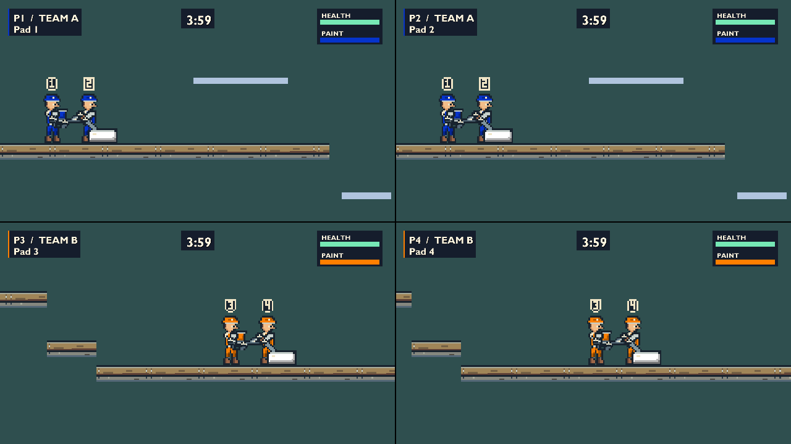

# Playable workshop comparison

Fourth polish increment, implemented on 2026-10-08 from `4409f1a`, using the
unchanged Labrador pin. It advances the next task in [the polish plan](polish-plan.md):
animated team masks, coordinated tool attachments and same-team identity in the
actual Movement Course. This is an explicitly selected comparison, not final art,
controller-feel acceptance or an accepted arena.

## Try it

Build and start the game normally. Choose **Movement Course** on the arena page.
Before locking the arena, use **Up/Down** on keyboard or controller to cycle:

- **Original art**: the existing player, weapon and terrain presentation.
- **Workshop / rotating tool**: the new painter and continuously rotated sprayer.
- **Workshop / posed tool**: the same painter with five authored sprayer directions,
  mirrored for the opposite side.

Both workshop choices use the directly authored roller pose. Other weapons remain
available with their existing tool artwork. The choice persists through restart
and rematch for that setup, but is not a saved global preference. Other stages
ignore it, and Random still excludes the course. Return to arena selection to
change the comparison; simulation aim remains continuous in all three choices.

## Artwork and attachment

The source kit now contains 28 sprites and 45 exported frames. Eight body poses
cover idle, running, airborne motion and a short landing recovery. Each pose owns
its matching team mask, selected by the same frame index. Cap and overalls retain
team colour while neutral trim, skin, boots, gloves and hardware retain their
authored colours. Quiet idle motion is phased by roster position without using
gameplay randomness.

The body is explicitly 52 by 120 world units at four units per native texel.
Visual dimensions are presentation data, independent of collision and weapon
tuning. Numbered neutral badges identify roster positions 1–4, matching the HUD;
they do not use controller slot numbers (the keyboard is slot 4).

Two pixel-stepped arm chains join authored shoulders to the tool's main and
support grips. Glove frames cover those grips. The continuous sprayer uses the
horizontal authored frame; the posed variant chooses the nearest authored visual
direction. Its frame is translated to keep the semantic muzzle at the actual
simulation muzzle between bins. The hands follow that translation. Projectile
direction, origin, obstruction handling, ammunition and collision shape are
unchanged. The roller retains its real fixed aim and white/non-firing paint state.
Its initial countdown pose also follows the weapon before the first world update.

Animation advances only during world updates. Drawing another pane or a paused
scene changes no animation state. Genuine landing/takeoff events select their
poses immediately, including a buffered rebound. Losing support while walking
selects the airborne pose on that same contact tick without creating a jump puff.
Movement interrupts decorative landing recovery, and respawn clears its history.
Visual culling includes tools, arms, gloves and badges; collision uses the original
shape. Arm strokes have a bounded subdivision count.

Rectangular paintable structures use repeated native platform modules, cropping
partial modules and final fractional texels at their actual boundaries. No
multi-texel texture is stretched to fit a platform. Existing paint overlays still
use the same scored faces and ownership. Ramps, jump-through platforms, other
structures and the course background retain their diagnostic artwork. Tiling
rejects content requiring more than 65,536 draw records for one structure.
This is a material comparison, not finished environment production.

## Reproduction and checks

```powershell
./scripts/build-workshop-kit.ps1 -StageRuntime
./scripts/check-workshop-kit.ps1
# From an x64 VS Developer shell with VCPKG_ROOT:
./scripts/run-acceptance.ps1 -Preset x64-debug
./scripts/run-acceptance.ps1 -Preset x64-release
./scripts/check-workshop-playable.ps1 -Preset x64-debug -SkipBuild -SequenceFrames 90
./scripts/check-workshop-playable.ps1 -Preset x64-release -SkipBuild
```

The builder stages only DDS/frame JSON into runtime content. Editable source,
PNG and attachment metadata remain under `game/art/polish/kit/`. New frames opt
into exported native pivots; original study frames keep their earlier origin
contract. The canonical check compares deterministic rebuilds, every native
pixel, team masks, gutters, premultiplied alpha, origins and staged hashes. It
independently compares presentation dimensions, shoulder and tool anchors against
the source kit, rejecting stale presentation data. Twelve malformed source cases
and five stale presentation variants are checked.

Debug and Release built under `/W4 /WX` and passed all eight consumer acceptance
cases. The player case exercises 7,200 exact baseline/comparison ticks and shot
trajectories per configuration across all five tools, along with body transitions,
pause, death/respawn and roster-badge culling. The terrain case checks cropped
edges, draw limits, collision identity, neutral coverage, painting and repainting
through actual paintable objects: 43 paintables and 72 unchanged structures across
the four stage fixtures. Original arena exposed areas remain 205920, 249000 and
91200; Movement Course has 194880 exposed units.

The actual LevelBuilder/Scene render probe passed on **NVIDIA GeForce RTX 5080,
D3D11 hardware** in both configurations. It covers all three modes, one through
four players, three palettes and 720p/1080p/QHD. Scripted movement, partial-speed
reversal, a held jump and continuous aim produce equal simulation/resource/paint
state. Repeated suspended draws are pixel-identical. Firing is checked separately
and must paint a real surface; the four-player fixture held 1728 units afterward
in each mode. The comparison does not reskin Close Quarters even with a remembered
workshop choice.

The Debug run also retained 90 consecutive 60-Hz frames for each mode at one and
four players. These are scripted input records, not physical controller playtests.
No interactive frame-pacing or supported-hardware claim follows from readbacks.

Debug startup and extracted Release startup passed with isolated saves and
graceful shutdown. The 44-file ZIP contains the exact new DDS/frame JSON and
presentation data, excludes source art, probes and private audio, and starts from
an unrelated directory with a system-only PATH and absent-bank fallback. A clean
Windows machine remains untested.

## Visual observations and remaining decisions



Matched stills: [original](images/polish-playable/original-four-player-720p.png),
[continuous rotation](images/polish-playable/continuous-four-player-720p.png),
[one-player 1080p](images/polish-playable/authored-one-player-1080p.png) and
[actual painted surface](images/polish-playable/authored-four-player-painted.png).

Silent 60-fps review copies: [original](images/polish-playable/original-four-player-aim.mp4),
[rotating sprayer](images/polish-playable/continuous-four-player-aim.mp4) and
[posed sprayer](images/polish-playable/authored-four-player-aim.mp4).
PNGs are lossless readback conversions; MP4s are H.264 review copies.

Inspected stills and sampled motion frames support keeping both treatments
available for playing comparison. The caps, faces, gloves and different tool
silhouettes are visible at four-player 720p. Badges distinguish same-team players,
although 3/4 are cramped at that size. Blue overalls remain darker against the
course background than orange; the neutral trim helps but does not settle that
readability question. Arms are attached across vertical aim, but their angular
elbows and pose-boundary shifts still need refinement in motion.

The fixed roller avoids rotating its diagonal pixels during normal play. Its
semantic ground edge matches the standing player's feet, while apparent contact
gaps in sampled 720p views still need a raster/camera review. Four-unit texels
project to fractional screen sizes at 720p and QHD, and the renderer truncates
destination edges. No final snapping, integer scaling or letterboxing policy is
accepted by this increment. Do not move collision geometry to hide a raster gap.

Only stills and sampled frames were inspected here. Human real-time playback,
keyboard/mouse and physical controller comparisons, busy combat and listening
remain open. Full firing/recovery poses, hurt/elimination/respawn art, idle muzzle
drips, roller secondary motion and all replacement audio remain future work.

Next, play the two workshop treatments against the original with movement feedback
enabled/disabled. Record arm reach, pose transitions, badge readability, dark-team
contrast and actual feet/roller contact under slow camera movement. Fix the visual
policy and movement issues that review exposes, and finish the outstanding course
route trials before laying out the Close Quarters reference blockout.

Local evidence is under `out/validation/polish-playable-20261008/`; consumer logs
are also retained under `out/acceptance/<preset>/`. `result.json` files record
game/engine revisions, working-tree state, content hashes, inputs and device.

- Atlas/source contract: `atlas-final/dca7ce4d8038431d8a64c344db948ab2/`.
- Debug stills/sequences: `visual-final/x64-debug/6fc5e227513a424a8be926d760df70ce/`.
- Release stills: `visual-final/x64-release/c1de35deab694d7a9ae29511877f9203/`.
- After the same-tick ledge-pose correction, Debug reran the complete still matrix:
  `visual-contact-fix/x64-debug/4b49e098bb364e768f9e03cca259d805/`. All 180 retained
  stills were byte-identical on these scripted routes; the ledge-specific CPU case
  exercises the corrected transition. Final focused movement/player logs are
  `x64-*-*-final-run.log`.
- Startup directories: `startup-debug/` and `startup-release-final/`.
  The final package inventory and extracted location are in `package-files-final.txt`
  and `package-root-final.txt`.

The initial terrain fixture used a function name colliding with a Windows macro;
renaming it fixed the probe compilation before both passing acceptance runs.
