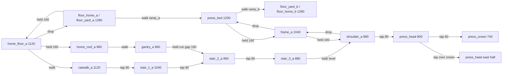

# Press Tower: King of the Hill blockout

Authored 2026-10-25 for `POL#21`, the first arena taken through the
[Crossfeed](polish-crossfeed.md) process after the author accepted Crossfeed as
the reference arena. It answers the King of the Hill row of the
[initial arena briefs](polish-plan.md#initial-arena-briefs). It is a new stage,
`press_tower`, and the original
[king_of_the_hill.json](../game/content/levels/king_of_the_hill.json) is
unchanged beside it: still selectable, still in Random. Press Tower is
explicitly selectable and excluded from Random until attended arena acceptance.
It reuses King of the Hill's accepted music, ending sting and stage icon. That
adds no cue and claims no listening acceptance.

## Question

**Is the press head worth holding?**

From the summit a holder sees both home roofs and gantries, most of the catwalk
tops, and the stair_3 and shoulder tops on their own side. They cannot see any
floor, the bed, the frames or any spawn body. That low route is 3,600 units of
exposed length, 30.77% of the paint. The crown in the middle of the press head
limits each holder to one side for low muzzles, and the hoist brings climbers up
at the shoulder, right beside the holder. High-ground control therefore trades
against the low paint routes and a flank, as the brief asks. The name does not
introduce a hill-scoring mode.

## Geometry and intended inputs

Source: [press_tower.json](../game/content/levels/press_tower.json). Coordinates
are world units, Y increases downward, and player positions are top-left (body
52 x 120). The stage is 3,600 wide and every gameplay piece and spawn reflects
across X=1800 (X' = 3600 - X - W). Decorative art does not imply collision.

| Piece (A side or centre) | X, Y, W, H | Role |
|---|---|---|
| floor_home_a / floor_yard_a | 0 / 520, 1280, 520 / 800, 400 | Scored walking floor under home and along the approach. |
| home_floor_a | 0, 1120, 520, 10 | One-way ruler; all four spawns; drop to the floor. |
| home_roof_a | 0, 960, 520, 10 | One-way ruler; held 160 from home; joins the gantry. |
| catwalk_a / gantry_a | 520, 1120 / 960, 480, 10 | One-way rulers continuing home floor and roof to X 1000. |
| stair_1_a / stair_2_a / stair_3_a | 1000 / 1160 / 1320, 1040 / 960 / 880, 160, 80 | Solid pencil treads, all faces scored; 80 risers. |
| frame_a / shoulder_a | 1480, 1040 / 880, 160, 10 | One-way hoist rulers; the shoulder is level with stair_3. |
| ramp_a | (1320,1280) (1480,1280) (1480,1200) | Walkable 0.5 slope onto the bed; passes paint. |
| press_base | 1320, 1280, 960, 400 | Covered base under ramps and bed; never scores. |
| press_bed | 1480, 1200, 640, 80 | Raised plinth: the required crossing; top scored. |
| press_head | 1640, 800, 320, 80 | The summit; all faces scored, crown buries 40 of the top. |
| press_crown | 1780, 740, 40, 60 | Perch and low-muzzle block; top and sides scored. |

That is 30 collision objects: 13 per side and 4 in the centre. Spawns are
(30/150/270/390, 1000) for A and their mirrored bodies (3518/3398/3278/3158,
1000) for B, all on the home floor. The camera and overview bounds are
(0, 380, 3600, 1000); the highest possible head, a held jump from the crown, is
at Y 413, 33 inside the top.

| # | Connection | Importance | Input |
|---|---|---|---|
| R1 | home floor → home ground | required departure | Drop (Down). |
| R2 | home ground → yard → ramp → bed → ramp → far yard → far home | required contest crossing | Walk only, zero takeoffs. |
| R3 | catwalk → stair_1 → stair_2 → stair_3 → shoulder → press head | optional summit approach | Tap 80 three times, walk the level 880, tap 80. Held jumps also work. |
| R4 | bed → frame → shoulder → press head | optional hoist / flank | Held 160, held 160, tap 80. |
| R5 | home floor → roof → gantry → stair_2 | optional roof shortcut | Held 160, walk, held running jump over a level 160 gap. |
| R6-R11 | stair_1 → gantry; catwalk → gantry; frame → stair_3; head → crown; head half → half; yard / ground → catwalk / home floor | optional and recovery edges | One tap or held jump each. |
| R12 | press head → shoulder → frame → bed → yard | recovery, partial retreat | Walk off, drop, drop, walk down the ramp. |
| R13 | shoulder → stair_3 → stair_2 → stair_1 → catwalk | recovery | Walk west; each tread edge drops 80. |

No rise on any route is more than 160 and every required route is a walk or a
drop. The clearance stacks are Crossfeed's 150 (30 standing headroom); stair_1
leaves 40 headroom over the yard, stair_2 120, and the press head 200 over the
bed. The 140-wide summit halves (88 of positioning range) are controlled
landings that the crown backstops.

## Paint budget

At the 12-unit strip the exposed length is 11,700 and the area 140,400, 1.129x
Crossfeed. By face: tops 110,400 (78.63%), undersides 15,360 (10.94%), walls
14,640 (10.43%). By X band (edges 0, 520, 1480, 1640, 1960, 2120, 3080, 3600):
each home 18,720 (13.33%), each approach 38,280 (27.26%), each hoist 5,760
(4.10%) and the crown band 14,880 (10.60%). By elevation: floor 31,680
(22.56%), bed 7,680 (5.47%), 1120 rulers 24,000 (17.09%), stairs 34,320
(24.44%), frames 3,840 (2.74%), 960 rulers 24,000 (17.09%) and the high tier
14,880 (10.60%). The perimeter walls, `press_base`, the ramps and the bed's
sides and bottom do not score. The acceptance case writes the per-strip and
per-region receipts as `press_tower-faces.csv` and `press_tower-paint.csv`.

## Sightlines and spawn safety

Two separate checks, because they answer different questions.

**Geometric claims** (the blueprint's model): point casts against every flat,
one-way rulers included, ramps excluded, from muzzles 60 and 80 above the feet
at 4-unit steps, with targets at mirrored 8-unit cells.

| From | To | Result (both teams) |
|---|---|---|
| Summit halves, crown, shoulder, stair_3 | own spawn span | 0 clear pairs |
| Summit, standing or jumping (150 to 320 above the feet) | own floors, bed, frame tops | 0 clear pairs |
| Yard | far yard top | 0 clear pairs; the bed breaks the lane |
| Own summit half | home roof, gantry, stair_3, shoulder tops | 100% |
| Own summit half | catwalk / home floor tops | 40 of 60 / 3 of 65 |

**Live fire.** The fixed-muzzle model is not where paint leaves the gun: real
nozzles sit 62.5 to 110 from the body's centre along the aim, and paint is a
box that may fall. Fed real nozzle positions, a point cast does find straight
lines from stair_3 to the spawn span, threading between the gantry underside
(Y 970) and the catwalk. The live-fire check therefore fires the actual five
tools. A standing holder at both ends and the middle of stair_3, the shoulder,
both summit halves and the crown sweeps its aim through every direction facing
the home it overlooks, at 1 degree for the Sniper and Sprayer and 2 degrees for
the others, one paid shot per aim. Every projectile is followed until the Scene
retires it, and its swept box is tested against the spawn span. Result: 130
sweeps, no projectile reaches either spawn span. From stair_3, 3 Sniper launch
points still have a straight point line to the span, but every real jet is
stopped, closest by the home roof 40 above the span; the Sprayer's closest
approach is 217, the Bucket's 382. A Bucket held right beside the crown or the
press head's face loses every throw to launch obstruction; that is the game's
behaviour, not a gap in the sweep.

These are standing holders. Moving and jumping fire at the spawns, and arcs
into home in native play, are still for attended play.

## Decoration

Interior dressing only, all `terrain` sheet, WHITE, no drift: the works wall,
six skylights, the roof truss, `tower_backwall` behind the hoist and bed, two
hanging signs on four hangers, the brush pot on home A's roof and the tape roll
behind the crown. The hangers stop at Y 700, above every standing head.

Two background layers do sit behind walking space, and the blueprint's line
"no art is drawn over the summit standing band" was wrong about them:
`tower_backwall` spans the bed lane and the summit band, and `tape_roll`
(X 1672-1928, Y 652-812) sits behind both summit standing slots. Both are added
before the structures and players, so they draw behind them. The tape roll
frame's bottom 12 rows are transparent padding, so its art ends at Y 800 exactly
and does not cover the press head's landing edge. Whether the summit still reads
clean and heavily painted against the roll is a native-capture question (below).

**Open against the brief: supports.** The brief asks for "stairs represented by
supported geometry". Nothing draws a support: the stairs, frames, shoulders and
press head read as floating, as Crossfeed's suspended mixer does. Every
candidate upright (under the treads, the press-head ends or the gantry) would
stand behind a walking lane, the yard or the bed, and could suggest collision
that is not there, which the art rules forbid. Supports are therefore left to
the art pass, as visuals only with no collision change, once native captures
show what reads.

## Tool hypotheses (to measure, not balance claims)

- **Sniper:** lanes from a summit half to the same side's roof, gantry, catwalk,
  stair_3 and shoulder. Check that the summit is not a sniper nest that also
  paints. Gantry to gantry is the counter-duel.
- **Roller:** 2,640 of floor plus the 640 bed, all walkable and all unseen from
  the summit. Measure loop time under the 30-headroom ceilings.
- **Bucket:** arcs from the yards and bed past the frames onto the shoulders,
  and from the summit over the roof edge toward home.
- **Mister:** close fights on the bed under the press head and its 320
  underside. Check that the mist cannot hold the bed slots from one spot.
- **Sprayer:** pressure along the stair diagonal and onto a hoist climber
  surfacing at the shoulder.

## First headless five-tool report (2026-10-26)

These are 125 native 2P A/B, 60-second Skirmish matches for this arena within
the completed 250-match `TOOL#1` report: all 25 ordered five-tool pairs at fixed
seeds **0, 1, 17, 42, 2026**. No gameplay value changed. The
[shared method and evidence](gameplay-tuning.md#first-five-tool-report-2026-10-26)
records the clean `817a3686` source, executable and receipts. The full 25-cell
matrix, raw five values for every measure, medians and literal min/max ranges
remain in `tool1-first-report-native-v1/analysis/pair-summary.csv` under
`out/validation/todo-loop-20261025/`.

The five equal-tool controls below show **team A's final share of painted area**,
not arena coverage. Values are percentages rounded to two decimals, in the seed
order above; full precision is retained in the CSV. They are a readable subset,
not a tool ranking or an isolated test of map-side fairness.

| Same tool on A and B | A share: five seeds (%) | Median [min, max] (%) |
|---|---|---|
| Sprayer | 50.45, 50.36, 45.11, 49.95, 44.85 | 49.95 [44.85, 50.45] |
| Sniper | 56.67, 49.48, 57.14, 55.41, 58.68 | 56.67 [49.48, 58.68] |
| Roller | 48.29, 55.63, 69.29, 51.07, 49.93 | 51.07 [48.29, 69.29] |
| Mister | 52.08, 52.77, 57.08, 54.38, 58.58 | 54.38 [52.08, 58.58] |
| Bucket | 53.32, 54.11, 53.88, 51.52, 51.97 | 53.32 [51.52, 54.11] |

**Mixed-pair observations and questions for `POL#27` / `POL#31`.** Sniper A
against Sprayer held 7.81 [6.48, 9.21]% of painted area and credited
3 [1, 4] eliminations; swapped Sniper B held 7.12 [5.75, 13.61]%
and credited 2 [1, 3]. Does deliberate summit/gantry aiming make that
elimination/held-paint trade useful? Bot aim, supply withdrawal and visibility
limits remain part of this observation; it is not a Sniper retuning decision.

Roller against Bucket held 63.02 [61.28, 73.52]% as A and
74.63 [52.29, 81.38]% as B; Mister against Bucket held
58.56 [55.35, 67.86]% as A and 66.14 [53.93, 67.04]% as B.
Test low walkable painting against real Bucket arcs and attended bed pressure.
The observations do not establish R2 use or bed control. Sprayer A against
Roller held 44.93 [28.02, 66.29]%; Roller A in the reverse order held
44.04 [37.34, 60.42]%. Both orders and their broad spreads belong in the
existing attended comparison. Mister's same-tool A share stayed above 50% in
these five seeds, but that sign alone does not isolate a map-side effect.

**Crown X-band final paint.** X=1640-1960 spans the full Y=-100-1800 partition.
It includes scoring surfaces throughout that vertical band, not just the summit;
it is not a hill-capture or summit-occupation measure. Values below are both
teams' combined painted fraction of the scoring area on each authored/local
face, median [min, max], using sample-double denominators rather than team share.

| Same-tool match | Authored top coverage (%) | Authored bottom coverage (%) |
|---|---|---|
| Sprayer | 50.00 [50.00, 50.00] | 2.50 [2.50, 2.50] |
| Sniper | 15.62 [3.75, 25.00] | 1.25 [1.25, 1.25] |
| Roller | 28.12 [18.75, 34.38] | 2.50 [2.50, 2.50] |
| Mister | 41.88 [41.88, 45.62] | 2.50 [2.50, 2.50] |
| Bucket | 45.62 [38.12, 48.75] | 8.75 [1.25, 10.00] |

The repeated 50% Sprayer top coverage and low bottom coverage describe final
paint only. They do not prove that bots reached, held or ignored either summit
half. The preserved raw five values and side-order contrasts in
`region-face-summary.csv` and `side-swap-summary.csv` are questions for the
already-required summit-value/half-width session, not instructions to alter the
crown geometry.

Ordered tool swaps retain seat-specific RNG and conditional bot decisions;
they do not mirror random trajectories or isolate terrain from seat/tool/policy
interactions. Skirmish has no line-of-sight, route planner or ballistic-intercept
solver. Five prespecified seeds describe these runs; they provide no population,
significance or human-acceptance result. Held paint is not time held, visits,
route occupancy, spawn pressure or hill control. Keep the existing values for
attended review rather than retuning automatically from these bot observations.
`POL#31` still requires both sides and 1-4P attended play, including spawn pressure,
summit value and whether the halves feel fiddly. Support art and the explicit-only
stage policy remain unchanged.

## Hard five-tool matrix (`TOOL#3`, 2026-10-30)

125 matches of the 875-match `TOOL#3` rerun: all 25 ordered five-tool pairs at
seeds 0, 1, 17, 42, 2026, 2P A/B, 60 seconds, Hard shipping bots on both sides.
No gameplay value changed. Bands are **final held area** at time-up, not route use, visits, time held,
spawn pressure or hill control; `crown` is the full-height X band 1640-1960, not the summit. The policy is the shipping `MatchBotDriver` at Hard on both
seats, 2P only: it has a route planner and ballistic aim, unlike `TOOL#1`'s
Skirmish, but it is one bot at one difficulty, and ordered swaps combine side,
seat RNG, tool and conditional bot behaviour. Five chosen seeds are not population
samples; ranges are observed minima/maxima. Method, receipts and limits:
[gameplay tuning](gameplay-tuning.md#turbulence-bands-and-hard-five-tool-rerun-tool3-2026-10-29).

Team A's share of painted was 51.4 [6.5, 94.5]% over all 125 matches; 99 had a
credited elimination (214 in all). Equal-tool controls, A share of painted (%):

| Same tool on A and B | Five seeds | Median [min, max] | Painted / paintable, median |
|---|---|---|---|
| Sprayer | 50.9, 53.1, 57.3, 49.0, 49.9 | 50.9 [49.0, 57.3] | 62.7 |
| Sniper | 50.7, 51.5, 47.7, 47.4, 55.4 | 50.7 [47.4, 55.4] | 14.3 |
| Roller | 40.2, 58.5, 36.7, 47.8, 43.0 | 43.0 [36.7, 58.5] | 61.7 |
| Mister | 55.1, 53.2, 46.4, 46.0, 51.4 | 51.4 [46.0, 55.1] | 60.4 |
| Bucket | 45.7, 51.9, 53.1, 46.8, 57.1 | 51.9 [45.7, 57.1] | 44.1 |

Per band, all 125 matches (coverage is both teams' held paint over the band's
paintable area; A's part is A held over painted in the band; median [min, max] %):

| Band | Paintable area | Coverage | A's part of painted |
|---|---|---|---|
| home_a | 18720 | 50.5 [0.3, 92.6] | 98.3 [0.0, 100.0] |
| approach_a | 38280 | 52.9 [6.3, 84.3] | 78.3 [0.0, 100.0] |
| hoist_a | 5760 | 75.0 [0.8, 100.0] | 64.9 [0.0, 100.0] |
| crown | 14880 | 60.0 [9.7, 92.3] | 49.4 [3.8, 100.0] |
| hoist_b | 5760 | 74.2 [5.0, 100.0] | 44.0 [0.0, 100.0] |
| approach_b | 38280 | 55.7 [6.9, 81.8] | 18.2 [0.0, 98.8] |
| home_b | 18720 | 53.6 [5.1, 97.4] | 6.1 [0.0, 98.4] |

The two hoist bands are the most covered and the crown splits evenly at the
median. Of the equal-tool controls, the Bucket mirror leaves the hoists least
covered (43% and 62% median, against 78-98% for Sprayer, Roller and Mister).
Whether the crown is worth contesting, and whether the hoists feel fiddly, stay
attended `POL#31` questions.

## Evidence

[scripts/acceptance/press_tower.cpp](../scripts/acceptance/press_tower.cpp) and
[press_tower/](../scripts/acceptance/press_tower/), run by
`scripts/run-acceptance.ps1` on both presets, on the actual Player and Scene,
current tuning, with no device or save:

- **Geometry:** all 30 pieces, types, faces and runtime bounds; mirror pairs;
  spawns; an independent face partition reconciled object by object with the
  runtime tiles; bands and tiers; standing clearance on every support and all
  18 stations.
- **Sightlines and live fire:** as above.
- **Spawns and R1:** all eight spawns, two deaths each, held input carried into
  the respawn tick takes no jump, and the R1 drop needs none.
- **Routes:** R2 with zero takeoffs both ways. R3 in both tap and held families
  and R4, R5 and R6-R11 at press delays of -2, 0 and +2 ticks, each with its
  exact takeoff count (4, 3, 2 and one per edge). R12 and R13 with none.
- **Tools and painting:** all five tools paint the bed and a stair tread for
  both teams; a firing R2 paints both yards and the bed, and a firing R3 paints
  the stairs from its three taps.

Scripted inputs establish feasibility, not comfort, pressure or balance.

### Native inspection (`POL#32`)

`scripts/check-painter.ps1 -PressTowerOnly` selects the dedicated `press-tower`
probe and [verifier](../scripts/check-painter/verify-press-tower.ps1). Both
presets' dedicated evidence is qualified, and the `-SurfaceFinishOnly` and
`-MiniatureTerrainOnly` matrices now include Press Tower beside the previous
five selected stages; their Debug/Release qualification is complete.

The final required matrices completed at 2026-10-25 23:44:32 UTC on D3D11 /
NVIDIA GeForce RTX 5080. Qualification used the `87593628` game baseline and
pinned `1e60fb2` engine,
with exact source/producer hashes and executed scopes retained in the receipt roots
below. The final probe source is bound by `pol32-prep-v1/ready-v6.json`; earlier
dedicated/surface receipts retain qualification for their unchanged executed paths.
The Press Tower stage hash is
`28C6D39D8E9A0596D93B7C73277B511275CC2D9830ACE45C14CAC44725554609`;
gameplay content, movement, weapons and camera policy did not change in this
test-only increment. All paths below are under
`out/validation/todo-loop-20261025/`.

- **Dedicated landings/exits:** per preset, two actual public-builder Levels
  produced four full 1280x720 frames, sixteen unscaled 640x360 pane crops and
  sixteen station/target/camera CSV rows, with eight frozen readbacks and 566
  neutral updates. Stair stations and both crown-separated summit halves are
  deliberately placed and settled; 25 direct projectile contacts establish the
  controlled-heavy fixture. Each crop's RGB rows equal its whole-frame pane;
  geometry, cameras, public/paint state and RNG are checked independently.
  Debug also retains its replay fingerprint; Release labels it unavailable.
  The configured input-slot identifiers are 3, 1, 2, 0, with alternating A/B
  teams, the blue/orange palette and Sprayer/Sniper/Roller/Bucket in view order.
  Inputs are neutral and audio muted; this records no physical-pad session.
- **Surface finish:** passed in both presets. Each matrix retains
  24 full frames, 60 native pane crops, two synthetic crops and 60 readbacks
  across the six stages, clean and controlled-heavy at 720p in 1P/4P.
  Independent per-face primer/sealed-edge and paint-order checks remain.
- **Miniature terrain:** passed in both presets. All six stages
  retain actual StagePreview and 1P/4P overview/story contexts at
  720p/1080p/QHD, resize return, culling/order parity, frozen state/RNG and
  Debug fingerprints, alongside independent thin-feature pixel oracles. Each
  preset retains 523 CSV rows (64 for Press Tower), 67 lossless PPMs and 68
  PNGs, including four contact pages.

| Check | Preset | Result receipt |
|---|---|---|
| Dedicated native leaf | Debug | `pol32-native-v1/press-tower/x64-debug/42ad8259b96a44bd9cd7f4d202b0c398/result.json` (original wrapper failure; native checks passed) |
| Derived Debug postprocessing | Debug | `pol32-postprocess-v5-debug/recovery-result.json` |
| Dedicated native leaf | Release | `pol32-native-v5/press-tower/x64-release/9ec6d2ccc94d435e84dadae22730f3f6/result.json` |
| Surface finish | Debug | `pol32-native-v5/surface-finish/x64-debug/7f64f07e9a764502a5801ee837ca94b6/result.json` |
| Surface finish | Release | `pol32-native-v6/surface-finish/x64-release/24edce545fd14efba205aef8f1ec26e6/result.json` |
| Miniature terrain | Debug | `pol32-native-v6/miniature-terrain/x64-debug/46ae6c340eac4996b0fb55023ad8915d/result.json` |
| Miniature terrain | Release | `pol32-native-v6/miniature-terrain/x64-release/e22228c864d944bfb1530d3d7fdb5ca4/result.json` |

Two initial failures remain part of the record. The first Debug dedicated
native run and its verifier passed, then the wrapper failed because the contact
sheet did not select the new filenames. A separate, hash-bound postprocessing
recovery passed after adding the selector: all 31 original files and the
original FAILED result remain unchanged. Recovery generated sixteen native
PNGs and one 2624x1632 contact sheet, with no repeated native run or readback.
Its independent review is `pol32-prep-v1/independent-recovery-review-v5-debug.json`.

The first Debug miniature run
(`pol32-native-v5/miniature-terrain/x64-debug/3f80daee5fba4fe3bfad27e1a8438735/`)
failed a legacy-pixel-difference assertion after Press Tower's exact preview,
repeat/RNG and resize checks passed. Press Tower's native preview pair was
identical, as Crossfeed's was; every original arena retained a positive
difference. The fixture now explicitly keeps that positive control on those
four legacy arenas while all six still require exact reference/repeat/resize
checks. No art or production rendering changed to satisfy the test.
Fresh Debug and Release miniature runs passed with the corrected positive-control scope. The failed run and its source/evidence audit remain
preserved; they are not relabeled as successful.

These are controlled native inspection and renderer-integration results.
They establish no attended readability, spawn pressure, summit value, route
comfort, competitive balance, listening, physical-device or performance
acceptance. Press Tower remains explicit-only and excluded from Random;
`POL#31` and the support-art question below remain open.

### Shipping-bot routes and team trials (`POL#41`)

Done 2026-10-29: descriptive evidence for `POL#31`, not a substitute for it.
The scripted routes above prove the geometry can be crossed. These two opt-in
cases now show what the shipping bot does on it, with no bot, geometry or
tuning change. The other stages are unchanged and come first.
[bot_arena_routes.cpp](../scripts/acceptance/bot_arena_routes.cpp) keeps its
150-route contract, and [bot_team_trials.cpp](../scripts/acceptance/bot_team_trials.cpp)
keeps its 200-trial contract. Press Tower runs after each, with its own lines
and totals. Its unfinished routes are measured limits, not failures.

- **Routes** (`press_tower_routes`): each run injects the start position only.
  The bot then gets 900 active steps of ordinary driver input, against a
  neutral human at the opposite natural spawn. Each route runs for both teams,
  all five tools and Easy/Normal/Hard, so 30 trials per route.
  R2 is `floor_yard_a` → `press_bed` → `floor_yard_b` (start X 1200).
  R3 is `catwalk_a` → `stair_3_a` → `shoulder_a` (start X 900).
  R4 is `press_bed` → `frame_a` → `shoulder_a` (start X 1560).
  The summit leg is `shoulder_a` → `press_head` (start X 1560).
  Each route mirrors exactly for B. Each also has a minimum takeoff count:
  0 for R2, 2 for R3 and R4, since they rise 240 and 320 against a held jump's
  207, and 1 for the summit leg. Contacts must come on strictly later steps.
  That matters here because `stair_3` and `shoulder` are level neighbours, and
  a body straddling X 1480 touches both on the same step.
  Every Press Tower trial keeps a trace of every 30th step and every jump, and
  an unfinished trial prints it.
- **Team trials**: same-tool 2v2 from natural spawns: three bots and a neutral
  human. Each runs for both human sides, all five tools and Easy/Normal/Hard
  (30 trials of 1800 steps, one final-input replay), using the `x_band`
  partition (`metrics.cpp:221-226`). The trial rows append to the existing
  four CSVs; their `controller` column now names the difficulty.
  `bot_team_trials_press_tower.csv` adds one row per bot: route contacts landed
  (named from the bot's side), summit steps (grounded on `press_head` or
  `press_crown`), off-home steps and deaths.

**First results (x64-release and x64-debug identical).** Before and after the
change, the existing stages' stdout (216 route lines, 19 team lines) and every
existing row of the four team CSVs are byte-identical.

| Route | Finished | Easy | Normal | Hard | A / B |
|---|---|---|---|---|---|
| R2 | 5/30 | 5/10 | 0/10 | 0/10 | 2/15, 3/15 |
| R3 | 24/30 | 6/10 | 9/10 | 9/10 | 9/15, 15/15 |
| R4 | 30/30 | 10/10 | 10/10 | 10/10 | 15/15, 15/15 |
| Summit | 30/30 | 10/10 | 10/10 | 10/10 | 15/15, 15/15 |

Finish-top paint was held in 80 of the 120 trials.

| Team trials | Summit bots | Summit steps | Left home | Deaths (bots) | Bed / far yard landed |
|---|---|---|---|---|---|
| Easy | 25/30 | 3629 | 30/30 | 10 (9) | 23 / 12 |
| Normal | 25/30 | 3678 | 30/30 | 14 (11) | 19 / 5 |
| Hard | 26/30 | 3131 | 30/30 | 20 (14) | 13 / 1 |
| Team A | 38/45 | 5240 | 45/45 | 20 (16) | 28 / 10 |
| Team B | 38/45 | 5198 | 45/45 | 24 (18) | 27 / 8 |

Measured limits, named:

- **R2, the required contest crossing: 25 of 30 unfinished, including every
  Normal and Hard trial.** All 30 reached the bed. Sampled traces across
  tools, difficulties and both teams agree. The bot walks the yard and ramp
  onto the bed, climbs under its own frame (X 1521 for A, 2077 for B), goes
  through frame and shoulder, and stands on the press head by about step 240.
  Its goal choice prefers the tower to the far yard.
  The team trials agree: from natural spawns, 12, 5 and 1 bots per 30 landed
  on the far yard at Easy, Normal and Hard. R2's only finishers are Easy
  Sprayer and Mister for A, and Easy Roller, Mister and Bucket for B.
- **R3 is one-sided: A finished 9 of 15 and B 15 of 15.** The starts mirror
  exactly. Four A misses never reached `stair_3_a`: Easy Sprayer, Mister and
  Bucket, and Hard Roller. Two touched it and left without reaching the
  shoulder: Normal Sprayer and Easy Sniper. The Normal Sprayer trace drops
  through the catwalk toward home on step 10.
- R4 and the summit leg have no limit: 60 of 60.

What this does not decide is unchanged. It does not settle whether the summit
is worth holding, whether the crown halves are fiddly or whether spawn pressure
is fair; those remain `POL#31`, attended. It does not decide Easy/Normal/Hard
values (`ROAD#10`) and does not move Press Tower into Random. The A/B R3
asymmetry and the bot preferring the hoist to R2 are bot facts for `ROAD#10` to
weigh. They are not geometry findings, and no row follows unless attended play
shows bots abandoning the floor matters.

Rerun: `scripts/run-acceptance.ps1 -Cases bot_arena_routes,bot_team_trials`
(x64-debug or x64-release).

## Open

- Attended play on both sides and 1-4P (`POL#31`), including spawn pressure, the summit's
  value and the summit halves' feel. If the halves read as fiddly, narrow the
  crown to 24 (halves 148) and re-run the sightline and live-fire checks.
- Bot evidence for that session (`POL#41`, above): bots favour the hoist and
  summit, and seldom take R2 to the far yard at Normal or Hard.
- Support art for the brief, above.
- Review frames: `ColourWars.exe +exec review_press_tower +quit` writes the
  seeded 1-4P clean and heavy frames and every station
  ([`DBG#18`](debug-console.md#arena-review-screenshot-pack-dbg18)).
- Spawn margins depend on the gantry ending at X 1000; shortening it to 940
  opens a standing summit line to X 405. Any geometry edit re-runs the checks.
