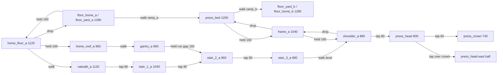

# Press Tower: King of the Hill blockout

Authored 2026-10-25 for `POL#21`, the first arena taken through the
[Crossfeed](polish-crossfeed.md) process after the author accepted Crossfeed as
the reference arena. It answers the King of the Hill row of the
[initial arena briefs](polish-plan.md#initial-arena-briefs). It is a new stage,
`press_tower`, and the original
[king_of_the_hill.json](../game/content/levels/king_of_the_hill.json) is
unchanged beside it: still selectable, still in Random. Press Tower is
explicitly selectable and excluded from Random until attended arena acceptance.
It reuses King of the Hill's accepted music, ending sting and stage icon. That
adds no cue and claims no listening acceptance.

## Question

**Is the press head worth holding?**

From the summit a holder sees both home roofs and gantries, most of the catwalk
tops, and the stair_3 and shoulder tops on their own side. They cannot see any
floor, the bed, the frames or any spawn body. That low route is 3,600 units of
exposed length, 30.77% of the paint. The crown in the middle of the press head
limits each holder to one side for low muzzles, and the hoist brings climbers up
at the shoulder, right beside the holder. High-ground control therefore trades
against the low paint routes and a flank, as the brief asks. The name does not
introduce a hill-scoring mode.

## Geometry and intended inputs

Source: [press_tower.json](../game/content/levels/press_tower.json). Coordinates
are world units, Y increases downward, and player positions are top-left (body
52 x 120). The stage is 3,600 wide and every gameplay piece and spawn reflects
across X=1800 (X' = 3600 - X - W). Decorative art does not imply collision.

| Piece (A side or centre) | X, Y, W, H | Role |
|---|---|---|
| floor_home_a / floor_yard_a | 0 / 520, 1280, 520 / 800, 400 | Scored walking floor under home and along the approach. |
| home_floor_a | 0, 1120, 520, 10 | One-way ruler; all four spawns; drop to the floor. |
| home_roof_a | 0, 960, 520, 10 | One-way ruler; held 160 from home; joins the gantry. |
| catwalk_a / gantry_a | 520, 1120 / 960, 480, 10 | One-way rulers continuing home floor and roof to X 1000. |
| stair_1_a / stair_2_a / stair_3_a | 1000 / 1160 / 1320, 1040 / 960 / 880, 160, 80 | Solid pencil treads, all faces scored; 80 risers. |
| frame_a / shoulder_a | 1480, 1040 / 880, 160, 10 | One-way hoist rulers; the shoulder is level with stair_3. |
| ramp_a | (1320,1280) (1480,1280) (1480,1200) | Walkable 0.5 slope onto the bed; passes paint. |
| press_base | 1320, 1280, 960, 400 | Covered base under ramps and bed; never scores. |
| press_bed | 1480, 1200, 640, 80 | Raised plinth: the required crossing; top scored. |
| press_head | 1640, 800, 320, 80 | The summit; all faces scored, crown buries 40 of the top. |
| press_crown | 1780, 740, 40, 60 | Perch and low-muzzle block; top and sides scored. |

That is 30 collision objects: 13 per side and 4 in the centre. Spawns are
(30/150/270/390, 1000) for A and their mirrored bodies (3518/3398/3278/3158,
1000) for B, all on the home floor. The camera and overview bounds are
(0, 380, 3600, 1000); the highest possible head, a held jump from the crown, is
at Y 413, 33 inside the top.

| # | Connection | Importance | Input |
|---|---|---|---|
| R1 | home floor → home ground | required departure | Drop (Down). |
| R2 | home ground → yard → ramp → bed → ramp → far yard → far home | required contest crossing | Walk only, zero takeoffs. |
| R3 | catwalk → stair_1 → stair_2 → stair_3 → shoulder → press head | optional summit approach | Tap 80 three times, walk the level 880, tap 80. Held jumps also work. |
| R4 | bed → frame → shoulder → press head | optional hoist / flank | Held 160, held 160, tap 80. |
| R5 | home floor → roof → gantry → stair_2 | optional roof shortcut | Held 160, walk, held running jump over a level 160 gap. |
| R6-R11 | stair_1 → gantry; catwalk → gantry; frame → stair_3; head → crown; head half → half; yard / ground → catwalk / home floor | optional and recovery edges | One tap or held jump each. |
| R12 | press head → shoulder → frame → bed → yard | recovery, partial retreat | Walk off, drop, drop, walk down the ramp. |
| R13 | shoulder → stair_3 → stair_2 → stair_1 → catwalk | recovery | Walk west; each tread edge drops 80. |

No rise on any route is more than 160 and every required route is a walk or a
drop. The clearance stacks are Crossfeed's 150 (30 standing headroom); stair_1
leaves 40 headroom over the yard, stair_2 120, and the press head 200 over the
bed. The 140-wide summit halves (88 of positioning range) are controlled
landings that the crown backstops.

## Paint budget

At the 12-unit strip the exposed length is 11,700 and the area 140,400, 1.129x
Crossfeed. By face: tops 110,400 (78.63%), undersides 15,360 (10.94%), walls
14,640 (10.43%). By X band (edges 0, 520, 1480, 1640, 1960, 2120, 3080, 3600):
each home 18,720 (13.33%), each approach 38,280 (27.26%), each hoist 5,760
(4.10%) and the crown band 14,880 (10.60%). By elevation: floor 31,680
(22.56%), bed 7,680 (5.47%), 1120 rulers 24,000 (17.09%), stairs 34,320
(24.44%), frames 3,840 (2.74%), 960 rulers 24,000 (17.09%) and the high tier
14,880 (10.60%). The perimeter walls, `press_base`, the ramps and the bed's
sides and bottom do not score. The acceptance case writes the per-strip and
per-region receipts as `press_tower-faces.csv` and `press_tower-paint.csv`.

## Sightlines and spawn safety

Two separate checks, because they answer different questions.

**Geometric claims** (the blueprint's model): point casts against every flat,
one-way rulers included, ramps excluded, from muzzles 60 and 80 above the feet
at 4-unit steps, with targets at mirrored 8-unit cells.

| From | To | Result (both teams) |
|---|---|---|
| Summit halves, crown, shoulder, stair_3 | own spawn span | 0 clear pairs |
| Summit, standing or jumping (150 to 320 above the feet) | own floors, bed, frame tops | 0 clear pairs |
| Yard | far yard top | 0 clear pairs; the bed breaks the lane |
| Own summit half | home roof, gantry, stair_3, shoulder tops | 100% |
| Own summit half | catwalk / home floor tops | 40 of 60 / 3 of 65 |

**Live fire.** The fixed-muzzle model is not where paint leaves the gun: real
nozzles sit 62.5 to 110 from the body's centre along the aim, and paint is a
box that may fall. Fed real nozzle positions, a point cast does find straight
lines from stair_3 to the spawn span, threading between the gantry underside
(Y 970) and the catwalk. The live-fire check therefore fires the actual five
tools. A standing holder at both ends and the middle of stair_3, the shoulder,
both summit halves and the crown sweeps its aim through every direction facing
the home it overlooks, at 1 degree for the Sniper and Sprayer and 2 degrees for
the others, one paid shot per aim. Every projectile is followed until the Scene
retires it, and its swept box is tested against the spawn span. Result: 130
sweeps, no projectile reaches either spawn span. From stair_3, 3 Sniper launch
points still have a straight point line to the span, but every real jet is
stopped, closest by the home roof 40 above the span; the Sprayer's closest
approach is 217, the Bucket's 382. A Bucket held right beside the crown or the
press head's face loses every throw to launch obstruction; that is the game's
behaviour, not a gap in the sweep.

These are standing holders. Moving and jumping fire at the spawns, and arcs
into home in native play, are still for attended play.

## Decoration

Interior dressing only, all `terrain` sheet, WHITE, no drift: the works wall,
six skylights, the roof truss, `tower_backwall` behind the hoist and bed, two
hanging signs on four hangers, the brush pot on home A's roof and the tape roll
behind the crown. The hangers stop at Y 700, above every standing head.

Two background layers do sit behind walking space, and the blueprint's line
"no art is drawn over the summit standing band" was wrong about them:
`tower_backwall` spans the bed lane and the summit band, and `tape_roll`
(X 1672-1928, Y 652-812) sits behind both summit standing slots. Both are added
before the structures and players, so they draw behind them. The tape roll
frame's bottom 12 rows are transparent padding, so its art ends at Y 800 exactly
and does not cover the press head's landing edge. Whether the summit still reads
clean and heavily painted against the roll is a native-capture question (below).

**Open against the brief: supports.** The brief asks for "stairs represented by
supported geometry". Nothing draws a support: the stairs, frames, shoulders and
press head read as floating, as Crossfeed's suspended mixer does. Every
candidate upright (under the treads, the press-head ends or the gantry) would
stand behind a walking lane, the yard or the bed, and could suggest collision
that is not there, which the art rules forbid. Supports are therefore left to
the art pass, as visuals only with no collision change, once native captures
show what reads.

## Tool hypotheses (to measure, not balance claims)

- **Sniper:** lanes from a summit half to the same side's roof, gantry, catwalk,
  stair_3 and shoulder. Check that the summit is not a sniper nest that also
  paints. Gantry to gantry is the counter-duel.
- **Roller:** 2,640 of floor plus the 640 bed, all walkable and all unseen from
  the summit. Measure loop time under the 30-headroom ceilings.
- **Bucket:** arcs from the yards and bed past the frames onto the shoulders,
  and from the summit over the roof edge toward home.
- **Mister:** close fights on the bed under the press head and its 320
  underside. Check that the mist cannot hold the bed slots from one spot.
- **Sprayer:** pressure along the stair diagonal and onto a hoist climber
  surfacing at the shoulder.

## Evidence

[scripts/acceptance/press_tower.cpp](../scripts/acceptance/press_tower.cpp) and
[press_tower/](../scripts/acceptance/press_tower/), run by
`scripts/run-acceptance.ps1` on both presets, on the actual Player and Scene,
current tuning, with no device or save:

- **Geometry:** all 30 pieces, types, faces and runtime bounds; mirror pairs;
  spawns; an independent face partition reconciled object by object with the
  runtime tiles; bands and tiers; standing clearance on every support and all
  18 stations.
- **Sightlines and live fire:** as above.
- **Spawns and R1:** all eight spawns, two deaths each, held input carried into
  the respawn tick takes no jump, and the R1 drop needs none.
- **Routes:** R2 with zero takeoffs both ways. R3 in both tap and held families
  and R4, R5 and R6-R11 at press delays of -2, 0 and +2 ticks, each with its
  exact takeoff count (4, 3, 2 and one per edge). R12 and R13 with none.
- **Tools and painting:** all five tools paint the bed and a stair tread for
  both teams; a firing R2 paints both yards and the bed, and a firing R3 paints
  the stairs from its three taps.

Scripted inputs establish feasibility, not comfort, pressure or balance.

## Open

- Attended play on both sides and 1-4P, including spawn pressure, the summit's
  value and the summit halves' feel. If the halves read as fiddly, narrow the
  crown to 24 (halves 148) and re-run the sightline and live-fire checks.
- Native four-pane captures of the stair landings and hoist exits, clean and
  heavily painted. A `-PressTowerOnly` check-painter leaf (as Crossfeed's) is
  the way to get them; the surface-finish and miniature-terrain painter
  matrices do not list Press Tower yet.
- Support art for the brief, above.
- Spawn margins depend on the gantry ending at X 1000; shortening it to 940
  opens a standing summit line to X 405. Any geometry edit re-runs the checks.
