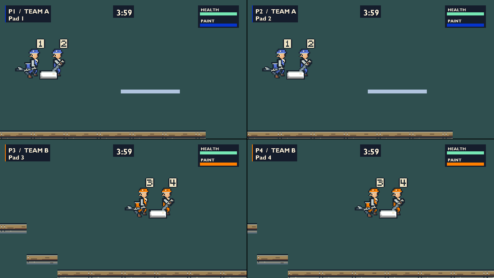

# Workshop refinement and course trials

Fifth polish increment, implemented on 2026-10-08 from `26314aa`, using the
unchanged Labrador pin. It takes the next task in [the polish plan](polish-plan.md)
as far as it can go without a person playing: it refines the
[playable workshop comparison](polish-playable-kit.md), makes the
[Movement Course](polish-movement-course.md) route trials retained acceptance, and
captures movement feedback on and off while the camera moves. The candidates
remain selectable comparisons. No human keyboard/mouse or controller review has
taken place, so the plan's visual and movement decisions are still open.

## Try it

From a Debug build:

```powershell
out/build/x64-debug/game/ColourWars.exe +stage movement_course +players 4 +visual posed
```

**F8** cycles original -> rotating -> posed, **F9** toggles movement feedback,
**F6**/**F7** pause and step. See [the developer console](debug-console.md).

## Visual refinements

All three Movement Course presentations remain: **Original art**,
**Workshop / rotating tool** and **Workshop / posed tool**. Simulation, aim,
muzzle, collision and paint are unchanged; the acceptance comparison of 7,200
ticks across all five tools is still exact.

| Issue from the previous increment | Change |
|---|---|
| Angular elbows | Each arm is two equal bones, half of `arm_length` (48, an even texel count). The elbow sags off the span by what the bones leave over, capped at `elbow_drop`, so long reaches draw straight. It bends downward and slightly toward the back. The sag fades out where the bend side has to change, so the arm straightens rather than jumps across. Both segments share one snapped joint texel. |
| Posed tool flickering between directions | The authored direction is chosen once per world update, after the weapon takes its aim, and changes only `pose_hysteresis_degrees` (6) beyond the midpoint to a neighbour. Drawing stays a pure read. Respawn clears the held direction. |
| Cramped badges 3/4 | Badges are 9 by 10 texels (about 24 by 27 px at four-player 720p): one shared cream plate, dark rim and dark numerals. They sit above and behind the head, mirrored with facing, and are drawn before the tool, so an upward muzzle is never covered. |
| Dark blue overalls | Body and tool team masks are tinted toward white just enough to reach `team_mask_minimum_luminance` (0.20; 0 disables). Only blue changes, to about (86,117,220). Paint, HUD, scoring colours and the original art keep the true team colour. The darkest mask tone moved from `#747474` to `#808080`. |
| Feet/roller contact gap | Not a raster gap; see below. Nothing changed. |



Matched four-player 720p stills at scripted tick 42 (airborne):
[original](images/polish-refine/original-four-player-720p-tick42.png),
[rotating](images/polish-refine/continuous-four-player-720p-tick42.png) and
[posed](images/polish-refine/authored-four-player-720p-tick42.png). Compare the
[previous posed still](images/polish-playable/authored-four-player-720p.png).

### Automated proxies and their limits

`workshop_player` now measures what can be measured without a viewer:

- **Arms.** A tenth-degree aim sweep of every aimed tool, in both workshop modes
  (28,720 compared ticks), fails if an elbow moves more than one texel between
  neighbouring aims within one pose and facing. Spans of at least `arm_length`
  must draw straight, and the bones must stay equal halves. Both the old fixed
  drop and the rule without the fade were deliberately reintroduced and failed.
- **Pose changes.** Dithering ±2° around a direction boundary for 240 ticks
  produces 0 changes, against 240 without hysteresis. The posed grip still moves
  about 59 world units (39 px at 720p) when the direction changes. Hysteresis
  moves that change; it does not shrink it. Removing it would need residual
  rotation or more authored directions, and that decision stays open.
- **Badges.** No overlap with the muzzle at straight-up aim, either facing, in
  both workshop modes.
- **Contrast.** A WCAG ratio table for every palette, team and mask tone, against
  the outline and the course background read from level data. Every tone must be
  at least 1.40:1 from the outline (the lowest is blue shadow, 1.48). The lit tone
  must be at least 2.00:1 from the background (the lowest is blue, 2.13; it was
  1.01). The mid and dark tones of orange, pink and blue are still 1.1–1.3:1
  against this placeholder background, which sits in the middle of every team's
  ramp. That needs a background value decision or a light rim, not a stronger
  tint.

`check-workshop-kit.ps1` covers the new data: arm length, hysteresis, badge size
and offset, the luminance floor and the shared badge plate. It now rejects fifteen
stale presentation variants and one stale badge silhouette, alongside the twelve
malformed source cases. The loader rejects sprayer directions whose angles do not
strictly increase.

### Ground contact is pixel-flush

The previous increment reported apparent feet/roller gaps at 720p. Standing
contact has no raster gap. The foot line and the platform top are the same world
value, pass through the same camera transform and are truncated by the same
engine rule. The body is exactly 80, 120 or 160 px tall at 720p, 1080p and QHD,
so its centre pivot lands on whole pixels. The apparent gaps were airborne frames
in the sampled clips, and the dark boot or roller outline merging with the
platform's own dark top band.

The playable probe now retains this. For every grounded player in every
movement-sequence frame, the painted frame and the settled frames, it projects
the collision bottom through that player's view. A row of course background
between the platform row and the row above fails the probe. 2,100 checks passed,
90 at each of 720p, 1080p and QHD for settled frames, with none skipped. The check
does not attribute those pixels to the boots, and ramps are not exercised.

What fractional scale does cause is smaller: the body alternates 34/35 px wide at
720p (69/70 at QHD), the roller's bottom outline alternates 2/3 px, and terrain
texel columns re-split between 2 and 3 px as the camera pans. Candidate remedies,
none accepted:

- Snap the camera translation to whole pixels (1.5, 1 or 0.75 world units). This
  stops terrain shimmer, but scrolling at 720p moves in 1.5-unit steps.
- Draw the body from its snapped left edge. Never snap the feet without the
  platforms, or a real gap appears.
- Use an integer number of pixels per texel. Only this removes the alternation,
  but it changes how much world each resolution shows.

The engine truncates sprite edges toward zero, so a sprite straddling a pane's top
or left edge loses a pixel. A draw also cannot read its view's camera. Neither
blocks this increment, and nothing here works around either. They are not filed
in [engine reports](review/engine-reports.md); one becomes a report if a chosen
snapping policy needs a workaround.

## Movement Course route trials

The new CPU-only `movement_course` acceptance case loads the authored course
collision objects into a Scene with the real Player and follows Level's update
order, including its swept projectile pass. It runs in CI with the other consumer
cases. Every trial builds a fresh scene and places the player only by construction
or respawn. Every tick it requires the player to stay in bounds and alive, and
not to overlap a solid. Missing named objects fail by name. Gap widths and rise
heights come from the level data, and grace/buffer expectations repeat the
player's own countdown instead of freezing tick counts.

Only intended outcomes are asserted. Everything else is a `MEASURE` line, because
the tuning is still a candidate. Debug and Release logs are byte-identical. The
results are recorded in [the course document](polish-movement-course.md#retained-route-trials).
Its previous gap evidence came from a scratch probe that teleported the player;
this case replaces it.

## Feedback on/off with a moving camera

The movement feedback probe adds a moving, aim-sweeping route in all three
presentations at one and four players. Each tick updates the world once, then
draws it with feedback enabled and disabled, and requires the simulation to be
unchanged. One-player panes cannot pan on the 800-unit runway (the scroll border
is at 1152), so team A crosses the short gap with a held full-speed jump, while
team B jumps on its own runway. The probe requires horizontal camera pan in every
view, a takeoff on the press tick and a landing on the named platform's top.
Takeoff and landing phases are checked at 720p, 1080p and QHD.

| Measure | Result |
|---|---|
| One-player pan | 124 world units horizontally, 13 vertically |
| Four-player pan | 716, 64, 713 and 174 horizontally |
| Changed pixels, four-player 720p | At most 152 per pane (original) or 118 (workshop); 10,996 / 9,477 over 150 ticks |

Feedback on (top) over off (bottom), four-player 720p, 60 fps:
[original](images/polish-refine/original-four-player-route-onoff.mp4),
[rotating](images/polish-refine/continuous-four-player-route-onoff.mp4) and
[posed](images/polish-refine/authored-four-player-route-onoff.mp4). Matched stills
at tick 70: [on](images/polish-refine/authored-four-player-route-tick70-on.png) and
[off](images/polish-refine/authored-four-player-route-tick70-off.png).

At four-player 720p the takeoff puff shows as a few faint grey dots, and the
difference is hard to see while the camera moves. This supports the earlier
observation that the prototype effect is restrained to the point of near
invisibility at the smallest pane. It is an input to the human comparison, not
its conclusion. Two artefacts of the scripted route are visible: an airborne
roller reads as a white block beside the body, and P1 and P3 land almost stacked,
so P3's badge covers P1 at the end of the clip.

## Reproduction and checks

```powershell
./scripts/build-workshop-kit.ps1 -StageRuntime
./scripts/check-workshop-kit.ps1
# From an x64 VS Developer shell with VCPKG_ROOT:
./scripts/run-acceptance.ps1 -Preset x64-debug
./scripts/run-acceptance.ps1 -Preset x64-release
./scripts/check-workshop-playable.ps1 -Preset x64-debug -SkipBuild -SequenceFrames 90
./scripts/check-movement-feedback.ps1 -Preset x64-debug -SkipBuild -SequenceFrames 90
```

The movement feedback probe saves paired four-player sequences by default.
`-OnePlayerRouteSequences` adds the one-player pairs. Under Windows PowerShell
5.1, pass `-OutputDirectory` to the two render probes and `check-startup.ps1`.
Their defaults use `$PSScriptRoot` in the parameter block, which 5.1 leaves
empty. CI uses PowerShell 7 and is unaffected.

Debug and Release built under `/W4 /WX` and passed all nine consumer acceptance
cases. They also passed the kit check, the level editor check and both render
probes on **NVIDIA GeForce RTX 5080, D3D11 hardware**. Debug startup passed. The
44-file Release ZIP carries the new DDS, frame JSON and presentation data with
matching hashes. Its extracted copy started from an unrelated directory with a
system-only PATH and the absent-bank fallback. A clean Windows machine remains
untested.

Evidence is under `out/validation/polish-refine-20261008/`, with `result.json`
files recording revisions, working-tree state, content hashes and device:

- Final runs: `final-*.log`, `final-playable/`, `final-feedback/`,
  `final-startup-*`, `final-package-listing.txt`.
- Debug sequences: `playable-visual/x64-debug/f067afa85c1d4911a14fd9a09e1cffb6/`
  and `feedback-visual/x64-debug/4e988fdeb4b342cc990fa9dafe40b624/`.
- Route measurements: `route-measurements-{debug,release}.log`.
- Media: `convert.sh` holds the exact PNG and MP4 commands. Its `media/` folder
  holds every converted copy; `docs/images/polish-refine/` holds a selection.

## Open after this increment

- **Human review is still the gate.** Play the three presentations with keyboard
  and mouse and a physical controller, with movement feedback on and off. Judge
  the bent arms in motion, the hysteresis, the prominence of the light badge, and
  whether lifted blue still reads as the blue team's paint.
- **Visual policy decisions.** Residual rotation or more authored directions for
  the posed tool, camera pixel snapping or integer texel scale, and a course
  background value band, or a light rim, for the remaining mid-tone contrast.
- **Movement design questions** surfaced by the trials, below.
- **Feedback strength.** Decide whether to strengthen the takeoff/landing
  feedback, which is hard to see at four-player 720p.
