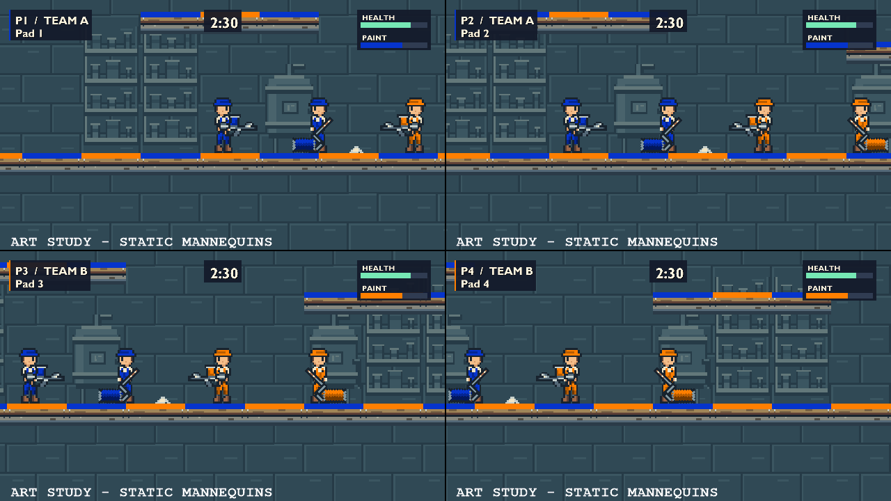

# Workshop native-pixel kit study

Historical workshop study. The author retired its kit, runtime comparison modes,
F8 binding and dedicated build/check scripts on 2026-10-15 (`POL#2`). Commands
and source links below describe that earlier revision; use Git history to
reproduce it. Retained images and clips remain evidence of the study. Current
art rules are in [polish plan ?1](polish-plan.md#1-establish-the-art-and-display-rules).

Third polish increment, begun on 2026-10-08 from `1387a76`, using the existing
Labrador pin. It turns the [workshop reference](polish-style-reference.md) into
an editable native-grid composition for section 1 of [the plan](polish-plan.md).
It does not approve the style, replace the gameplay artwork, or author an arena.

Follow-up: [the fourth increment](polish-playable-kit.md) extends this source kit
and makes it explicitly selectable in Movement Course. This document records the
third increment's static study and its evidence; the follow-up owns current
runtime integration and the remaining playing review.

## Source and reproduction

The [kit source](../game/art/polish/kit/source.json) explicitly authors each
texel with palette symbols. It contains one painter pose, sprayer, roller,
platform module, wall, shelving, mixing tank, contact-puff study and utility
pixel. These shapes are newly authored from the reference's design direction;
the flattened generated reference is not sampled or cropped into sprites.
The [authoring notes](../game/art/polish/kit/README.md) describe the material
palette, team masks, pivots and semantic anchors.

```powershell
./scripts/build-workshop-kit.ps1
./scripts/check-workshop-kit.ps1
# The visual probe requires an x64 VS Developer shell and VCPKG_ROOT.
./scripts/check-workshop-style.ps1 -Preset x64-debug -SequenceFrames 90
./scripts/check-workshop-style.ps1 -Preset x64-release
```

The builder packs deterministic frames with transparent gutters, a straight-alpha
PNG, one-mip premultiplied RGBA8 DDS, engine frame JSON and layout/anchor metadata.
Base and grayscale team layers contain disjoint source cells. Changing a team
palette therefore recolours only the authored cap, overalls and tool paint,
without extracting colours from shaded hardware. The metadata records the
source SHA-256. The retained rebuild check detects stale generated files.
Kit JSON uses enforced LF line endings, so a Windows checkout's `core.autocrlf`
cannot change those byte identities.

All source and generated kit files live under `game/art/polish/kit/`, outside
runtime content and the redistributable manifest. The probe loads the atlas
explicitly. The game and Movement Course continue to use their current artwork.

## Geometry and display choices under test

The candidate remains four world units per native texel, with a one-texel
outline. The 13 by 30 painter is therefore 52 by 120 world units, matching the
current player rectangle. Its face, gloves and hardware use their authored
colours rather than the existing body's burlywood tint.

Tool draw sizes are independent of weapon tuning. The old 70 by 30 sprayer and
100 by 50 roller cannot be uniformly mapped onto this grid. The study draws
22 by 12 and 28 by 22-texel frames at exactly four units per texel, preserving
the existing weapon pivot and muzzle/contact coordinates through metadata.
The fractional semantic muzzle point is deliberate; its surrounding pixels are
still discrete. A left-facing UV flip also mirrors the visual origin so that
the grip stays attached. This compensation is especially necessary for the
roller's off-centre grip.

Platforms repeat a 32 by 12-texel module, rather than stretching a detailed
texture over an arbitrary rectangle. Background modules use the same density
and a lower-contrast slate palette. The illustrated paint strips use the
current paint thickness, but do not represent simulated surface ownership.

The rendering study uses the real `PlayerCamera`, viewport manager, point-sampled
renderer, team palettes, weapon calculations and gameplay HUD. Its stationary
mannequins and tiled room are a composition, not a `Level` or `Scene` playtest.
Synthetic paint and HUD values are explicitly illustrative. It exercises one
and four views at 720p, 1080p and QHD, each fixed palette, clean/painted material,
both facings, and a continuous sprayer aim/camera sequence. The roller retains
its real fixed aim. It records projected geometry and repeated-draw stability.

Current framing and continuous simulation aim are unchanged. Native texels
occupy 2.667, 4 and 5.333 display pixels at the three resolutions. Point filtering
does not turn these fractional ratios into integer scaling. Rotated sprites
also leave the axis-aligned pixel grid. This increment records those facts;
it does not declare a final snapping, aimed-pose or letterboxing policy.

## Evidence and decisions



Also retained: [single-player 1080p](images/polish-kit/one-player-1080p.png),
[four-player aim sequence](images/polish-kit/four-player-aim-study.mp4) and
[single-player aim sequence](images/polish-kit/one-player-aim-study.mp4).
The PNGs are lossless conversions of the renderer readbacks. The MP4s are
60-fps H.264 review copies of the 90-frame sequences; raw PPMs remain in local
evidence. These are silent art studies, not gameplay clips.

Both Debug and Release probes passed on **NVIDIA GeForce RTX 5080, D3D11
hardware**. Each captured 36 stills: two layouts, three resolutions, three team
palettes and clean/painted variants. Three additional draws of each state were
byte-identical. The final Debug run also captured 90 frames for each layout at
720p, with a full-turn sprayer aim sequence and 0.5-world-unit camera-target
motion per frame; Release checked the static matrix only. No performance or
hardware-minimum claim follows from these scripted draws.

World muzzle/contact anchor error was zero across all 2,160 Debug and 360
Release observations. A guard rejects errors above 0.001 world units. The
diagnostic estimate of rasterized attachment error reached **1.254 screen
pixels**, accounting for the engine's destination-edge truncation. It is a
geometric diagnostic, not a measured optical alignment guarantee. Fractional
screen scaling and continuous rotation still need a visual policy.

The inspected stills and sampled aim frames support these next decisions:

- Keep four units per texel as the candidate for a playable pose comparison.
  Faces, caps, overalls and the two different tool silhouettes are visible at
  four-player 720p. This is a useful size, not final character-design approval.
- The unchanged blue team colour is much darker against slate than orange,
  pink, green or yellow. Preserve the gameplay palette while testing stronger
  neutral trim and player badges. Same-team identity has no character marker yet.
- The initial roller sleeve appeared to float above the platform. Thickening
  its native drum improved contact without changing its anchor; the retained
  final captures use that revision. Rotating its diagonal pixels still produces
  toothed edges. Compare a directly authored fixed-angle roller pose next.
- The sprayer's grip stays at the correct geometric point, but a single static
  body/hand pose does not convincingly hold it through vertical aim. Author
  coordinated arms and tool poses before installing it as a player animation.
- Paint strips keep their edge and team colour readable while covering much of
  the timber cap. Background shelving/tanks stay quieter than the characters,
  but the repeated wall and limited props are a material study, not the intended
  final environment detail or an accepted arena composition.

Only stills and selected sequence frames were inspected here. Human real-time
clip review, playtesting, input devices, busy combat and listening were not
performed; none of those acceptance gates is closed.

The atlas check passed two identical rebuilds, retained-artifact comparison,
every native PNG/DDS pixel, team masks, gutters, attachment metadata and a
fractional-alpha fixture. The same check passed on files exported from Git's index
with this checkout's `core.autocrlf=true`, including retained artifact hashes.
Eleven malformed-source cases fail without replacing previous output.
Debug and Release game builds and all six consumer acceptance
cases passed. Debug startup and extracted Release startup passed with isolated
saves and graceful close. The 42-file Release ZIP excludes the study kit,
development tools and private audio; extracted startup used a system-only PATH
and the absent-bank fallback. The clean-Windows deployment check remains open.

Final local evidence is under `out/validation/polish-kit-20261008/`:

- Atlas: `atlas/dd3a5c06579748868c669420a40ffea2/result.json`.
- Checkout round trip: `checkout-check/a7f662f9f1354fabbfc7bec9878ef498/result.json`.
- Debug: `visual/x64-debug/a68740f9f5e24c2b896e314d33d6ba52/`.
- Release: `visual/x64-release/19efc3d09af9455bb92a666e768ef1e9/`.
- Consumer build/check logs: `acceptance-debug/` and `acceptance-release/`.
- Startup: `startup-debug/` and `startup-release/`; ZIP list: `package-files.txt`.

Probe results retain kit/content hashes, baseline game/engine revisions and
working-tree state. Earlier diagnostic runs remain locally, including a missing
probe include and a corrected access-macro link failure. Neither required a game
or engine change. The source body-pivot correction preceded the successful image
captures; the final runs include the thicker roller and stable LF metadata.

## Next accepted work boundary

Review the source kit and motion captures at actual playing size. Decide whether
the small painter has enough personality and same-team identification, whether
the sleeve looks grounded, and which aimed-pose/display treatment is worth
testing. The single static pose is not animation acceptance. Integrating the
kit into a playable comparison needs a game-owned visual attachment interface,
animated team masks that follow body poses, and truthful tiled terrain handling;
it must preserve the existing collision, muzzle and scoring rules.

The movement-feedback comparison with keyboard/mouse and physical controllers
remains outstanding, as do fresh-player observations and crowded combat review.
Do not start the Close Quarters blockout from an assumed final movement or art
decision. Audio replacement, all remaining character actions, final HUD/menu
art, level design and the clean-Windows deployment check remain open.
