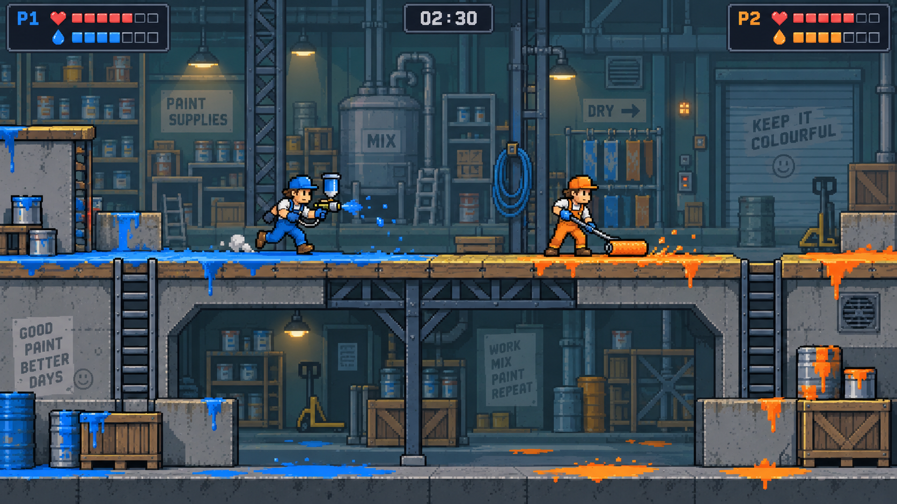

# Workshop style candidate

First candidate created on 2026-10-08 for sections 1 and 4 of
[the polish plan](polish-plan.md). This records a direction to test, not an
accepted runtime art set or an arena blockout.

The source is [workshop-reference.png](../game/art/polish/workshop-reference.png),
generated with the built-in imagegen tool from this retained
[prompt](../game/art/polish/workshop-reference-prompt.txt). It is 1672 by 941 pixels.
Keep it outside runtime content and the release package. The image is a flattened
concept source; it is not an editable layered sprite sheet or a reproducible atlas.

## Direction to carry into a native-pixel study

- Workshop painters with gloves, boots and overalls; a readable face and head
  silhouette, and team regions that can be recoloured independently of hardware.
- A compact pressure-fed sprayer with a visible reservoir, and a long-handled
  decorator's roller. Design the hand grips and tool movement with the character.
- Quiet slate/teal shelves and machinery behind timber caps, concrete scoring
  faces and supported steelwork. Use the mixing tank, drying racks and loading
  door as recognisable landmarks.
- Saturated team paint on exposed scoring faces; restrained neutral contact
  puffs so a foot landing does not imply newly captured paint.
- Dark HUD plaques with a player number and separate health/paint symbols.
  Preserve exact ammunition and health information when producing the real UI.

## Candidate grid and framing

Try **four world units per native texel** first. The current 52 by 120 player
rectangle then gives a 13 by 30 texel body study. This is an authoring experiment;
collision dimensions remain gameplay data. Start with a one-texel outer outline
and three shade steps per material. Larger silhouettes and fewer interior marks
take precedence over fitting every detail from the reference.

With the implemented camera framing, the corresponding native canvases are:

| Layout | World extent per pane | Native canvas at 4 world units/texel |
|---|---|---|
| One player | 1920 by 1080 | 480 by 270 |
| Two players | 1920 by 540 | 480 by 135 |
| Three/four players | 960 by 540 | 240 by 135 |

One native texel would occupy 2.667 screen pixels at 720p, 4 at 1080p and 5.333
at QHD under the current resolution-independent camera. The player's screen
height stays 80, 120 and 160 pixels respectively across layouts; split-screen
reduces visible world, not character size. A complete concept image shrunk to fit
a four-player pane would therefore be the wrong scale test. Review a world crop
at the pane's actual extent instead.

Keep point sampling and continuous simulation aim while prototyping. Integer
scaling, camera alignment, aimed-pose quantisation and any letterboxing policy
are still decisions to test with motion. Do not infer pixel stability from this
still image or quantise the gameplay aim to suit artwork.

## Review of this candidate and required corrections

The tool silhouettes, timber/concrete separation and workshop landmarks make
the proposed direction inspectable. The painter faces and bright paint stand
out against the cooler rear wall. These are useful qualities to retain.

The generator did **not** deliver the requested exact 480 by 270 native grid
enlarged to 1920 by 1080. Character proportions, fine outlines, light gradients
and pixel cluster sizes vary. Background signage and shelf detail compete for
attention. Reauthor deliberate pixel shapes; downsampling this picture is not
the production art pass.

The pictured ladders are not a supported gameplay object and imply climbing.
Replace traversal suggestions with the accepted platforms/ramps in the actual
blockout. Decorative ladders, if retained, must be visibly inaccessible. The
paint on floor props and decorative faces is also illustrative, not a scoring
specification. Runtime paint must follow the actual exposed ownership faces.

The two plaques illustrate visual hierarchy only. They do not approve a new
HUD layout, font licence, colour palette or player-identity system. The image's
blue/orange colours are approximate and have not been checked against the three
runtime palettes. Same-team differentiation still needs a marker study.

Next, author a small editable, grid-exact character/sprayer/roller/platform kit
and a reproducible atlas; place it in a gameplay composition under the real
camera. Review one and four views at 720p, 1080p and QHD, all three palettes,
left/right facing, aim sweeps, slow camera movement and heavily painted terrain.
The reference is a starting point for that work, not evidence that those checks
passed. Final sprite grid, typography, weapon rotation and art acceptance remain
open, as do the Close Quarters route and physical-controller playtest gates.
