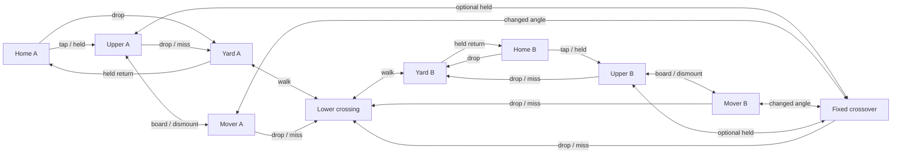

# Turbulence: route and score brief

**Static candidate, authored 2026-10-26.**
[Turbulence Yard](../game/content/levels/turbulence_blockout.json) is the next
`POL#21` blockout, beside the preserved `turbulence.json`, under the
[blockout scope](polish-plan.md#turbulence-blockout-work-pol21). Keep the current
P3 movement, five-tool values, Crossfeed and earlier arenas unchanged. The
candidate is explicit-only with `include_in_random: false`. Its first skeleton
contains neither movers nor scored rotated structures; those retain the
capability and placement checks below.

The separate explicit-only [mover comparison](../game/content/levels/turbulence_mover_trial.json)
adds the qualified horizontal pair beside that preserved skeleton. It is a
playable blockout comparison, with its measured local role below. The separate
explicit-only [scored-slab comparison](../game/content/levels/turbulence_slab_trial.json)
adds the qualified fixed pair to that mover layout. Core, routes, native
composition, replay and the bounded four-geometry tool comparison are qualified;
broader placement pressure and attended balance remain open.

**Selectable slab trial, 2026-10-26.** The actual editor loaded the qualified
private 24-object candidate, set its display name to **Turbulence Yard - Slab
Trial**, saved it into source and reopened it unchanged. The registration API
then added exactly one manifest name and one runtime asset path. All eight
earlier level files, tuning and presentation remain byte-identical; the new
file preserves all 22 mover-trial objects and the private candidate's two
fixed slabs. There are nine explicit selections and the same four Random
arenas. This is a playable comparison, pending arena selection and balance.

Both presets build and pass startup with audio, isolated save, DPI awareness
and graceful shutdown. The read-only `turbulence_slab_stage` case loads the
actual registered catalog and drives four fresh public 1/2/3/4P matches per
preset through count-in, time-up, overview and finish. Each takes 543 updates:
active at 181, time-up at 301 and overview at 422. Static/slab geometry and
paint remain unchanged; original movers retain their local paint while moving.
Both presets also pass stage selection, all 19 source/staged/template format
checks, terrain material/score/shadow checks and the full fixed-slab case. The
new trial uses the same strict untinted, cloudless paper policy as the two
earlier Turbulence blockouts; finished-arena cloud rules remain intact.
These neutral CPU endings establish roster, score, camera and transition
preconditions, without native ending pixels or attended play claims.

Receipts: `out/validation/overnight-20261026/phase16/registration/` and
`phase16/public-stage/` (Release `turbulence-slab-stage-41768`, Debug
`turbulence-slab-stage-35412`). The authoring tool requires explicit
`--author-preview` and `--apply` modes; normal consumer checks cannot execute it.

## Question and research transfer

**Take the short exposed upper crossing now, wait for a moving change of angle,
or descend to paint and approach from below?**

The loading-yard subject is expressed through the approved Tool Props kit:
offset ruler gantries above connected walking ground, with eraser freight
blocks separating approaches. Machinery is scenery. There is no wind, lift,
crushing route or moving rotation in this brief.

This applies the recorded [H1-H8 criteria](level-design-research.md#criteria-for-the-original-new-map):
TowerFall's connected spaces inform reconnecting approaches; Splatoon's joint
weapon/geography design informs the firing and paint stations; INVERSUS informs
the short-route/changed-angle choice; N++ informs repeated, recoverable
landings. These are our design inferences from the recorded research, not new
observations or imported geometry. Do not use the research's pre-P3 jump range
as a current reach guarantee.

## Directed routes before dimensions

Reflect gameplay geometry and whole player bodies about the centre line. Use
the same names with suffix A/B; every connection below applies on both sides.
Offset platforms describe the stepped vertical arrangement, not an unmeasured
side advantage. Exact coordinates, travel and timing follow real-Player trials.

| Connection | Importance | Input family and intended landing |
|---|---|---|
| Home -> lower yard | Required departure | Drop through the home ruler, then walk; a stationary player can choose and take this route. |
| Lower yard -> central lower crossing -> far lower yard | Required contest route | Walk, using supported ramps for elevation changes; space to stop and reverse behind solid freight blocks. Never requires boarding or waiting for a mover. |
| Lower yard -> home | Recovery / return | Held jump through home support; provide a clear takeoff and braking area. |
| Home -> side step -> upper approach | Optional second departure | Tap then held jump; stop or reverse at the upper approach before committing to centre. It leaves home through a different opening from the lower departure. |
| Upper approach -> fixed crossover -> opposite upper approach | Optional short exposed crossing | Held jump between fixed landings; continue or brake on the receiving landing. A solid centre baffle interrupts a single straight lane between both homes. |
| Upper approach -> mover -> crossover flank | Optional change of angle | Held boarding jump, carried horizontal interval, then tap/held dismount as measured. Stop or reverse on the receiver; no launch-velocity inheritance is assumed. |
| Crossover / mover / upper approach -> lower crossing or yard | Recovery after retreat, failed boarding or missed landing | Walk off or drop into supported lower space; rejoin the required route without respawn. Do not place a pit under an optional crossing. |
| Lower crossing -> own yard -> home -> side step -> own upper approach | Optional return to height | Walk back, held return to home, tap then held; the longer static recovery avoids an inner ladder obstructing the walking corridor. |

The graph is an authoring contract, not evidence that any edge is achievable.
The fixed skeleton must work before adding movers. Check full-body clearance,
rest/intermediate/full-speed approaches, +/-2 input ticks and receiving space
for continuing, stopping and reversing. A successful touch does not qualify a
landing. Avoid the narrow-full-speed-stop problem recorded in Crossfeed.

## First static geometry

Coordinates are world units, Y downward. Reflect rectangles by
`x_b = 4000 - x_a - width`, and reflect whole spawn bodies by their width.

| Piece | A / centre rectangle (X, Y, W, H) | Initial role |
|---|---|---|
| Ground | 0, 1280, 4000, 400 | Continuous scored walking floor, exposed top only. |
| Home floor / roof | 0, 1120, 600, 10 / 0, 960, 480, 10 | Static one-way rulers; ordinary tops score. |
| Side step | 600, 1040, 280, 80 | 80-unit tap departure. |
| Upper approach | 880, 880, 360, 80 | Held 160 rise from the side step, then a controlled stop. |
| Lower bed | 1260, 1200, 320, 80 | Walkable low firing break; exposed faces score. |
| Bed ascent / descent | 1100, 1200, 160, 80 / 1580, 1200, 160, 80 | Mirrored existing ramps; support players but pass paint. |
| Crossover half | 1400, 800, 540, 80 | Optional 160-gap / 80-rise connection from the upper approach. |
| Centre baffle | 1940, 720, 120, 160 | Upper firing break and optional controlled 80-unit tap crossing. |

There are 20 collision objects, including two unscored perimeter walls. Spawns
are A top-left X=30/150/270/390, Y=1000 and the corresponding reflected B
bodies. Bounds are (-100,-100,4200,1900); camera/overview bounds are
(0,360,4000,1020). The proposed top margin is not native framing evidence.
The 120-wide baffle has only 68 units of whole-body positioning space; it is
a controlled tap landing, not a promised full-speed braking destination.

The source was created through `LevelDocument::create`, palette/setter calls,
save and reopen, with resolved existing resources and byte-identical earlier
arena files. `ColourWarsRegisterStage` previewed and applied its manifest and
runtime-asset additions. The bounded authoring/registration receipts are under
`out/validation/overnight-20261026/turbulence-author/`; this was the actual
editor document pipeline, not an attended GUI handling session.

## Spawns and pressure stations

Each home has four distinct, supported, nonoverlapping full-body spawn slots,
using the current player dimensions. Reflect positions by the body's width,
not just its top-left point. Keep every body inside the bounds, clear of solids
and the full mover/standing envelopes. Home floors and roofs remain static.

The lower drop opens behind a solid freight baffle; the upper departure leaves
on its other side/height after the side step. Give each exit a waiting/reversal
space outside the four spawn slots. Ramps and one-way support alone do not
establish projectile shielding; use the actual solid/projectile geometry.

Name stations at each home exit, each upper receiver, both ends of the fixed
crossover, the lower centre cover and each mover endpoint. From the opposing
stations, sample standing, jumping and moving fire with all five tools at all
four spawn bodies and both departure mouths. Record which exits one position
threatens, the warning/escape interval and the approach needed to gain it.
Reject geometry that lets one centre holder cover both departures and their
retreat at once. The samples will not prove universal spawn safety.

## Regional and face paint budget

These are initial **design allocations of exposed scored area**, totalling
100%, before geometry exists; they are neither measurements nor balance gates.

| Region | Target share | Route and painting reason |
|---|---:|---|
| Home A / Home B | 12% each | Ordinary home floor/roof tops score. Repainting here trades travel time for time away from the contest. |
| Yard and upper approach A / B | 22% each | Connected Roller walking paint plus scored baffle faces and upper landings; two attack angles reconnect here. |
| Lower central crossing | 12% | Accessible contest paint behind intermittent solid cover; no uninterrupted end-to-end shooting tunnel. |
| Fixed upper crossover and both movers | 20% total | More exposed paint and changed angles, without making height alone decide the surface score. |

Start with approximately 75% tops, 15% undersides and 10% walls across those
regions. Ordinary floors and raised tops accept paint; perimeter boundaries or
buried foundations may be unscored for their physical role. Do not ban home
paint to repair a safe-loop problem. Diagnose travel/repaint cost and exposure.

Reconcile object/region/face strips with runtime paint tiles after occlusion.
Assign a mover's local scored faces once to its owning region; motion does not
mint area or change ownership. Also report its occupied world region at sample
phases so a local budget does not conceal paint carried into a sheltered area.
Measure complete walking loops, paint per traversal/tank and the time to contest
or repaint each region from all spawn slots before revising these targets.

**Initial measured geography.** The static candidate exposes 12,400 units of
scoring edge, or 148,800 area at the unchanged 12-unit thickness. Runtime tiles
and independent exposed-face counts agree: tops 103,680 (69.68%), undersides
29,760 (20.00%), walls 15,360 (10.32%). The regional partition is:

| Region | Measured area | Share |
|---|---:|---:|
| Home A / B | 20,160 each | 13.55% each |
| Approach A / B | 25,200 each | 16.94% each |
| Lower contest | 25,440 | 17.10% |
| Upper crossing | 32,640 | 21.94% |

These differ from the pre-geometry allocations: less approach/top paint, more
lower-contest/underside paint. Keep that difference as a pressure/repaint
question; it does not by itself justify changing tuning or banning floor paint.
The case writes `turbulence-blockout-faces.csv` and
`turbulence-blockout-regions.csv` beside its acceptance executable.

## Why the new geometry earns its place

**One horizontal mover per side, mirrored as a pair.** Each traverses an open
upper side bay and offers a flank landing with a different line onto the
crossover's scored faces. It must earn that angle against waiting and exposure;
it does not open the only exit, shorten the only recovery or carry spawn cover.
The fixed upper route remains an immediate alternative. At endpoints, midtravel
and reversals, misses fall to the lower route, with no closing standing corridor.
Choose travel, period and mirrored initial phases only after comparing both
sides' boarding/waiting/exposure windows. Use only the existing horizontal
triangular motion, through the qualified public loader/editor path.

**Isolated mover proposal, 2026-10-26.** The optional `turbulence_movers`
acceptance case adds two one-way public-palette paintables in a saved/reopened
`LevelDocument`: A anchor `(600,720,320,20)`, B anchor `(2760,720,320,20)`,
320-unit horizontal travel, four-second period and phases 0/0.5. The original
twenty collision objects, spawns, bounds and unrelated metadata remain equal;
all seven source arena files and tuning remain byte-identical. Fresh public
`LevelBuilder` loads pass with 1/4 actual players and the unchanged 181-update
count-in. Debug and Release each pass the explicit `--routes` matrix of 26
real-Level trials: 24 rides across four authored phases, -2/0/+2 input margins
and both sides, plus two tap-miss controls. One held boarding jump, personal
braking, 244 carried updates through two reversals, paid Sprayer paint credited
to raw keyboard slot 4, inward waiting and jump to the fixed crossover or
one-way drop, and ordinary home/lower-route recovery all pass without
post-construction placement or respawn. Actual local scoring adds 16,320 area:
total 165,120, tops 111,360, undersides 37,440 and walls 16,320. The upper-role
budget is 48,960/165,120 (29.65%), above the initial 20% target; the added faces
are fully counted. Receipts are under
`out/validation/overnight-20261026/phase7/`, including `author-run.log`,
`movers-routes-debug.log`, `movers-routes-release.log` and their per-trial CSVs.
The optional case authors a fresh trial in its receipt directory when no staged
default exists; both-preset default invocations also pass their six focused
routes and actual author/save/reopen checks. An explicit input path remains
authoritative. The qualified source is registered separately as the explicit-only
`turbulence_mover_trial`, preserving the static candidate. Debug `--replay` also
passes two fresh seeded
public disk rebuilds from decoded tape settings, seed and timestep: A's
wait/jump route matches all 788 active updates and thirteen checkpoints; B's
drop route matches all 619 active updates and ten checkpoints. Each run compares
the initial state, all 186 source countdown/settling updates, every active
fingerprint, final state, terminal RNG and unchanged editor source bytes.
Paid raw-slot local paint, two carried reversals, release and lower-route
recovery are exercised. This standalone harness explicitly repeats its source
priming before applying the active-input tape; unmodified DebugDirector
fresh-launch playback is not qualified. Receipts are in
`out/validation/overnight-20261026/phase8/replay-debug.log` and
`replay/x64-debug/turbulence-movers-30764/` beneath that phase directory.
Release `--replay` reports its explicit Debug-tools limit. The bounded local
five-tool comparison below qualifies a Sniper paint angle; attended play and
the increased upper score share remain unaccepted. Route and paint-credit
success alone do not establish competitive value or safety at both departures.

**Private mover native composition, 2026-10-26.**
`check-painter.ps1 -TurbulenceMoverOnly -TrialPath <saved-trial.json>` passes in
Debug and Release at 1280x720, using a private registry without changing the
shipped registration. Each preset records 33 full frames, 81 native crops/CSV
rows, 67 readbacks and eight actual Levels: one/two/three/four players,
clean/heavy paint, outer waiting, an inward commitment
window, the carried inner reversal and the outward ride. An isolated actual
StagePreview supplies the thirty-third frame. Owner-bound moving shadows follow
the production builder path; repeated draws preserve observed motion, local
paint, credit, carrier, shadow/cull bounds, actual Scene views, pixels and RNG,
with Debug fingerprints checked where built.

Every gameplay pane includes the whole player and an immediate supported upper
escape. The full crossover landing patch is required during the measured inward
window; outer waiting/ride frames make no promise that the distant landing is
visible or reachable at that instant. The post-run verifier independently
reconstructs phase, offsets, support/shadow/pane geometry and compares every crop
RGB row with its source frame. Source trial hashes remain equal before/after.
The all-layout receipts are in
`out/validation/overnight-20261026/phase9/mover-all-layouts/`, with 4,792 updates
and 64 controlled heavy contacts per preset; the earlier one/four-player
receipts remain under `phase8/mover-native-v2/`. The independent verifier
checks the two-player halves and three-player TL/BR/BL pane order as well as
full-screen/quadrant layouts. Representative clean one/two-player and heavy
three/four-player frames were visually inspected. These controlled hidden native captures establish
composition and state preservation; attended readability, route cost, pressure,
balance, physical pads and performance remain separate.

**Bounded forward-pressure comparison, 2026-10-26 (Release).**
The proposal's `--pressure` mode passes 280 own-mover samples (five tools,
two sides, four authored phases and seven opposing home/departure/receiver
bodies), plus 70 original-static upper-approach controls. Each uses actual
editor validate/save/reopen, a public two-player LevelBuilder, the full
181-update count-in, neutral readiness, one paid fixed-aim pulse and 180
observation updates. All 350 distant forward samples miss within that window;
no projectile remains at the end. Two separate mirrored ground-level Sniper
controls at 300-unit separation both cause real nonfatal health loss at update
6, leaving 0.666 health. The complete run uses 352 paid pulses and 143,992
updates, including 842 for those positive controls.

Receipts in `out/validation/overnight-20261026/phase8/pressure-v4/x64-release/`
separate the 280 mover rows, 70 static rows and two positive controls. Source
stage bytes remain equal. The neutral target oracle checks its exact physical
foot plane, X and body size plus supported state; a one-ULP top-coordinate
reconstruction on solid support is not treated as movement. Projectile counts
are public snapshots, without launch/trajectory attribution. These samples
cover cross-arena forward fire from each team's own half. They establish
neither invader camping pressure nor useful local flank value, universal spawn
safety, tracking, sustained fire, human warning time or competitive balance.

**Local crossover role and unoccupied paint controls, 2026-10-26 (Release).**
`--local-roles` passes 50 occupied single-pulse scenes and 50 separate unoccupied
paint controls: each family has five tools, two sides, four mover phases and
one matched original-static upper-approach control per tool/side. These use
valid original-spawn public LevelBuilder construction and the full count-in,
then one controlled source placement (and an opposing crossover defender in
the occupied family) before readiness. The 100 scenes use 40,900 updates and
150 public setup placements. Every subsequent readiness/observation update
uses real support, carry, weapons and contacts; no placement occurs during
those intervals. These combat stations do not measure the travel cost to earn
them; the separate driven routes qualify boarding and recovery.

The occupied family records 14/40 mover and 4/10 static health-loss witnesses.
Sniper hits from all four mover phases on each side and from each static
control; Mister hits from three mover phases per side and each static control.
The other three tools miss the stationary defender at this initial separation.
Those counts are samples of a single paid pulse, fixed initial aim and seed,
with a neutral defender; they are not competitive rankings.

In fresh one-player controls, the fixed aim point is the crossover top centre
`(1520,800)` or its mirror. The public paint collector identifies the actual
crossover and its local face, team and raw keyboard-slot credit. Sniper paints
288 top area from every sampled mover phase, versus zero crossover paint from
the static approach: this is the concrete changed paint angle. Mister paints
240/288 top area in two mover phases per side, versus 48 from the static
control. Sprayer and Bucket instead favour this static station: Sprayer paints
144 wall plus 48 underside area there and no crossover face from the movers;
Bucket paints 48 top, 864 wall and 48 underside area there and none from the
movers. Roller paints neither
receiver at this fixed-point separation. No extra pulse is added to force a
miss into a hit, and samples are separate scenes rather than summed match score.

Receipts in `out/validation/overnight-20261026/phase8/local-roles-v2/x64-release/`
separate occupied health/paint observations from `local-paint.csv` and their
per-tool summaries. They retain actual firing poses/phases, ammunition,
per-face credit, first paint and public projectile-count snapshots. The
proposal therefore offers a phase-dependent optional route and a measured
Sniper top-paint angle, without supplying a general five-tool advantage.
Pressure under tracking, invader camping, persistent return fire, opposed
recovery and attended value/readability remain unqualified. All seven earlier
arenas and P3/five-tool tuning are preserved.

The playable comparison was freshly authored through the same document pipeline
and has exactly the qualified trial's bytes. The registration CLI preview and
apply add only its manifest/runtime-asset entries. Both game builds and focused
`moving_structure`, `stage_selection`, `level_format`, `turbulence_blockout`,
`turbulence_movers` and manifest-wide `terrain` checks pass. Terrain checks
retain anchored material/miniature geometry and independently translated world
collider/shadow bounds for movers; the paper-only backdrop contract remains
exact. Both isolated SystemOnlyPath startups pass with the accepted audio bank,
per-monitor DPI awareness and graceful shutdown. Receipts are under
`phase8/registered-mover/`, `registered-mover-followup-v2/` and
`registered-startup/` in the same overnight validation directory. Random still
has four candidates among eight explicit stages.

A local Release ZIP at revision `57865ad0` also passes the CI file/audio/console
inspection and isolated extracted-package SystemOnlyPath startup. Its 62 files
include byte-identical mover content, manifest and tuning, with the accepted
bank and no development executables/audio. The ZIP and inspection receipt are
under `out/validation/overnight-20261026/phase9/release-package/`; this is local
packaging evidence, not the clean Windows machine acceptance in `ROAD#1`.

**A mirrored pair of fixed sloping scored slabs at the crossover shoulders.**
The intended role is a walkable retreat from an upper receiver toward the lower
crossing while presenting a paintable underside to the lower approach. A solid
slab also breaks a level firing line; an existing ramp passes paint and cannot
provide that combined job. Select one shallow fixed orientation and footprint
after the static route trial, then define support, projectile contact and local
face scoring before implementation. If a flat solid plus existing ramp provides
the same route and shot windows, retain that simpler construction and record why
rotation was unnecessary. No arbitrary or animated rotation follows from this.

**Isolated composite shoulder trial, 2026-10-26.** Before adding a new shape,
the optional `turbulence_slopes` case authors a comparison through the actual
editor palette and setters. It appends two existing 160-by-80 ramps across
the shoulder gaps and two ordinary solid paintable shoes immediately beneath
them: A shoe `(1240,880,160,24)`, B `(2600,880,160,24)`. The ramps rise toward
the fixed crossover. They retain their existing unscored, paint-pass contract;
the shoes retain all ordinary exposed flat faces, including their reachable
tops. This is a compound construction, without sloped-face scoring or an
equivalence claim for a rotated slab.

Debug and Release pass actual save/reopen and fresh public 1/4-player loads,
the unchanged 181-update count-in and twelve neutral updates. Independent
unit-edge occupancy, editor strips and every runtime source/face agree at
172,800 total: a net 7,680 above the mover comparison. Each shoe contributes
1,920 top, 1,920 bottom and 288 exposed-end area; its other end is buried and
the adjacent old approach loses 288 end area. No reachable paint is hidden
to make the budget resemble the earlier target.

Both presets also pass twelve mirrored uphill/downhill shoulder trials and
two original home/lower crossings, totalling 7,408 updates. Personal speed
marks 0/415/800 come from actual input; the uphill 800 mark can occur on the
ramp rather than before entry. The rest-start cases stop with the whole body
on the ramp; all cases stop on the flat receiver and recover the original
lower bed. No jump, velocity setter or post-construction placement is used.
All eight source arenas, the original twenty-two objects and tuning remain
unchanged. Receipts are under
`out/validation/overnight-20261026/phase9/shoulder-trial-v2/`.

The case is available explicitly, outside the default CI inventory, and authors
its fresh candidate in its receipt directory. It registers no game content.
The controlled Sniper checks below qualify one blocked line and reachable top
paint; the later five-tool comparison qualifies the recorded fixed stations.
Comparison with a scored slab and attended value remain open before selecting
the geometry.

**Composite shot/paint controls, 2026-10-26.** Both presets pass the separate
`--tools` mode's six real LevelBuilder scenes, 2,526 updates and ten controlled
placements after the full count-in and before neutral readiness. Each side has
a two-player shoe-present scene, a matched scene whose editor document removes
only that shoe, and a fresh solo top-paint scene. All actors remain supported;
one ready Sniper pulse is paid and released, then observed for 180 updates.
No actor is moved during readiness or observation.

From the original lower bed at centre 1320 (or its mirror), the intact shoe
gains 288 owned underside area at update 4 and the defender standing on the
ramp keeps full health. Without that shoe, the same shot passes the existing
ramp and causes nonfatal health loss at update 7, leaving 0.666 health. A solo
source on the original upper approach at centre 1160 (or its mirror) paints
288 shoe-top area at update 4, credited to raw keyboard slot 4. All six shots
cost 0.3 reserve and naturally recover full reserve by the observation end.

Receipts are under
`out/validation/overnight-20261026/phase9/shoulder-tools-v2/`. The separate
station-preflight CSV labels rejected crossover-origin proposals as geometric
analysis, without pretending they were fired trials. Public projectile counts
are snapshots, not a continuous trajectory trace. These controlled samples
establish the flat shoe's underside blocking/painting and reachable top in the
existing paint-pass ramp construction. They do not qualify sloped-face score,
rotated-slab equivalence, other weapons/aims, earned travel, human response or
competitive value. All eight source arenas and tuning remain unchanged.

**Composite native descent, 2026-10-26.**
`check-painter.ps1 -TurbulenceShoulderOnly -TrialPath <isolated-trial.json>`
passes Debug and Release at 1280x720 across all 1/2/3/4-player layouts,
clean/heavy paint: 25 full frames, 61 native crops/CSV rows, 51 readbacks and
eight actual Levels per preset. The 3,080 Level updates include actual no-jump
walks from the fixed crossover to a supported whole-body ramp stop, then to
the upper flat stop. Twenty initial public placements establish the controlled
stations; there is no later placement. Bounded analog input corrections reach
the measured stopped centres within 0.04 units, with zero personal X velocity
and the actual body-edge triangle support plane, rather than a claimed centre
foot contact. Third/fourth actors wait on their static upper approaches.

Each pane contains the whole player, standing-body ramp warning patch, full
upper stop and complete shoe underside. Repeated draws preserve pixels,
public/structure observations, every world paint tile's corners, face, team,
raw owner and area, and full state for the two original movers, carrier,
shadow/cull and Scene views. Debug fingerprints and RNG are checked where
applicable. The independent verifier reconstructs triangles, shoes, support
planes and native pane geometry, then compares every retained crop RGB row
with its source frame. Seventy-two controlled contacts establish full heavy
paint; they are not weapon-efficiency samples. An actual private-registry
StagePreview supplies the final frame at authored initial poses.

Receipts are under
`out/validation/overnight-20261026/phase9/shoulder-native/`; representative clean
one-player descent and heavy three-player ramp-stop frames were visually
inspected. Source trial hashes stay equal. These are controlled hidden native
observations; endings, human readability/reaction, physical pads, listening,
performance, competitive value and a scored rotated-slab contract remain open.

**Three-geometry five-tool comparison, 2026-10-26 (Release).** The separate
`turbulence_slopes <staged-game-directory> --comparison` mode passes 60 fresh
public `LevelBuilder` scenes, 24,540 updates and 60 paid single pulses. Each
tool and side uses the same supported original upper-approach station across
the static, mover and composite candidates. An opposed two-player family aims
at a defender on the original fixed crossover; a separate solo family aims
at the fixed point `(1320,880)`, or its mirror. That point is the shoe top
only in the composite. Ninety public placements occur after the full count-in
and before readiness; there is no later placement or earned-travel measurement.
Ready health, reserves, aim, clock and paid cost match across each trio.

The opposed samples reproduce the same recorded outcomes across all three
geometries on both sides: Sniper first damages at update 7, leaving 0.666
health; Mister first damages at 48, leaving 0.98. Sprayer, stationary Roller
and Bucket cause no health loss during the 180-update observation. Each
geometry has four health-hit scenes out of ten and eight scenes with **any**
owned paint. The latter includes source-floor paint and does not mean that
eight pulses paint the intended receiver. These fixed stations show no new
opposed pressure advantage for the composite.

Fresh solo samples distinguish the flat shoe's paint role. Values below are
settled owned area per scene; both sides reproduce them. Static and mover
values agree at these particular stations, with their distinct total arena
budgets retained.

| Tool | Static / mover total | Composite total | Composite shoe-top contribution |
|---|---:|---:|---:|
| Sprayer | 240 | 240 | 240 |
| Sniper | 192 | 288 | 288 |
| Roller | 624 | 624 | 0 |
| Mister | 576 | 624 | 336 |
| Bucket | 1,200 | 1,152 | 0 |

All ten solo scenes per geometry gain some owned paint, including paint away
from the fixed target. Sprayer redistributes its sample to the shoe top;
Roller and Bucket do not paint that top. These independent scenes are not a
match-score sum, damage-efficiency or competitive-value comparison. Source and
face ordinals, raw-slot credit, optional shoe absence and the actual neutral
budgets of 148,800 / 165,120 / 172,800 remain explicit in the CSV. Public
projectile counts are snapshots, and the next-RNG value is a terminal witness,
without a full-trajectory or complete-RNG-state claim.

Receipts are under
`out/validation/overnight-20261026/phase10/shoulder-comparison/x64-release/turbulence-slopes-25784/`.
Debug compilation and the existing six-control Release `--tools` regression
pass; the extended Debug comparison was not run. All eight source arenas and
tuning remain unchanged. The composite remains isolated and unregistered.
Its qualified route, flat underside and paint role do not establish a scored
diagonal walking face or rotated-slab equivalence. The fixed-slab core and
four-geometry comparison below now qualify that distinct local role.

**Fixed scored-slab core, 2026-10-26 (Debug and Release).** The isolated trial appends two
`FixedSlabPaintable` objects to the unchanged twenty-two-object mover stage:
A top edge `(1240,880)` to `(1400,800)`, mirrored to B `(2600,800)` to
`(2760,880)`, each with 24-unit normal thickness. The body is solid to players
and paint, and its walking face itself scores. This is the bounded fixed
[capability contract](feature-roadmap.md#horizontal-movement-capability-2026-10-26),
not a claim that it outperforms the ramp-plus-flat-shoe composite.

Both game/editor builds and `fixed_slab` pass. Per preset, eighteen actual Scene courses
run 3,684 updates through mirrored driven joins, mid-slope rest/jump, solid
end caps/undersides, both object orders, pinched-ceiling stops and recovery.
Separate actual-object controls cover local score and raw-slot credit,
inverse-quad paint contact, diagonal Jet traversal, growing Spray/Mister
boxes, launch departure/crossing and nearest enemy/cover selection. The
geometry controls include 560 independent SAT probes. Exact buried-cap zero
and real small-gap score remain distinct checks.

The actual editor authors, saves and reopens the private 24-object trial.
Fresh public 1/4-player Levels per preset complete the full count-in and twelve neutral
updates each, totalling 386 updates; seven malformed/unsupported records are
refused by both editor and runtime. Every original object, spawn and retained
metadata stays unchanged. The actual scored total is 173,350.512451, against
an independent analytic 173,350.513456; local face areas, not world AABBs,
own the score. Receipts are under
`out/validation/overnight-20261026/phase11/slab-v4/x64-debug/fixed-slab-29548/`.
The Release receipt is `phase11/regression/x64-release/fixed-slab-35444/`
under the same validation root.
All eight source stages and tuning remain unchanged; this slab trial is not
registered. The full editor suite/hidden-window checks and twelve
focused existing consumer cases also pass in both presets.

The separate Scene courses alone do not establish a full public-loader driven
route or replay. Native composition and a partial local Roller paint role are
qualified below. Broader five-tool pressure and attended value remain separate
slices before geometry selection. `POL#21` and `GAP#D5` remain open.

**Native fixed-slab composition, 2026-10-26 (Debug and Release).**
`check-painter.ps1 -TurbulenceSlabOnly -TrialPath <private-trial.json>` passes
on the RTX 5080/D3D11 at 1280x720. Each preset retains 29 full frames,
71 native pane crops/CSV rows, 59 readbacks and eight actual Levels. Twenty
initial public placements establish the stations; 3,080 ordinary Level updates
then drive the crossover descent, whole-body slab stop and upper-flat stop.
All 1/2/3/4-player layouts have clean/heavy pairs at those three phases, plus
four immediate wet midpoint frames and an isolated StagePreview.

The 80 controlled paint contacts include eight friendly wet repaints. They
preserve tile ownership, local areas and personal poses. The subsequent actual
walk outlasts the wet/splash duration before the last capture. Repeated draws
preserve observed public state, collider/material and real shadow bounds,
every published tile corner/face/team/raw owner/area, mover/carrier/view state,
pixels, RNG and Debug fingerprints. Native RGBA crops and an independent
retained-RGB row comparison agree with their full frames.

The first native run exposed white primer pinholes between independently
rounded rotated tiles. The rigid painter now draws contiguous same-team bases
as complete bands, with individual wet highlights; scoring tiles and credit
remain separate. Six independently classified interior probes change from
white to team blue in the retained before/after frames. A seventh candidate
lies outside the geometric band and is excluded from that assertion. Settled
one-player paint, fresh four-player wet paint and the miniature were visually
inspected. This qualifies those bounded raster samples, without a universal
pixel-seam or animation-lifetime claim.

Final receipts are under `out/validation/overnight-20261026/phase12/slab-native/`:
Debug `993662f0a8dd4927b81575dec8945de7`, Release
`eaa33d9da0104a44ab47b5453a22bf4b`. The old composite's Release native check
also passes after the shared fixture changes. Both normal-bank, isolated-save,
SystemOnlyPath startup checks pass. The slab remains private and unregistered;
public driven replay, broader pressure and attended acceptance remain separate
qualifications. The local Roller role below uses actual public-loader routes.

**Registered slab endings, 2026-10-26 (Debug and Release).** The same native
leaf now also inspects two fresh 0.75-second matches from the registered
stage's actual spawns: 1P clean and 4P controlled-heavy. Each reaches the real
overview at update 347 and finishes at 468. Its actual `LevelEndInfo` supplies
`Session::finish_round` and a real `EndMenuInitial` over the finished Level.
This inspects result-derived menu composition without claiming the intervening
`GameLevel` results-navigation path was driven.

Each preset passes 33 full frames, 75 native crops/CSV rows, 67 reads and ten
fresh Levels. The original 29-frame gameplay/preview/wet/pinhole controls are
retained; four ending frames and a separate four-row CSV are added. Actual
updates total 4,016, including 936 for the two short endings. Initial placements
stay at twenty; controlled paint contacts total 98. Native crop RGB matches
its retained full frame. Frozen repeated drawing preserves the complete paint,
collider/shadow, result and Session state, pixels and RNG; Debug also checks
the replay fingerprint.

Root inspected the clean whole-stage overview and heavy four-player end menu:
the stage is framed and menu copy fits. These are controlled hidden captures,
without attended readability, balance, physical-pad or performance acceptance.
Receipts: `out/validation/overnight-20261026/phase17/slab-native/`, Release
`7601c0dc393645e9bd48ae8bec2ea0c7`, Debug `817d052a0b6f4947901f64828ededb8f`.

**Lower-approach underside control, 2026-10-26 (Debug and Release).** Four
fresh public Levels compare both sides with the solid slab and with only that
slab replaced by an existing unscored, paint-pass ramp sharing its support
segment. The actual editor saves/reopens each variant and preserves the
original 22 objects and opposite slab. Legal source spawns put the Sniper on
the lower bed; one public defender placement after count-in establishes the
upper station before sixty readiness updates. Each scene then observes one
paid upward pulse for 180 updates. Total updates are 1,684, with four setup
placements and none after readiness; earned access is not claimed.

The solid protects the player above: health stays 1, while the pulse owns
48.844513 of local underside area on each side and no other face. First paint
is update 6 on A and 5 on B; this one-update asymmetry is retained. In the
paint-pass controls, the same paid pulse first damages the player at update 7,
leaving 0.666 health, and owns no surface. Actual ready poses match within
0.002 world units, with the same health, reserve, aim and step. All sources
recover full reserve and all projectiles retire within the observation.

This supplies the brief's local scored-underside/cover role from below. The
two geometries have different score budgets; this is a controlled interception
comparison, without normalized efficiency, tracking, sustained counterfire,
opposed survival or human-balance claims. Outcomes, faces and complete pose
receipts are byte-identical between these Debug/Release runs, without a general
cross-build determinism claim. Receipts: `out/validation/overnight-20261026/phase17/lower-tools/`,
Release `turbulence-slab-tools-5100`, Debug `turbulence-slab-tools-2908`.

**Public driven Roller comparison, 2026-10-26 (Debug and Release).**
The optional `turbulence_slab_routes` case passes eight fresh public Levels:
slab/composite, both mirrored sides and both walking directions. Private
editor-authored spawn variants establish the upper approach at centre 1160,
feet 880, or the crossover at centre 1540, feet 800; B mirrors those stations.
There is no later placement, velocity edit or jump input. Each scene completes
181 count-in and 60 neutral readiness updates, one held-fire walk, seventeen
release/braking updates and 180 quiet updates. All original twenty-two objects,
both input candidates, source stages and tuning remain unchanged.

The eight scenes total 3,824 updates and 320 actual paid firing updates.
Readiness is checked before each tick and reconciled against its actual ammo
debit; holding the presentation firing flag is not counted as payment. Matched
geometries start at the same actual pose, health and full reserve. Both sides
reproduce the following settled **receiver-top** areas; the slab's receiver is
its diagonal walking face, while the composite's is the flat shoe below its
unscored ramp.

| Direction | Paid updates per scene | Slab top area | Composite shoe-top area |
|---|---:|---:|---:|
| Uphill | 39 | 1,170.886414 | 576 |
| Downhill | 41 | 97.573868 | 0 |

Uphill slab samples also paint 48 on the exposed end cap. No sample paints the
receiver underside. The CSV records original upper/crossover faces and total
owned area separately, retaining each geometry's different score budget.
Arrival reserves are about 0.844 uphill and 0.836 downhill in both geometries;
all scenes recover full reserve, full health and supported endpoints. Slab
routes have zero airborne walking updates. Each composite downhill route has
ten airborne updates despite zero jump inputs, then lands and stops normally.
This is a measured contact difference, without a human comfort claim.

The result establishes a partial diagonal-face paint role during these paid
walks. It does not establish full-face coverage, damage efficiency, opposed
survival, a universal weapon advantage or competitive value. Receipts are under
`out/validation/overnight-20261026/phase13/roller/`: Debug
`x64-debug/turbulence-slab-routes-17364`, Release
`x64-release/turbulence-slab-routes-17176`. Compile the available-only case with
`run-acceptance.ps1 -Cases turbulence_slab_routes -CompileOnly`, then invoke its
executable with the staged game directory and the two private trial JSON paths.
The fresh public replay qualification follows below. The remaining five-tool
pressure comparison belongs to the arena work.

**Fresh public replay, 2026-10-26 (Debug).** The same case's `--replay` mode
passes four record/play pairs: A/B, uphill/downhill. Production
`ReplayRecorder`, codec and `ReplayPlayer` handle 1,192 actual tape updates,
with sixteen checkpoints. A fresh factory rereads each private stage from disk
using decoded stage/setup/seed/step metadata. It compares all observed match
fingerprint fields and every paint quad, local area, face, team, raw owner and
source ordinal on every update, plus final state, paid firing and a terminal
RNG witness. Playback starts with neutral inputs and checks the actual
post-player-filter input against the decoded tape.

The first 180 countdown updates do not call `SeatInputFilter`. They are actual
cold priming observations in separate receipts, not invented tape inputs.
Each fresh rebuild compares its initial observation and all 180 priming
observations before the 297-update uphill or 299-update downhill tape.
The four pairs use 1,912 recording and 1,912 playback Level updates. Four
malformed-input codec controls and one fresh wrong-checkpoint control pass;
the latter adds 240 updates, for 4,064 actual updates in total.

Receipts: `out/validation/overnight-20261026/phase15/replay/x64-debug/turbulence-slab-routes-42640/`.
After adding the hooks, the default Release comparison's entire CSV and trace
remain byte-identical to the earlier qualified outputs. Release explicitly
rejects `--replay`. This qualifies the standalone public factory with its
explicit priming; it does not qualify unmodified DebugDirector cold playback,
cross-build determinism or human acceptance. The bounded `GAP#D5` capability
work is complete; arena selection and pressure remain `POL#21`.

**Four-geometry station comparison, 2026-10-26 (Release).** The optional
`turbulence_slopes <content> <shoulder.json> --comparison <slab.json>` form
adds the fixed slab to the same existing station family. Eighty fresh public
Levels use 32,720 updates, 120 pre-readiness placements and eighty paid single
pulses. Initial source/defender poses, health, ready reserves and fixed aims
match across static, mover, composite and slab geometries. No participant
tracks, moves after setup or fires a second pulse.

Both sides reproduce unchanged target-health results at the opposed crossover:
Sniper first damages at update 7, leaving 0.666 health; Mister at 48, leaving
0.98. Sprayer, stationary Roller and Bucket cause no health loss in the
180-update observation. Each geometry has four health-hit scenes and eight
scenes with any owned paint out of ten; all ten fresh solo scenes gain some
paint. These totals include source-floor paint and do not imply receiver hits.

For the fresh solo family, the fixed aim `(1320,880)` lies **below the slab
body**, while it is the composite shoe's top. The new slab intercepts paint
before that point. Settled owned areas below reproduce on both sides:

| Tool | Composite total | Slab total | Slab local top |
|---|---:|---:|---:|
| Sprayer | 240 | 48.787 | 48.787 |
| Sniper | 288 | 48.787 | 48.787 |
| Roller | 624 | 624 | 0 |
| Mister | 624 | 243.935 | 243.935 |
| Bucket | 1,152 | 96.787 | 48.787 |

Bucket also paints 48 on the slab's exposed end cap. None of these station
samples paints its underside. Stationary Roller paints the original floor;
its separately qualified walking role above is different. Opposed Sprayer,
Mister and Bucket samples paint slab-top areas of 48.787 / 97.574 / 48.787,
replacing their earlier crossover paint without improving the sampled health
result. This is a changed local paint/cover role, without a global advantage
or normalized efficiency claim.

The CSV distinguishes optional shoe and slab-local sources, all four local
faces, absent-source `0/-1` values and raw-slot credit. The slab's authoritative
tile sum is 173,350.512451; the runtime float aggregation is separately
reconciled at 173,350.5. Neither is substituted for the other. Source content,
tuning and both private candidates remain unchanged.

Receipts: `out/validation/overnight-20261026/phase14/comparison/x64-release/turbulence-slopes-40872/`.
The original three-geometry CSV and summary remain byte-identical to their
earlier receipts. Release default mover/composite routes and the six Sniper
controls pass; Debug compilation passes. The extended four-geometry Debug
matrix was not run. Public snapshots and the terminal RNG witness do not
establish complete trajectories, opposed survival or human balance. The next
slice stages the qualified slab comparison explicitly and checks ending views;
it remains outside Random and outside attended arena acceptance.

## Tool and recovery hypotheses

| Tool | Stations and question |
|---|---|
| Sprayer | Yard exit -> crossover shoulder: can a moving burst contest a receiver while leaving enough tank and time to retreat behind the freight baffle? |
| Sniper | Upper receiver -> far receiver: is the short lane useful without also owning both lower departures or painting the underside? Check the centre baffle and reload/recovery exposure. |
| Roller | Home -> yard -> lower crossing -> retreat: does connected walking paint repay the longer route, and can a missed upper landing return to that work without a trap? |
| Mister | Lower cover -> shoulder underside / approaching mover: does diffusion create a distinct nearby contest without blanketing both routes from safety? Keep lifetime provisional. |
| Bucket | Yard / lower-centre cover -> upper receiver: do real arcs reach the exposed landing, and does that launch position retain an escape before a second shot? |

At these mirrored stations compare real nozzle/volume contact, stationary and
moving fire, shot cadence, cover-to-cover exposure and the shot-free retreat
interval. Record regenerated ammunition and return-to-contest time; standing
behind one block is not evidence of a useful recovery loop. Do not change P3,
Sniper reserve or Mister lifetime to make a first geometry attempt pass.

## Static qualification and next slice

The Debug and Release CPU cases qualify all eight spawns with two explicit deaths and
held-input-safe respawns each, followed by jump-free lower departures. Its
mirrored walking trial reaches the near bed at update 116, centre at 192 and
far home at 352 with zero takeoffs. It deliberately stops/brakes at intermediate
stations; these are fixture update counts, not uninterrupted match travel times.

Optional departure/recovery trials pass at -2/0/+2 input ticks. They include
the home roof rise, side-step tap, held upper approach, descent to the lower
route and the longer return through home. Fixed-crossover trials pass with
actual initial velocities 0/±415/±800 and those input margins, including a
controlled centre-baffle tap and whole-body stopped landings. No position is
injected after construction. Fresh public `LevelBuilder` loads with 1/4 players
also pass, retaining the actual sparse slots, team-local spawns, screen layout,
unchanged 181-update count-in, 12 active updates and exact neutral score.

Receipts are under `out/validation/overnight-20261026/phase2/`, in
`remaining/x64-debug/` and `release/x64-release/`. Add movers only
after runtime/schema, public replay
rebuild and editor round-trip support; add scored sloping solids only after
their separate collision/paint contract is qualified. Keep a before/after
route and budget record for those additions.

**Explicit five-tool measurements, 2026-10-26.** The separate Release
`turbulence_blockout <staged-game-directory> --tools` mode passes 20 mirrored
lower-bed/crossover firing, ordinary retreat and natural refill trials, plus
280 paid directed pulses from 40 standing holders. It uses actual weapons,
projectile contacts and ammunition, with 7,690 station updates and 8,356 threat
updates. The fast default case remains the static geometry/route check; the
larger matrix is opt-in. When invoking its executable directly, include the
staged game directory on `PATH` for its runtime DLLs.

Receipts in `out/validation/overnight-20261026/phase4/turbulence/x64-release/`
include 60 station-phase rows, 280 pulse rows, 40 holder summaries and
`turbulence-tools-summary.json`. The candidate's geographic X-band partition
is now available to the balance metrics; the station CSV instead labels its
separate object-role budget explicitly. Its paper backdrop is provisional,
without cloud or landmark acceptance; collision and scored geometry are unchanged.

These samples expose questions rather than settle pressure. From each lower
bed, Sniper's seven separately aimed shots collectively reach both departure
regions. Upper-approach Sniper samples reach spawn bodies 3/4 and Mister reaches
body 4. The centre-baffle Sniper reaches the opposite receiver. These are swept
projectile-box arrivals before retirement, without victim damage, simultaneous
coverage or a universal spawn-safety claim.

The station bursts pay for nearby paint and all refill during the shot-free
retreat/recovery window. Sprayer, Sniper and Bucket bursts at the sampled downward
angles have no surviving projectile after launch contact, so they do not yet
establish a useful receiver-contest shot. Retain these rows as the local-floor
paint baseline; the separate controls below qualify useful near-receiver work.
Do not change weapon tuning to make an exploratory fixture report a better result.

**Paired useful-role controls, 2026-10-26 (Release).** Twenty pairs add 9,026
updates with unchanged geometry and tuning. Each pair first constructs a real
opposing Player on the intended receiver and stops at its first health loss,
before an elimination. A fresh, independent scene then measures painting of the
unoccupied receiver's top, ordinary retreat and natural refill. The victim is
never moved after construction; the painting/recovery run does not claim to
continue that encounter or measure survival under return fire.

The lower source is bed A/B at mirrored centre X=1420; the target stands at
mirrored X=1780 on central ground. Its paint region is ground X=1740-2260. The upper
source is crossover A/B at mirrored X=1670; the near target stands at mirrored X=1840 on
the same crossover half. Its paint region is X=1780-1940 on A, mirrored to
X=2060-2220 on B. These are near-receiver samples, not an across-crown duel.
Tools use distinct contact/painting aims, and the Roller closes through ordinary
movement rather than being treated as a ranged tool.

| Tool | Lower / upper first-health-loss updates | Lower / upper settled receiver-top area |
|---|---:|---:|
| Sprayer | 15 / 5 | 240 / 240 |
| Sniper | 24 / 18 | 288 / 288 |
| Roller | 43 / 23 | 864 / 1,296 |
| Mister | 52 / 13 | 336 / 144 |
| Bucket | 24 / 1 | 1,248 / 1,248 |

Both sides reproduce these values. The update counts begin after 45 settling
updates and include weapon readiness/cooldown; they are not pure flight times.
Bucket's upper first hit occurs during paid launch contact, with no projectile
surviving that contact. Its separate painting run still reaches the intended
receiver. Mister's lower receiver has no paint at trigger release, then 336 held
area by retreat arrival, retaining the distinction between release and settled
paint. The ordinary retreats take 62-89 updates. Reserve at arrival spans
0.5833-1.0; every painting run reaches full reserve after 180 further quiet
updates. The target-first-contact and unoccupied painting controls do not measure
opposed retreat, damage per tank or competitive weapon value.

Receipts are under
`out/validation/overnight-20261026/phase5/turbulence-useful/x64-release/`:
`turbulence-useful-stations.csv` has 20 paired rows, alongside the retained 60
local-paint phase rows, 280 directed pulse rows and 40 holder summaries. The
updated summary distinguishes actual first-health-loss measurements from the
older virtual target-volume arrivals. Across the same 280 paid pulses, **zero
individual pulses reach both departure regions**; two Sniper holder summaries
still reach both as the union of seven separately aimed pulses. A paid Mister
pulse can contain several projectiles, so this is neither a same-instant coverage
test nor universal safety evidence. The recorded spawn/pressure questions remain.

**Single-pulse defender escape samples, 2026-10-26 (Release).** The separate
`turbulence_blockout <staged-game-directory> --escape` mode passes 60 fresh-scene
trials: the same 20 mirrored lower/upper roles, each with an idle defender,
ordinary retreat, or one jump plus retreat. Actors are constructed once; initial
bodies, health, ready ammunition and fixed aim agree across each role's three
policies. The stationary attacker pays for one trigger update, then releases;
the defender begins its policy on that same update. No actor is repositioned
after construction, and the attacker does not track the moving target.

The 13,692 updates comprise 2,892 neutral warmup updates and 10,800 observation
updates. Warmup is 45 updates per trial, or 61 for Sniper to become ready; all
trials then run 180 updates, with no additional flight tail needed within the
180-update tail cap. The following first-health-loss counts start at the paid
trigger, after readiness, and reproduce on both sides. Each cell is
idle / retreat / jump-retreat; `miss` means no measured health loss in that
bounded trial, not universal evasion.

| Tool | Lower first-health-loss updates | Upper first-health-loss updates |
|---|---|---|
| Sprayer | 15 / 19 / miss | 5 / 5 / 5 |
| Sniper | 8 / 8 / 8 | 2 / 2 / 2 |
| Roller | miss / miss / miss | miss / miss / miss |
| Mister | 52 / miss / miss | 13 / 28 / miss |
| Bucket | 24 / 33 / miss | 1 / 1 / 1, paid launch contact |

Across the 20 roles, idle policies have 16 hits / 4 misses, ordinary retreat
14 / 6, and jump-retreat 8 / 12. Bucket's six upper-policy trials damage the
target during paid launch contact, with no surviving projectile; they are not
flight-time observations. Roller remains stationary here and misses at the
initial separation; the earlier paired role separately qualifies its ordinary
closing movement. Every defender remains alive and ends supported. Ordinary
upper retreat moves 74 units before the centre baffle stops it; jump-retreat
passes over that baffle and ends on the far home floor. Lower retreats end on
ground. All attackers naturally recover full reserve during the observation
window, after paying for their single pulse.

Receipts are under
`out/validation/overnight-20261026/phase6/escape-final/x64-release/`:
`turbulence-escape.csv` has 60 rows, with exact warmup/core/tail counts, actual
health, body/support, takeoff and ammunition observations;
`turbulence-escape-summary.json` records the policy totals. First health loss
is the damage event. `first_observed_box_overlap_update` samples actual launch
and post-contact poses; it can omit swept-through or retired contacts and does
not measure continuous arrival or a warning interval. These real moving-target
rows remain distinct from the older virtual target-volume arrivals.

The fixed aims and one repeated seed control this comparison, rather than
sample an aiming or randomness distribution. Simultaneous scripted reaction
does not establish human warning time, and a single pulse does not establish
survival under persistent fire. The defender-escape mode itself has no
counterfire; the separate bounded exchange below adds that comparison. The
paired useful-role and defender-escape extensions are qualified in Release
here; no extended Debug run is implied.

**Moving attack and single-pulse counterfire comparison, 2026-10-26 (Release).**
`turbulence_blockout <staged-game-directory> --exchange` passes 60 experimental
trials plus 20 fresh matched standing controls. Each of the same 20 roles has
an ordinary inward-walking attacker, a jump-plus-walk attacker, and a stationary
attacker against an ordinarily retreating defender who fires one actual Sprayer
pulse toward the initial attacker. The moving-attack trials keep the defender
idle. Every attacker pays for one trigger update and releases; the counterfire
defender also pays once and releases. The opt-in guest-weapon seam is enabled
for all exchange/control scenes, neutral during readiness, and disabled by
default for the earlier modes. Both inputs request their shots on the same
update, with actual weapon work in the production roster's attacker-then-defender
order. This does not measure simultaneous dispatch or input latency.

The 80 scenes use 18,256 updates: 3,856 neutral readiness/settling updates and
14,400 observation updates. Warmup is again 45 updates, or 61 for Sniper; every
scene observes 180 updates with no extra flight tail. The hard bounds remain
360 updates per scene, a 40-update optional flight tail and 21,600 updates for
the whole comparison. All 80 attacker pulses and 20 defender pulses are paid,
with no lethal stops or counterfire suppressed by elimination. Those terminal
stop/suppression branches therefore remain unexercised. Initial bodies,
health, ready reserves, fixed aims and one repeated seed match each standing
control. Actual projectile paint-owner/birth observations and first health loss
remain separate from sampled launch/post-contact box overlaps.

First defender-health-loss updates below begin at the paid trigger, after
warmup, and reproduce on both sides. Cells show lower / upper; `miss` retains
the bounded no-health-loss outcome.

| Tool | Standing control | Walking attacker | Jump-walking attacker | Retreating counterfire defender |
|---|---|---|---|---|
| Sprayer | 15 / 5 | 14 / 4 | 14 / 4 | 19 / 5 |
| Sniper | 8 / 2 | 8 / 2 | 8 / 2 | 8 / 2 |
| Roller | miss / miss | miss / miss | miss / miss | miss / miss |
| Mister | 52 / 13 | 40 / 10 | 40 / 10 | miss / 28 |
| Bucket | 24 / 1 | 24 / 1 | 25 / 1 | 33 / 1 |

The standing, walking and jump-walking families each hit 16 of 20 defenders;
the counterfire family hits 14 of 20. These totals conceal differences: lower
Mister leaves 0.99 defender health after walking fire and 0.98 after jump-walking
fire, while its upper counterfire defender ends at 0.97. The Roller pulse is
paid at the initial separation and released before the walk closes; it misses
in every family. Its separately qualified closing role still uses its own
input sequence. The lower defender's Sprayer counterpulse misses the original
attacker in all ten trials. The upper counterpulse hits the original attacker
at update 5 in all ten trials, leaving 0.99 health, across all five attacker
tools. In particular, Bucket's upper paid-launch hit at update 1 is nonfatal;
the defender still pays for its counterpulse in that update. No timing in this
matrix is a human warning or reaction interval.

Every actor remains alive and both participants end with full reserve. Lower
walking/jump-walking attackers end supported on ground; upper walking attackers
move 244 units before the baffle stops them. All ten upper jump-walking attackers
are still airborne at observation update 180, despite their projectiles having
retired. Those rows measure moving fire, without completed landing or recovery
qualification. Counterfire defenders reproduce the earlier ordinary-retreat
positions, including the upper 74-unit baffle stop.

Receipts in `out/validation/overnight-20261026/phase7/exchange/x64-release/`
include `turbulence-exchange.csv` (60 experiment rows),
`turbulence-exchange-controls.csv` (20 controls) and
`turbulence-exchange-summary.json`. The bounded moving-fire/counterfire sample
family is now complete for this static comparison. Sustained fire, tracking,
other aiming/randomness distributions and attended opposed balance remain
unqualified; these results do not choose a global weapon advantage or establish
safe recovery under return fire. No additional pressure mode is required before
the next bounded mover-placement comparison. This extension is qualified in
Release here; no Debug exchange run is implied.

**Static native composition qualified, 2026-10-26.**
`check-painter.ps1 -TurbulenceBlockoutOnly` passes in Debug and Release at
1280x720: 21 full frames, 51 native pane crops/CSV rows, 43 readbacks and ten
actual Levels per preset. The 3,258 Level updates include 300 scripted approach
updates after controlled placements. All 1/2/3/4-player lower/upper approaches
have clean/heavy pairs; four-player home departures, two actual short-match
overviews and an actual isolated StagePreview supplement them. The Levels use
production object/player builders; public `LevelBuilder` loads remain covered
by the separate CPU case.

Each gameplay pane contains the whole player, a whole-body landing patch and
an immediate supported reversal patch. Upper source-return and home-ground
patches include eight world units of the support cap; upper-return captures do
not claim that the eventual lower-bed drop is visible. CSV metadata comes from
the actual Scene camera/viewport/view count. The post-run verifier reconstructs
staged patch geometry, validates the bounded inventory and compares every crop
RGB row with its full frame. Controlled heavy paint covers all scored tiles;
clean/heavy actor positions and velocities agree. Repeated Level draws preserve
observed public/paint/geometry state, actual views, pixels, RNG and Debug
fingerprints. StagePreview checks only repeated pixels, widget bounds and RNG.

Receipts: `out/validation/overnight-20261026/phase5/turbulence-native/`.
Representative two/four-player upper and heavy-paint images were visually
inspected. These are controlled hidden native captures, without attended
readability, reaction-time, completed-route, balance, hardware-pad, listening
or performance acceptance. The paper-only backdrop remains provisional.

Drive both directions, failed routes and mover phases/reversals with the real
Player. Reconcile paint and sampled five-tool pressure with side/loadout swaps,
1v1, 2v2 and uneven three-player arrangements. Native 1/2/3/4-pane clean/heavy
captures must show the receiving surface and first escape before commitment,
including moving approaches, preview and ending views.

These checks establish construction, routes, score geography, the recorded
near-receiver tool, single-pulse defender and bounded moving-fire/counterfire
samples, and bounded native composition. The later mover/slab records qualify
their bounded capability placements; sustained/tracking opposed pressure and
attended balance remain open.
Attended both-side 1-4P play must still answer crossing comfort,
pressure and regional value. `POL#21`, `POL#3`, `POL#24`, `POL#27`
and physical-pad acceptance remain open.
