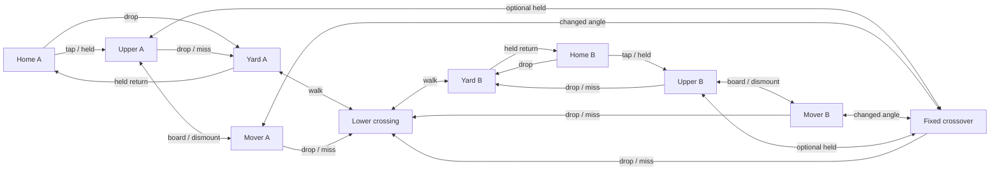

# Turbulence: route and score brief

**Static candidate, authored 2026-10-26.**
[Turbulence Yard](../game/content/levels/turbulence_blockout.json) is the next
`POL#21` blockout, beside the preserved `turbulence.json`, under the
[blockout scope](polish-plan.md#turbulence-blockout-work-pol21). Keep the current
P3 movement, five-tool values, Crossfeed and earlier arenas unchanged. The
candidate is explicit-only with `include_in_random: false`. Its first skeleton
contains neither movers nor scored rotated structures; those retain the
capability and placement checks below.

## Question and research transfer

**Take the short exposed upper crossing now, wait for a moving change of angle,
or descend to paint and approach from below?**

The loading-yard subject is expressed through the approved Tool Props kit:
offset ruler gantries above connected walking ground, with eraser freight
blocks separating approaches. Machinery is scenery. There is no wind, lift,
crushing route or moving rotation in this brief.

This applies the recorded [H1-H8 criteria](level-design-research.md#criteria-for-the-original-new-map):
TowerFall's connected spaces inform reconnecting approaches; Splatoon's joint
weapon/geography design informs the firing and paint stations; INVERSUS informs
the short-route/changed-angle choice; N++ informs repeated, recoverable
landings. These are our design inferences from the recorded research, not new
observations or imported geometry. Do not use the research's pre-P3 jump range
as a current reach guarantee.

## Directed routes before dimensions

Reflect gameplay geometry and whole player bodies about the centre line. Use
the same names with suffix A/B; every connection below applies on both sides.
Offset platforms describe the stepped vertical arrangement, not an unmeasured
side advantage. Exact coordinates, travel and timing follow real-Player trials.

| Connection | Importance | Input family and intended landing |
|---|---|---|
| Home -> lower yard | Required departure | Drop through the home ruler, then walk; a stationary player can choose and take this route. |
| Lower yard -> central lower crossing -> far lower yard | Required contest route | Walk, using supported ramps for elevation changes; space to stop and reverse behind solid freight blocks. Never requires boarding or waiting for a mover. |
| Lower yard -> home | Recovery / return | Held jump through home support; provide a clear takeoff and braking area. |
| Home -> side step -> upper approach | Optional second departure | Tap then held jump; stop or reverse at the upper approach before committing to centre. It leaves home through a different opening from the lower departure. |
| Upper approach -> fixed crossover -> opposite upper approach | Optional short exposed crossing | Held jump between fixed landings; continue or brake on the receiving landing. A solid centre baffle interrupts a single straight lane between both homes. |
| Upper approach -> mover -> crossover flank | Optional change of angle | Held boarding jump, carried horizontal interval, then tap/held dismount as measured. Stop or reverse on the receiver; no launch-velocity inheritance is assumed. |
| Crossover / mover / upper approach -> lower crossing or yard | Recovery after retreat, failed boarding or missed landing | Walk off or drop into supported lower space; rejoin the required route without respawn. Do not place a pit under an optional crossing. |
| Lower crossing -> own yard -> home -> side step -> own upper approach | Optional return to height | Walk back, held return to home, tap then held; the longer static recovery avoids an inner ladder obstructing the walking corridor. |

The graph is an authoring contract, not evidence that any edge is achievable.
The fixed skeleton must work before adding movers. Check full-body clearance,
rest/intermediate/full-speed approaches, +/-2 input ticks and receiving space
for continuing, stopping and reversing. A successful touch does not qualify a
landing. Avoid the narrow-full-speed-stop problem recorded in Crossfeed.

## First static geometry

Coordinates are world units, Y downward. Reflect rectangles by
`x_b = 4000 - x_a - width`, and reflect whole spawn bodies by their width.

| Piece | A / centre rectangle (X, Y, W, H) | Initial role |
|---|---|---|
| Ground | 0, 1280, 4000, 400 | Continuous scored walking floor, exposed top only. |
| Home floor / roof | 0, 1120, 600, 10 / 0, 960, 480, 10 | Static one-way rulers; ordinary tops score. |
| Side step | 600, 1040, 280, 80 | 80-unit tap departure. |
| Upper approach | 880, 880, 360, 80 | Held 160 rise from the side step, then a controlled stop. |
| Lower bed | 1260, 1200, 320, 80 | Walkable low firing break; exposed faces score. |
| Bed ascent / descent | 1100, 1200, 160, 80 / 1580, 1200, 160, 80 | Mirrored existing ramps; support players but pass paint. |
| Crossover half | 1400, 800, 540, 80 | Optional 160-gap / 80-rise connection from the upper approach. |
| Centre baffle | 1940, 720, 120, 160 | Upper firing break and optional controlled 80-unit tap crossing. |

There are 20 collision objects, including two unscored perimeter walls. Spawns
are A top-left X=30/150/270/390, Y=1000 and the corresponding reflected B
bodies. Bounds are (-100,-100,4200,1900); camera/overview bounds are
(0,360,4000,1020). The proposed top margin is not native framing evidence.
The 120-wide baffle has only 68 units of whole-body positioning space; it is
a controlled tap landing, not a promised full-speed braking destination.

The source was created through `LevelDocument::create`, palette/setter calls,
save and reopen, with resolved existing resources and byte-identical earlier
arena files. `ColourWarsRegisterStage` previewed and applied its manifest and
runtime-asset additions. The bounded authoring/registration receipts are under
`out/validation/overnight-20261026/turbulence-author/`; this was the actual
editor document pipeline, not an attended GUI handling session.

## Spawns and pressure stations

Each home has four distinct, supported, nonoverlapping full-body spawn slots,
using the current player dimensions. Reflect positions by the body's width,
not just its top-left point. Keep every body inside the bounds, clear of solids
and the full mover/standing envelopes. Home floors and roofs remain static.

The lower drop opens behind a solid freight baffle; the upper departure leaves
on its other side/height after the side step. Give each exit a waiting/reversal
space outside the four spawn slots. Ramps and one-way support alone do not
establish projectile shielding; use the actual solid/projectile geometry.

Name stations at each home exit, each upper receiver, both ends of the fixed
crossover, the lower centre cover and each mover endpoint. From the opposing
stations, sample standing, jumping and moving fire with all five tools at all
four spawn bodies and both departure mouths. Record which exits one position
threatens, the warning/escape interval and the approach needed to gain it.
Reject geometry that lets one centre holder cover both departures and their
retreat at once. The samples will not prove universal spawn safety.

## Regional and face paint budget

These are initial **design allocations of exposed scored area**, totalling
100%, before geometry exists; they are neither measurements nor balance gates.

| Region | Target share | Route and painting reason |
|---|---:|---|
| Home A / Home B | 12% each | Ordinary home floor/roof tops score. Repainting here trades travel time for time away from the contest. |
| Yard and upper approach A / B | 22% each | Connected Roller walking paint plus scored baffle faces and upper landings; two attack angles reconnect here. |
| Lower central crossing | 12% | Accessible contest paint behind intermittent solid cover; no uninterrupted end-to-end shooting tunnel. |
| Fixed upper crossover and both movers | 20% total | More exposed paint and changed angles, without making height alone decide the surface score. |

Start with approximately 75% tops, 15% undersides and 10% walls across those
regions. Ordinary floors and raised tops accept paint; perimeter boundaries or
buried foundations may be unscored for their physical role. Do not ban home
paint to repair a safe-loop problem. Diagnose travel/repaint cost and exposure.

Reconcile object/region/face strips with runtime paint tiles after occlusion.
Assign a mover's local scored faces once to its owning region; motion does not
mint area or change ownership. Also report its occupied world region at sample
phases so a local budget does not conceal paint carried into a sheltered area.
Measure complete walking loops, paint per traversal/tank and the time to contest
or repaint each region from all spawn slots before revising these targets.

**Initial measured geography.** The static candidate exposes 12,400 units of
scoring edge, or 148,800 area at the unchanged 12-unit thickness. Runtime tiles
and independent exposed-face counts agree: tops 103,680 (69.68%), undersides
29,760 (20.00%), walls 15,360 (10.32%). The regional partition is:

| Region | Measured area | Share |
|---|---:|---:|
| Home A / B | 20,160 each | 13.55% each |
| Approach A / B | 25,200 each | 16.94% each |
| Lower contest | 25,440 | 17.10% |
| Upper crossing | 32,640 | 21.94% |

These differ from the pre-geometry allocations: less approach/top paint, more
lower-contest/underside paint. Keep that difference as a pressure/repaint
question; it does not by itself justify changing tuning or banning floor paint.
The case writes `turbulence-blockout-faces.csv` and
`turbulence-blockout-regions.csv` beside its acceptance executable.

## Why the new geometry earns its place

**One horizontal mover per side, mirrored as a pair.** Each traverses an open
upper side bay and offers a flank landing with a different line onto the
crossover's scored faces. It must earn that angle against waiting and exposure;
it does not open the only exit, shorten the only recovery or carry spawn cover.
The fixed upper route remains an immediate alternative. At endpoints, midtravel
and reversals, misses fall to the lower route, with no closing standing corridor.
Choose travel, period and mirrored initial phases only after comparing both
sides' boarding/waiting/exposure windows. Use only the existing horizontal
triangular motion, through the qualified public loader/editor path.

**A mirrored pair of fixed sloping scored slabs at the crossover shoulders.**
The intended role is a walkable retreat from an upper receiver toward the lower
crossing while presenting a paintable underside to the lower approach. A solid
slab also breaks a level firing line; an existing ramp passes paint and cannot
provide that combined job. Select one shallow fixed orientation and footprint
after the static route trial, then define support, projectile contact and local
face scoring before implementation. If a flat solid plus existing ramp provides
the same route and shot windows, retain that simpler construction and record why
rotation was unnecessary. No arbitrary or animated rotation follows from this.

## Tool and recovery hypotheses

| Tool | Stations and question |
|---|---|
| Sprayer | Yard exit -> crossover shoulder: can a moving burst contest a receiver while leaving enough tank and time to retreat behind the freight baffle? |
| Sniper | Upper receiver -> far receiver: is the short lane useful without also owning both lower departures or painting the underside? Check the centre baffle and reload/recovery exposure. |
| Roller | Home -> yard -> lower crossing -> retreat: does connected walking paint repay the longer route, and can a missed upper landing return to that work without a trap? |
| Mister | Lower cover -> shoulder underside / approaching mover: does diffusion create a distinct nearby contest without blanketing both routes from safety? Keep lifetime provisional. |
| Bucket | Yard / lower-centre cover -> upper receiver: do real arcs reach the exposed landing, and does that launch position retain an escape before a second shot? |

At these mirrored stations compare real nozzle/volume contact, stationary and
moving fire, shot cadence, cover-to-cover exposure and the shot-free retreat
interval. Record regenerated ammunition and return-to-contest time; standing
behind one block is not evidence of a useful recovery loop. Do not change P3,
Sniper reserve or Mister lifetime to make a first geometry attempt pass.

## Static qualification and next slice

The Debug and Release CPU cases qualify all eight spawns with two explicit deaths and
held-input-safe respawns each, followed by jump-free lower departures. Its
mirrored walking trial reaches the near bed at update 116, centre at 192 and
far home at 352 with zero takeoffs. It deliberately stops/brakes at intermediate
stations; these are fixture update counts, not uninterrupted match travel times.

Optional departure/recovery trials pass at -2/0/+2 input ticks. They include
the home roof rise, side-step tap, held upper approach, descent to the lower
route and the longer return through home. Fixed-crossover trials pass with
actual initial velocities 0/±415/±800 and those input margins, including a
controlled centre-baffle tap and whole-body stopped landings. No position is
injected after construction. Fresh public `LevelBuilder` loads with 1/4 players
also pass, retaining the actual sparse slots, team-local spawns, screen layout,
unchanged 181-update count-in, 12 active updates and exact neutral score.

Receipts are under `out/validation/overnight-20261026/phase2/`, in
`remaining/x64-debug/` and `release/x64-release/`. Add movers only
after runtime/schema, public replay
rebuild and editor round-trip support; add scored sloping solids only after
their separate collision/paint contract is qualified. Keep a before/after
route and budget record for those additions.

**Explicit five-tool measurements, 2026-10-26.** The separate Release
`turbulence_blockout <staged-game-directory> --tools` mode passes 20 mirrored
lower-bed/crossover firing, ordinary retreat and natural refill trials, plus
280 paid directed pulses from 40 standing holders. It uses actual weapons,
projectile contacts and ammunition, with 7,690 station updates and 8,356 threat
updates. The fast default case remains the static geometry/route check; the
larger matrix is opt-in. When invoking its executable directly, include the
staged game directory on `PATH` for its runtime DLLs.

Receipts in `out/validation/overnight-20261026/phase4/turbulence/x64-release/`
include 60 station-phase rows, 280 pulse rows, 40 holder summaries and
`turbulence-tools-summary.json`. The candidate's geographic X-band partition
is now available to the balance metrics; the station CSV instead labels its
separate object-role budget explicitly. Its paper backdrop is provisional,
without cloud or landmark acceptance; collision and scored geometry are unchanged.

These samples expose questions rather than settle pressure. From each lower
bed, Sniper's seven separately aimed shots collectively reach both departure
regions. Upper-approach Sniper samples reach spawn bodies 3/4 and Mister reaches
body 4. The centre-baffle Sniper reaches the opposite receiver. These are swept
projectile-box arrivals before retirement, without victim damage, simultaneous
coverage or a universal spawn-safety claim.

The station bursts pay for nearby paint and all refill during the shot-free
retreat/recovery window. Sprayer, Sniper and Bucket bursts at the sampled downward
angles have no surviving projectile after launch contact, so they do not yet
establish a useful receiver-contest shot. Revise those station aim/positions to
measure the intended contest, compare single-shot departure coverage and escape
time, then add moving/jumping attack samples. Do not change weapon tuning to
make this exploratory fixture report a better result. Native composition remains
the other immediate slice.

Drive both directions, failed routes and mover phases/reversals with the real
Player. Reconcile paint and sampled five-tool pressure with side/loadout swaps,
1v1, 2v2 and uneven three-player arrangements. Native 1/2/3/4-pane clean/heavy
captures must show the receiving surface and first escape before commitment,
including moving approaches, preview and ending views.

These checks establish construction, routes, score geography and the recorded
tool samples. Useful five-tool pressure, mover/rotation placement and native
framing remain open.
Attended both-side 1-4P play must still answer crossing comfort,
pressure and regional value. `POL#21`, `GAP#D5`, `POL#3`, `POL#24`, `POL#27`
and physical-pad acceptance remain open.
