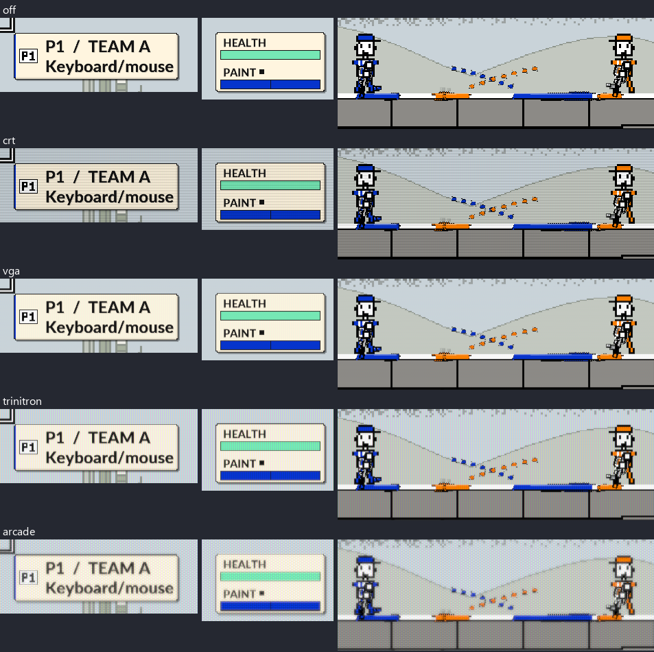

# Debug shader playground

The Debug shader playground lets you compare CRT displays on the same game
frame. Choose a desktop VGA monitor, a Trinitron-style aperture grille, an
arcade slot mask or the original light CRT texture. The playground also offers
RGB565 desktop colour, ordered dithering, the combined `paint90` look,
posterisation, ink edges and halftone dots. Playground settings last for the
current launch.

ColourWars already pins Labrador's custom-material API. The experiment uses
one HLSL post pass in
[game/shaders/shader_playground.hlsl](../game/shaders/shader_playground.hlsl).
It processes the whole picture, including menus, HUD text and split-pane
borders. The edge detector sees changes in the picture; it has no knowledge
of players, paint or collision geometry.

## Build and launch

From the repository root, build Debug with the existing build helper:

```powershell
powershell -File scripts/build.ps1 -Preset x64-debug
```

The normal Windows D3D11 build uses the Windows SDK's existing `fxc` shader
compiler. No additional shader tools are needed. The material is compiled
only for Debug and embedded in the executable; there is no runtime shader
file to stage beside it.

Launch the playground from PowerShell:

```powershell
$previousShaderPlayground = $env:COLOURWARS_SHADER_PLAYGROUND
try {
    $env:COLOURWARS_SHADER_PLAYGROUND = '1'
    Start-Process -FilePath (Resolve-Path 'out/build/x64-debug/game/ColourWars.exe').Path `
        -ArgumentList '+stage crossfeed +players 4 +intro off +shader vga' -Wait
}
finally {
    $env:COLOURWARS_SHADER_PLAYGROUND = $previousShaderPlayground
}
```

Only the exact value `COLOURWARS_SHADER_PLAYGROUND=1` enables it. The launch
above starts Crossfeed in four panes without its monitor opening. Use
`+players 1` for one pane, or `+stage movement_course` for practice. Leave out
the arguments to start at the title and compare the menus instead.

The playground owns Labrador's one post pass for the session. It suppresses
the separate [saved monitor-glass CRT effect](crt-trial.md), even when CRT is
saved On or `COLOURWARS_CRT_TRIAL` requests it. The playground's selected
look follows the game through menus, gameplay and the final reveal. For the
ordinary saved graphics settings, launch without the playground.

## Fit with ColourWars

The [backstory](backstory.md#opening-full-screen-before-the-view-splits)
places the picture inside a beige CRT. `crt` carries that display texture
through gameplay: stationary scanlines, a faint RGB aperture grille and
gentle edge falloff. It does not bend the picture, split colour channels or
add flicker, so source positions and mouse aim stay aligned.

The three monitor presets reconstruct light from neighbouring raster lines.
Bright paint spreads across more of a line than a dark outline does. Each
preset gives that light a different phosphor pattern on the screen.

| Preset | What to look for |
|---|---|
| `vga` | A fine dot mask and tight beam give small desktop text and thin paint edges a crisp appearance. |
| `trinitron` | Continuous vertical RGB stripes give bright, flat areas the texture of an aperture grille. |
| `arcade` | Staggered phosphor slots and a wider local glow soften the edges of bright paint. |

These native-size crops show the same paused four-player Crossfeed match at
1080p. Open the image at 100% to see the mask on the HUD and the paint edges.



The line-count control applies to the whole window. At 1080p a 360-line
raster has three output pixels per line, whether the match has one player or
four. The presets soften patterns that the output cannot resolve. They keep
straight lines straight and the raster stationary while the camera moves.

`highcolour` rounds colour channels to RGB565, the 5 red, 6 green and 5 blue
bits of a 16-bit display. `paint90` combines that display treatment with
restrained CRT texture in the same pass. `dither` offers a stronger early
desktop image treatment, using a stable 4-by-4 ordered pattern and fewer
levels per channel. It keeps black and white endpoints and does not choose
an unrelated fixed palette for team colours.

These are comparisons for the author to judge. The accepted
[Windows 98 Paint art rules](polish-plan.md#1-establish-the-art-and-display-rules)
remain 24-bit colour, at most 28 colours per level, and no dithering by
default. The playground's low-colour looks do not change those source-art
rules or the ordinary game's palette.

## Change the picture

Open the console with **`**, enter a command, then close it to see the
picture. Commands also work as launch statements, as in the example above.
See [the console reference](debug-console.md) for scripts, screenshots and
key binds.

The **F10 > view > shader** picker also selects a look with its default values.
To compare the mask patterns on the same frame, pause with **F6** and try
`shader vga 1 480`, `shader trinitron 1 480` and `shader arcade 1 480`.
Strength and raster density then match across all three profiles.

| Command | Result |
|---|---|
| `shader` | Report the current look and parameters. |
| `shader off` | Show the original picture through the identity mode. |
| `shader crt` | CRT throughout gameplay, strength `0.5`, scanlines spaced four output pixels apart. |
| `shader crt 0.35 6` | A lighter CRT treatment with six output pixels per scanline. |
| `shader vga` | Desktop dot mask, strength `0.85`, 600 raster lines. |
| `shader trinitron` | Vertical aperture grille, strength `0.85`, 480 raster lines. |
| `shader arcade` | Arcade slot mask, strength `0.9`, 360 raster lines. |
| `shader arcade 0.7 480` | Blend in a lighter arcade treatment and fit 480 lines across the picture height. |
| `shader highcolour` | RGB565 desktop colour, strength `1`; no detail parameter. |
| `shader highcolour 0.5` | Blend halfway toward the 16-bit display's colour steps. |
| `shader dither` | Ordered colour dithering, strength `0.6`, eight levels per channel. |
| `shader dither 0.4 4` | Blend toward a stronger four-level dithered picture. |
| `shader paint90` | RGB565 plus restrained CRT, strength `0.5`, four output pixels per scanline. |
| `shader paint90 0.7 6` | A stronger combined treatment with wider scanline spacing. |
| `shader posterise` | Posterised colour, strength `0.75`, six levels per colour channel. |
| `shader posterise 0.5 4` | Blend halfway toward four colour levels per channel. |
| `shader ink` | Darken image edges, strength `0.65`, one output pixel radius. |
| `shader ink 0.8 2` | Stronger ink with a two output pixel sampling radius. |
| `shader halftone` | Add halftone dots, strength `0.65`, six output pixel cells. |
| `shader halftone 0.4 10` | Lighter dots in larger cells. |

Each effect accepts optional **strength**, then **detail**, except `highcolour`,
which has fixed channel depths and refuses a detail argument. Strength is
`0..1`: zero returns the original picture and one applies the full look.
Detail is a whole number:

| Look | Detail range |
|---|---|
| `crt`, `paint90` | `4..12` output pixels per scanline. |
| `vga`, `trinitron`, `arcade` | `240..720` virtual raster lines across the full picture height. |
| `dither`, `posterise` | `2..16` levels per colour channel. |
| `ink` | `1..4` output pixels for the sampling radius. |
| `halftone` | `3..24` output pixels per dot cell. |

Selecting a look resets its omitted parameters to that look's defaults.

The material stays selected for the whole playground launch. `shader off`
returns the original pixels but retains the post pass and its small rendering
overhead. Restart without the environment variable for ordinary rendering.

## Write another look

The mode selection lives in
[shader_playground.hlsl](../game/shaders/shader_playground.hlsl). The three
monitor presets share their beam, light spread and mask code in
[crt_monitors.hlsli](../game/shaders/crt_monitors.hlsli). The original CRT
and low-colour looks live in
[desktop_90s.hlsli](../game/shaders/desktop_90s.hlsli). Rebuild Debug and
restart after editing shader source. Console parameter changes apply live.

Labrador supplies `MaterialInput`, `scene_point(uv)` and `scene_linear(uv)`.
`input.uv` is the top-down position across the output, `input.output_pixel`
is its position in output pixels, and `scene_size.zw` is one input texel in
UV coordinates. Keep sampling through the helpers so the engine handles
texture orientation for each backend.

The shader reads `material_value(0)` as:

| Component | Meaning |
|---|---|
| `x` | Mode: `0` identity, `1` posterise, `2` ink, `3` halftone, `4` CRT, `5` highcolour, `6` dither, `7` paint90, `8` VGA, `9` Trinitron, `10` arcade. |
| `y` | Strength. |
| `z` | Detail for the chosen mode. |
| `w` | Unused. |

The API provides eight groups of four floats through `PostValues`; the
playground currently uses only this first group. Preserve the scene's
premultiplied alpha when changing colour, keep denominators positive and
send finite parameter values. A look that needs time must receive it in a
parameter; the reserved frame timing fields do not supply a clock.

The engine's
[authoring guide](../external/labrador/website/src/content/docs/docs/guides/your-shader.mdx)
explains `labrador_add_material`, generated material headers, registration
and parameter updates. [game/CMakeLists.txt](../game/CMakeLists.txt) owns this
experiment's build registration. The monitor presets sample nearby pixels
for local light spread in one pass. A bloom pyramid, previous-frame phosphor
persistence, custom sprite shaders and extra game textures would need additional
renderer support.

## Validation and visual review

### Original three looks

Validated locally on 2026-11-18 before the desktop treatments were added:

- Debug and Release builds passed, as did the `debug_console` acceptance case
  in both presets, including the opt-in guard and absence from Release.
- Seven hidden, isolated D3D11 runs on the NVIDIA GeForce RTX 5080 passed
  25 checks across one-player, four-player and menu captures at 1280x720.
  Each look changed the image; every zero-strength look and `shader off`
  matched baseline RGB pixels exactly. One- and four-player `off` also
  matched separate ordinary no-post launches. Paused simulation checksums
  stayed unchanged; invalid strength and detail left settings and pixels
  unchanged. The PNG writer discards alpha, so captures do not qualify it.
- The playground ran with both saved CRT On and `COLOURWARS_CRT_TRIAL=1`,
  confirming the session override. Documentation links and whitespace passed.

### Desktop treatments

Validated locally on 2026-11-18 after adding `crt`, `highcolour`, `dither` and
`paint90`:

- Debug and Release builds and their `debug_console` acceptance cases passed.
- On D3D11 / NVIDIA GeForce RTX 5080, 67 checks passed across 12 hidden,
  isolated launches: one and four players at 720p and 1080p, a menu, and
  painted Crossfeed. Every zero-strength look and `off` matched baseline RGB
  pixels exactly; separate ordinary no-post comparisons passed. Active looks
  changed pixels while paused simulation checksums stayed fixed. Previous
  one- and four-player posterise captures remained byte-identical.
- Invalid CRT/dither detail, a highcolour detail argument and NaN strength
  were refused without changing prior settings or pixels. Saved CRT stayed
  On under the playground override, and every game process exited.
- Inspected painted Crossfeed captures retain distinct team paint, figures
  and readable HUD labels. This is image inspection, not acceptance in play.

The report, source/executable hashes, scripts, logs and captures are under
`out/validation/shader-playground-90s/`, including `gpu-results.json`.

The original experiment's captures, scripts and comparison results remain
under `out/validation/shader-playground/`. This is focused functional evidence, not
a performance measurement or an art-direction acceptance. The author still
needs to judge team colour recognition, small text and the look in play,
particularly in four panes. These settings remain experimental values.

### Repeatable shader checks (`DBG#20`)

Build `x64-debug` as above, then run the local hardware check from the repository
root.

```powershell
powershell -File scripts/check-shader-playground.ps1
powershell -File scripts/check-shader-playground.ps1 -Resolution 1920x1080
```

The [runner](../scripts/check-shader-playground.ps1) starts four hidden games,
each with a private profile. It pauses Movement Course at the same seeded
simulation update for an ordinary and a playground launch in each layout,
one pane and four panes. The default resolution is 1280×720.
`-Resolution` also accepts `1920x1080` and `2560x1440`.
Both `shader off` captures and every
zero-strength look must match the ordinary RGB baseline exactly. Each default
look must change pixels while the simulation checksum and update stay fixed.
The three monitor presets must produce distinct frames at equal strength and
line count, and respond to changes in line count across the accepted range.
Invalid detail must leave the prior settings and pixels intact.

Each run leaves a new evidence folder under `out/validation/shader-playground/`
or `-OutputDirectory`. `result.json` records the executable hash, the renderer's
selected device from `status` for each launch and every check's outcome. The
folder also holds the console scripts, transcripts and PNGs. A failed comparison,
launch or adapter check exits with an error and keeps the evidence. The check
requires D3D11 hardware and a display that can fit the capture resolution.

Before the three monitor presets were added, 51 checks passed on 2026-11-20
on D3D11 / NVIDIA GeForce RTX 5080 under Windows PowerShell 5.1.
A separate one-second deadline run returned failure,
retained its partial evidence and cleaned up all four owned processes.

With the monitor presets, all 83 checks passed at each of 720p, 1080p and
1440p on the same adapter. The Debug and Release builds and their
`debug_console` and `crt_trial` acceptance cases passed. Painted four-player
Crossfeed captures also cover the blue/orange palette at 1080p and pink/green
at 720p. The VGA profile retained the sharpest lettering in those captures.
The arcade profile visibly softened the smaller labels.

A four-player Crossfeed sequence compared all three presets and `off` at
each of 36 consecutive updates at 1080p. The simulation checksums matched
at every update. Players and paint moved while a 32×32 patch of the mask
on a static background remained identical across all 36 frames for each
preset. An attended match is still needed to judge readability at couch
distance.
