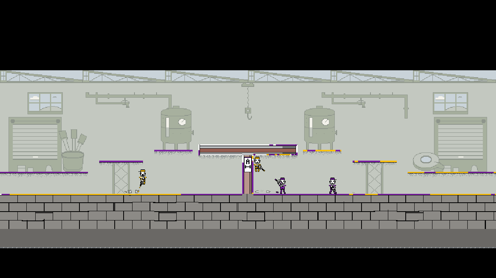
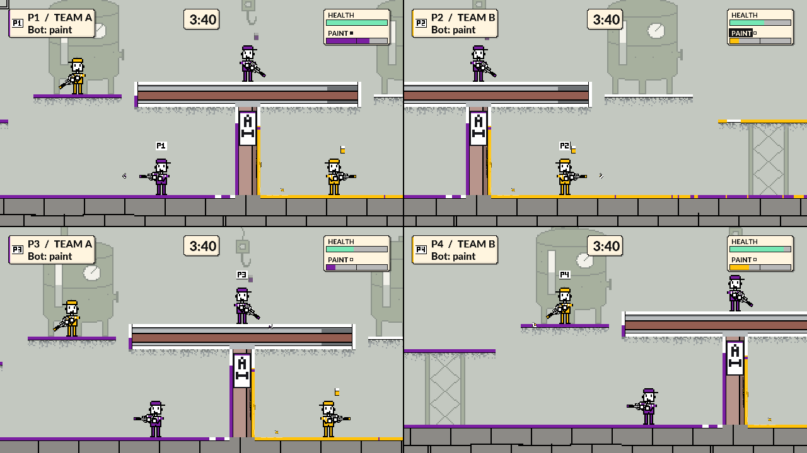

# Sluice Works

Choose **Sluice Works** in Stage Select for a match in the pump hall. Each
team starts on a loading dock. Drop to the channel floor for a direct approach
to the sluice, or climb the gauge step and inspection landing to cross the
bridge above it. Both teams can always use the bridge.

The gate seals the space between the floor and the underside of the bridge.
Either vertical face takes paint. Once a team holds enough of the gate and
leads on its two faces combined, its players can walk through. Shots keep
hitting the gate, including shots from the team that owns it. A tie closes it
to both teams. Paint on the gate, the channel floor and the upper route counts
toward ordinary territory. The two approaches share their dimensions and use
the existing Yard music, terrain materials and pump-room props.

## Play review

The arena is available by name. The four existing arenas remain the Random
pool until the author plays this one. Try the lower route against a player
holding the gate, then use the bridge to approach them from the other side.
Switch teams and repeat. In four-player split screen, check whether the
permission mark reads at couch distance, whether the tanks and trestles look
like scenery, and whether contesting the gate is worth giving up the high
route. These observations decide admission to Random under `REV#27`.

From a Debug build, `ColourWars.exe +stage sluice_works +players 2` starts a
match directly. `ColourWars.exe +exec review_sluice_works +quit` captures the
two- and four-player views at the start, after 20 seconds of paint, and from
the authored route stations. The pictured overview is the last frame of a
separate four-minute bot round.

## Route evidence

The [arena acceptance case](../scripts/acceptance/sluice_works.cpp) drives a
player from each spawn to the opposite loading dock over the closed gate.
Each takes three jumps to reach the bridge. It also walks the lower lane from
each side, confirms the closed gate stops the player, then claims it with
Sprayer fire and walks through. A seeded three-bot run checks that live bots
use the bridge and enter the gate with their team's permission.

Eleven one-minute Normal bot matches used all grenades. Nine 1v1 matches
paired Sprayer against itself and against Roller in both seat orders, at
seeds 17, 42 and 2026. Two 2v2 matches swapped Sprayer and Roller against
Bucket and Sniper at seed 17. An observer counted live crossings of the
arena centre above the bridge and through the gate. Each observed run
reproduced the balance runner's score and paint CSVs byte for byte.

| Observed in a match | Matches |
|---|---:|
| A bot crossed the centre on the upper route | 11 / 11 |
| The gate opened for a team | 9 / 11 |
| A bot crossed the centre through the gate | 8 / 11 |
| Both teams held permission at different times | 2 / 11 |

This sample establishes that bots use both routes. The local
[match results](../out/validation/sluice-works/balance/summary.json) retain
the individual seeds and crossings. The [arena source](../game/content/levels/sluice_works.json)
contains the stations used for captures and the
[group-move example](level-editor.md#editing).
